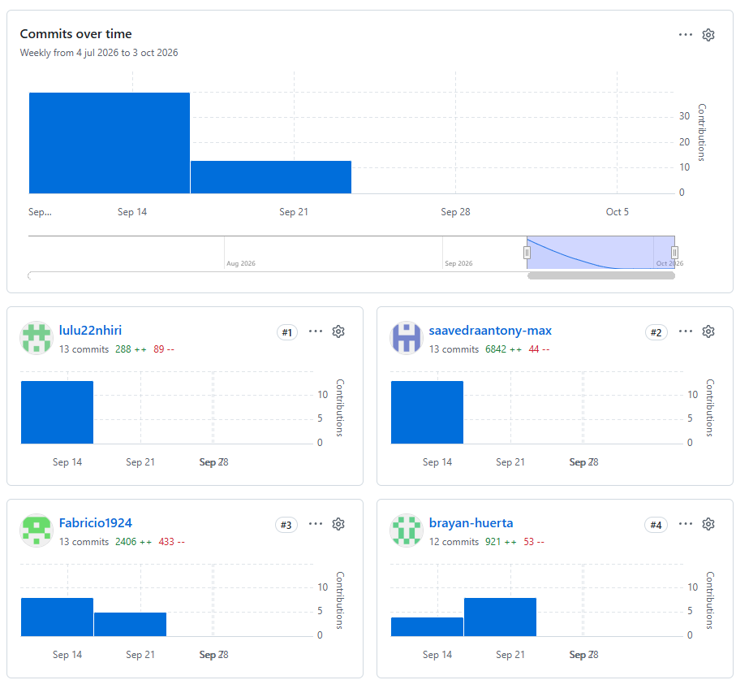
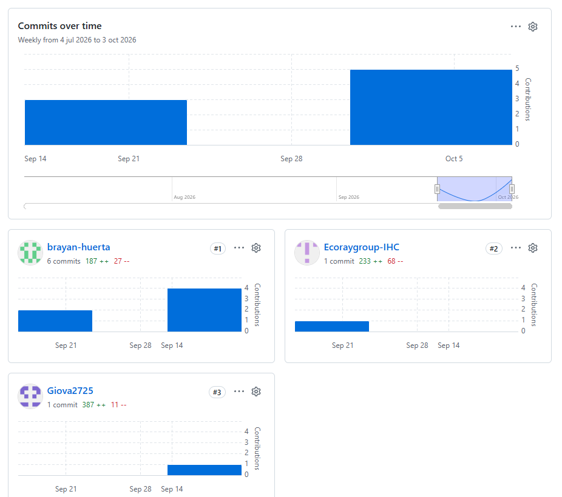
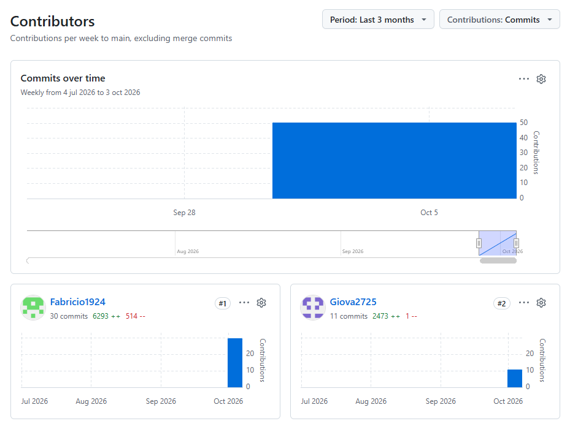
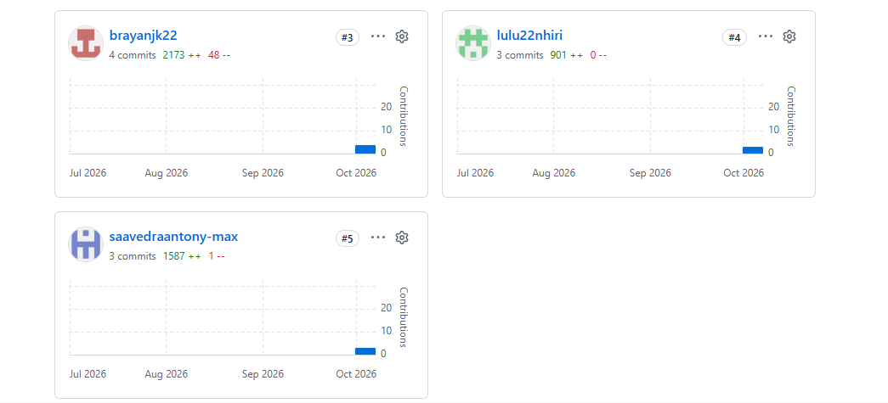
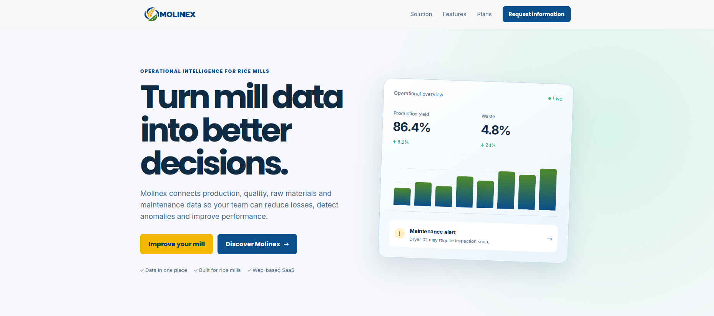

<div align="center">


Universidad Peruana de Ciencias Aplicadas<br>
Carrera de Ingeniería de Software<br>

### 1ASI0730
### Aplicaciones Web

**NRC**
### 8088

## Informe de Trabajo Final

**Docente**<br>
### Bautista Ubillús, Efraín Ricardo

Equipo<br>
**Vanguard**

Proyecto<br>
**Molinex**<br><br>

**Integrantes**<br><br>

<table style="margin: 0 auto; border-collapse: collapse; border: none;">
  <tr style="border: none;">
    <th style="border: none; text-align: left; padding-right: 30px;">Código</th>
    <th style="border: none; text-align: left;">Apellidos y Nombres</th>
  </tr>
  <tr style="border: none;">
    <td style="border: none; text-align: left; padding-right: 30px;">u202424008</td>
    <td style="border: none; text-align: left;">Casalino Berrocal, Luisa Nhiriel</td>
  </tr>
  <tr style="border: none;">
    <td style="border: none; text-align: left; padding-right: 30px;">u202424466</td>
    <td style="border: none; text-align: left;">Gallegos De La Cruz, Giovanni Marcelo</td>
  </tr>
  <tr style="border: none;">
    <td style="border: none; text-align: left; padding-right: 30px;">u20241e550</td>
    <td style="border: none; text-align: left;">Huerta Cardenas, Brayan Benjamin</td>
  </tr>
  <tr style="border: none;">
    <td style="border: none; text-align: left; padding-right: 30px;">u202420031</td>
    <td style="border: none; text-align: left;">Jimenez Saavedra, Antony Alexander</td>
  </tr>
  <tr style="border: none;">
    <td style="border: none; text-align: left; padding-right: 30px;">u202423883</td>
    <td style="border: none; text-align: left;">Rivera Rupay, Fabricio Jose</td>
  </tr>
</table>
<br>

**Periodo 202620**

**Octubre 2026**

</div>
<div style="page-break-after: always;"></div>

## Registro de Versiones del Informe

| Versión | Fecha | Autor | Descripción de la modificación |
|:--:|:--:|:--|:--|
| **AV1** |  |  | **Documentación del análisis, diseño e implementación de la Landing Page.** |
|0.1|14/09|Luisa Casalino|Se desarrollaron los segmentos objetivo y el análisis competitivo de Molinex.|
|0.2|14/09|Antony Jimenez|Se incorporó la descripción inicial de la startup y se configuró la estructura inicial del proyecto.|
|0.3|15/09|Brayan Huerta|Se realizaron correcciones y actualizaciones relacionadas con la descripción de la startup, perfiles del equipo y análisis de entrevistas.|
|0.4|16/09|Antony Jimenez Saavedra|Se incorporó el registro de entrevistas, el análisis de entrevistas y la User Task Matrix.|
|0.5|16/09|Luisa Nhiriel Casalino|Se agregaron User Persona, User Journey Map, Empathy Mapping y Ubiquitous Language.|
|0.6|17/09|Antony Jimenez Saavedra|Se actualizaron los perfiles de los integrantes y se incorporaron evidencias adicionales del proyecto.|
|0.7|17/09|Brayan Huerta|Se realizaron correcciones en hipótesis, perfiles del equipo y análisis de entrevistas.|
|0.8|17/09|Fabricio Rivera|Se incorporaron Style Guidelines, Information Architecture, Big Picture Event Storming, Design-Level Event Storming, arquitectura de software y diagramas de clases.|
|0.9|18/09|Fabricio Rivera|Se agregó el diagrama de base de datos y se completaron elementos del diseño técnico.|
|1.0|18/09|Giovanni Gallegos|Se agregaron los wireflows, wireframes, prototipo de aplicación web y evidencias de la Landing Page.|
|1.1|19/09|Giovanni Gallegos|Se completaron las secciones del informe correspondientes a AV1 y se agregaron evidencias.|
|1.2|19/09|Equipo Vanguard|Consolidación y revisión de las secciones del informe correspondientes a la evaluación AV1.|
| **TB1** |  |  | **Implementación, integración y despliegue de la primera versión funcional de la Web Application.** |
|1.3|08/10|Equipo Vanguard|Se actualizaron el Product Backlog, el Sprint Planning y el Sprint Backlog, y se documentaron las observaciones aplicadas a los modelos EventStorming, C4 y diagramas de clases.|
|1.4|09/10|Equipo Vanguard|Se documentaron la implementación de la Web Application, la API simulada, las pruebas, el despliegue en Azure y las contribuciones del Sprint 2.|
|1.5|09/10|Fabricio Rivera|Se incorporaron los GitHub Insights de AV1 y TB1, las evidencias funcionales y los anexos de acceso rápido.|

<div style="page-break-after: always;"></div>

## Project Report Collaboration Insights

## AV1

Para el desarrollo del informe correspondiente a la entrega AV1, se distribuyeron las diferentes secciones y actividades del proyecto Molinex entre los integrantes del equipo. La distribución presentada a continuación se basa en las actividades registradas mediante ramas y commits en los repositorios del proyecto.

| Integrante | Tareas Designadas |
| --- | --- |
| **Antony Alexander Jimenez Saavedra** | Registro y análisis de entrevistas, Interview Record, Interview Analysis, User Task Matrix, Lean UX Canvas, Product Backlog, Impact Mapping, Mapping, enlace del Backlog y Sprint Backlog. |
| **Luisa Nhiriel Casalino Berrocal** | User Persona, User Journey Map, Empathy Mapping, Ubiquitous Language, User Stories, Sprint Planning 1, Aspect Leaders and Collaborators y Student Outcome. |
| **Giovanni Marcelo Gallegos De La Cruz** | Wireframes de la aplicación web, Wireflows, prototipo de aplicación web, evidencias de la Landing Page, documentación de diseño y consolidación de secciones del informe para AV1. |
| **Brayan Benjamin Huerta Cardenas** | Análisis de la Landing Page, wireframe y mockup de la Landing Page, perfiles de integrantes, correcciones de la descripción de la startup y ajustes del análisis de entrevistas. |
| **Fabricio Jose Rivera Rupay** | Style Guidelines, Information Architecture, Big Picture Event Storming, Design-Level Event Storming, arquitectura de software, diagramas de clases y diagrama de base de datos. |


### Repositorios del proyecto

- Project Report: `https://github.com/Vanguard-app-web/molinex-report-apweb`
- Landing Page: `https://github.com/Vanguard-app-web/molinex-website-apweb`
- Web Application: `https://github.com/Vanguard-app-web/molinex-webapp`
- Mock Web Service: `https://github.com/Vanguard-app-web/molinex-platform`

La RESTful API definitiva será implementada en un sprint posterior. Durante el Sprint 2, `molinex-platform` proporciona una API simulada desplegable para integrar y validar la Web Application.

### Entrega AV1

Durante la entrega AV1 se avanzó en la elaboración y consolidación de los principales artefactos del proyecto Molinex. Se desarrollaron los perfiles de los integrantes, el análisis de entrevistas, User Persona, User Journey Map, Empathy Mapping, User Task Matrix, Lean UX Canvas, User Stories, Product Backlog e Impact Mapping. Asimismo, se trabajó en el diseño de la solución mediante Style Guidelines, Information Architecture, Big Picture Event Storming, Design-Level Event Storming, wireframes, wireflows y el prototipo de la aplicación web.

También se desarrollaron elementos relacionados con la arquitectura y el diseño técnico, como el modelo C4, diagramas de clases y diagrama de base de datos. Finalmente, se incorporaron evidencias de la Landing Page, Sprint Planning 1, Sprint Backlog, Aspect Leaders and Collaborators, Student Outcome y demás secciones requeridas para la consolidación del informe de la AV1.

El trabajo se realizó de manera colaborativa mediante ramas y commits en el repositorio, permitiendo integrar los avances de cada integrante en la rama de desarrollo.


#### Participación del equipo

- Casalino Berrocal, Luisa Nhiriel
- Gallegos De La Cruz, Giovanni Marcelo
- Huerta Cardenas, Brayan Benjamin
- Jimenez Saavedra, Antony Alexander
- Rivera Rupay, Fabricio Jose

#### Evidencias de colaboración y commits

El equipo gestionó el informe y la Landing Page mediante ramas de GitHub bajo el modelo GitFlow. Los siguientes gráficos muestran las contribuciones registradas durante la entrega AV1.



**Figura:** GitHub Insights del repositorio del informe durante AV1. Fuente: elaboración propia a partir de GitHub.



**Figura:** GitHub Insights del repositorio de la Landing Page durante AV1. Fuente: elaboración propia a partir de GitHub.

## TB1

Para TB1, el equipo implementó la primera versión funcional de la Web Application, la integró con la API simulada, publicó ambos productos en Azure y completó la documentación del Sprint 2.

| Integrante | Contribución principal en TB1 |
| --- | --- |
| **Antony Alexander Jimenez Saavedra** | Implementación del bounded context Asset & Maintenance para maquinaria y mantenimientos preventivos y correctivos. |
| **Luisa Nhiriel Casalino Berrocal** | Implementación del bounded context Quality & Waste para resultados de calidad y registros de merma. |
| **Giovanni Marcelo Gallegos De La Cruz** | Implementación del bounded context Production Management para recepciones, lotes, procesos e historial de producción. |
| **Brayan Benjamin Huerta Cardenas** | Implementación del shell compartido, navegación adaptable, tema visual e internacionalización EN/ES. |
| **Fabricio Jose Rivera Rupay** | Configuración del proyecto, Shared Kernel, integración con la API simulada, preparación de versiones, despliegue en Azure y consolidación del informe. |

La Web Application se desarrolló mediante ramas `feature/*`, Pull Requests hacia `develop`, ramas `release/*` y Conventional Commits. Los GitHub Insights registran contribuciones de los cinco integrantes durante TB1.





**Figura:** GitHub Insights del repositorio `molinex-webapp` durante TB1. Fuente: elaboración propia a partir de GitHub.

<div style="page-break-after: always;"></div>

## Contenido

- [Student Outcome](#student-outcome)
- [Capítulo I Introducción](#capítulo-i-introducción)
- [1.1 Startup Profile](#11-startup-profile)
  - [1.1.1 Descripción de la Startup](#111-descripción-de-la-startup)
  - [1.1.2 Perfiles de integrantes del equipo](#112-perfiles-de-integrantes-del-equipo)
- [1.2 Solution Profile](#12-solution-profile)
  - [1.2.1 Antecedentes y problemática](#121-antecedentes-y-problemática)
  - [1.2.2 Lean UX Process](#122-lean-ux-process)
    - [1.2.2.1 Lean UX Problem Statements](#1221-lean-ux-problem-statements)
    - [1.2.2.2 Lean UX Assumptions](#1222-lean-ux-assumptions)
    - [1.2.2.3 Lean UX Hypothesis Statements](#1223-lean-ux-hypothesis-statements)
    - [1.2.2.4 Lean UX Canvas](#1224-lean-ux-canvas)
- [1.3 Segmentos objetivo](#13-segmentos-objetivo)
- [Capítulo II Requirements Elicitation & Analysis](#capítulo-ii-requirements-elicitation-analysis)
- [2.1 Competidores](#21-competidores)
  - [2.1.1 Análisis competitivo](#211-análisis-competitivo)
  - [2.1.2 Estrategias y tácticas frente a competidores](#212-estrategias-y-tácticas-frente-a-competidores)
- [2.2 Entrevistas](#22-entrevistas)
  - [2.2.1 Diseño de entrevistas](#221-diseño-de-entrevistas)
  - [2.2.2 Registro de entrevistas](#222-registro-de-entrevistas)
  - [2.2.3 Análisis de entrevistas](#223-análisis-de-entrevistas)
- [2.3 Needfinding](#23-needfinding)
  - [2.3.1 User Personas](#231-user-personas)
  - [2.3.2 User Task Matrix](#232-user-task-matrix)
  - [2.3.3 User Journey Mapping](#233-user-journey-mapping)
  - [2.3.4 Empathy Mapping](#234-empathy-mapping)
- [2.4 Big Picture Event Storming](#24-big-picture-event-storming)
- [2.5 Ubiquitous Language](#25-ubiquitous-language)
- [Capítulo III Requirements Specification](#capítulo-iii-requirements-specification)
- [3.1 User Stories](#31-user-stories)
- [3.2 Impact Mapping](#32-impact-mapping)
- [3.3 Product Backlog](#33-product-backlog)
- [Capítulo IV Product Design](#capítulo-iv-product-design)
- [4.1 Style Guidelines](#41-style-guidelines)
  - [4.1.1 General Style Guidelines](#411-general-style-guidelines)
  - [4.1.2 Web Style Guidelines](#412-web-style-guidelines)
- [4.2 Information Architecture](#42-information-architecture)
  - [4.2.1 Organization Systems](#421-organization-systems)
  - [4.2.2 Labeling Systems](#422-labeling-systems)
  - [4.2.3 SEO Tags and Meta Tags](#423-seo-tags-and-meta-tags)
  - [4.2.4 Searching Systems](#424-searching-systems)
  - [4.2.5 Navigation Systems](#425-navigation-systems)
- [4.3 Landing Page UI Design](#43-landing-page-ui-design)
  - [4.3.1 Landing Page Wireframe](#431-landing-page-wireframe)
  - [4.3.2 Landing Page Mockup](#432-landing-page-mockup)
- [4.4 Web Applications UX/UI Design](#44-web-applications-uxui-design)
  - [4.4.1 Web Applications Wireframes](#441-web-applications-wireframes)
  - [4.4.2 Web Applications Wireflow Diagrams](#442-web-applications-wireflow-diagrams)
  - [4.4.3 Web Applications Mockups](#443-web-applications-mockups)
  - [4.4.4 Web Applications User Flow Diagrams](#444-web-applications-user-flow-diagrams)
- [4.5 Web Applications Prototyping](#45-web-applications-prototyping)
- [4.6 Domain-Driven Software Architecture](#46-domain-driven-software-architecture)
  - [4.6.1 Design-Level Event Storming](#461-design-level-event-storming)
  - [4.6.2 Software Architecture Context Diagram](#462-software-architecture-context-diagram)
  - [4.6.3 Software Architecture Container Diagrams](#463-software-architecture-container-diagrams)
  - [4.6.4 Software Architecture Components Diagrams](#464-software-architecture-components-diagrams)
- [4.7 Software Object-Oriented Design](#47-software-object-oriented-design)
  - [4.7.1 Class Diagrams](#471-class-diagrams)
- [4.8 Database Design](#48-database-design)
  - [4.8.1 Database Diagrams](#481-database-diagrams)
- [Capítulo V Product Implementation, Validation & Deployment](#capítulo-v-product-implementation-validation-deployment)
- [5.1 Software Configuration Management](#51-software-configuration-management)
  - [5.1.1 Software Development Environment Configuration](#511-software-development-environment-configuration)
  - [5.1.2 Source Code Management](#512-source-code-management)
  - [5.1.3 Source Code Style Guide & Coding Conventions](#513-source-code-style-guide-coding-conventions)
  - [5.1.4 Software Deployment Configuration](#514-software-deployment-configuration)
- [5.2 Landing Page, Services & Applications Implementation](#52-landing-page-services-applications-implementation)
  - [5.2.1 Sprint 1](#521-sprint-1)
    - [5.2.1.1 Sprint Planning 1](#5211-sprint-planning-1)
    - [5.2.1.2 Aspect Leaders and Collaborators](#5212-aspect-leaders-and-collaborators)
    - [5.2.1.3 Sprint Backlog 1](#5213-sprint-backlog-1)
    - [5.2.1.4 Development Evidence for Sprint Review](#5214-development-evidence-for-sprint-review)
    - [5.2.1.5 Execution Evidence for Sprint Review](#5215-execution-evidence-for-sprint-review)
    - [5.2.1.6 Services Documentation Evidence for Sprint Review](#5216-services-documentation-evidence-for-sprint-review)
    - [5.2.1.7 Software Deployment Evidence for Sprint Review](#5217-software-deployment-evidence-for-sprint-review)
    - [5.2.1.8 Team Collaboration Insights during Sprint](#5218-team-collaboration-insights-during-sprint)
  - [5.2.2 Sprint 2](#522-sprint-2)
    - [5.2.2.1 Sprint Planning 2](#5221-sprint-planning-2)
    - [5.2.2.2 Aspect Leaders and Collaborators](#5222-aspect-leaders-and-collaborators)
    - [5.2.2.3 Sprint Backlog 2](#5223-sprint-backlog-2)
    - [5.2.2.4 Development Evidence for Sprint Review](#5224-development-evidence-for-sprint-review)
    - [5.2.2.5 Execution Evidence for Sprint Review](#5225-execution-evidence-for-sprint-review)
    - [5.2.2.6 Services Documentation Evidence for Sprint Review](#5226-services-documentation-evidence-for-sprint-review)
    - [5.2.2.7 Software Deployment Evidence for Sprint Review](#5227-software-deployment-evidence-for-sprint-review)
    - [5.2.2.8 Team Collaboration Insights during Sprint](#5228-team-collaboration-insights-during-sprint)
- [Conclusiones](#conclusiones)
- [Conclusiones y recomendaciones](#conclusiones-y-recomendaciones)
- [Bibliografía](#bibliografía)
- [Anexos](#anexos)
  - [Anexo A. Enlaces de acceso rápido](#anexo-a-enlaces-de-acceso-rápido)
  - [Anexo B. Videos de Exposiciones](#anexo-b-videos-de-exposiciones)

<div style="page-break-after: always;"></div>

## Student Outcome

El curso contribuye al cumplimiento del Student Outcome ABET:

**ABET – EAC - Student Outcome 5**

Criterio: La capacidad de funcionar efectivamente en un equipo cuyos miembros juntos proporcionan liderazgo, crean un entorno de colaboración e inclusivo, establecen objetivos, planifican tareas y cumplen objetivos.

En el siguiente cuadro se describe las acciones realizadas y enunciados de conclusiones por parte del grupo, que permiten sustentar el haber alcanzado el logro del ABET – EAC - Student Outcome 5.

|Criterio específico | Acciones realizadas | Conclusiones |
| :--- | :--- | :--- |
| **Trabaja en equipo para proporcionar liderazgo en forma conjunta** | **Casalino Berrocal, Luisa Nhiriel**<br>**AV1:** Coordinó actividades de planificación y documentación del equipo.<br>**TB1:** Lideró el bounded context Quality & Waste Control e integró las funcionalidades US-11 y US-14 mediante el Pull Request #5.<br>**AV2:** Integró el módulo Quality and Yield Control en el backend C# con evaluaciones de calidad, registros de merma y consultas de rendimiento y composición por lote (TS-02).<br><br>**Gallegos De La Cruz, Giovanni Marcelo**<br>**AV1:** Participó en la definición técnica y en los artefactos UX/UI de la Web Application.<br>**TB1:** Lideró Production Management e integró los flujos US-05 a US-10 mediante el Pull Request #4.<br>**AV2:** Integró los módulos Production Management e Identity and Access Management en el backend C#. Documentó el contrato OpenAPI y las pruebas locales de la API de Molinex. También elaboró la Misión 4 de Web Quest con su video y ejercicio de CSS.<br><br>**Huerta Cardenas, Brayan Benjamin**<br>**AV1:** Participó en la definición del alcance y la documentación de la solución.<br>**TB1:** Lideró la integración del shell compartido, el tema visual, la navegación adaptable y la internacionalización EN/ES mediante el Pull Request #7.<br>**AV2:** Actualizó los diagramas C4 y de clases del backend C#. Documentó las capas anticorrupción, sus contratos y la decisión de integrar Reporting and Analytics mediante eventos.<br><br>**Jimenez Saavedra, Antony Alexander**<br>**AV1:** Participó en la definición y organización del Product Backlog.<br>**TB1:** Lideró Asset & Maintenance e integró las funcionalidades US-17, US-19 y US-20 mediante el Pull Request #6.<br>**AV2:** Integró Asset and Maintenance Management con modelos, servicios, persistencia y endpoints para maquinaria e intervenciones. Añadió la guía de verificación de TS-03.<br><br>**Rivera Rupay, Fabricio Jose**<br>**AV1:** Lideró la documentación de arquitectura y la consolidación técnica del informe.<br>**TB1:** Lideró la configuración del proyecto, el Shared Kernel, la integración con la API simulada, las versiones y el despliegue en Azure mediante los Pull Requests #1, #2, #3, #8, #9 y #10.<br>**AV2:** Alineó los diagramas C4 con la implementación y actualizó el esquema de base de datos a identificadores numéricos BIGINT. Incorporó el diagrama EER de MySQL Workbench y ordenó el backlog por prioridad de los bounded contexts. | En TB1, el liderazgo se distribuyó según los bounded contexts y las responsabilidades de integración. Cada líder coordinó un alcance identificable y los Pull Requests permitieron integrar los resultados en una versión funcional común. En AV2, los cinco integrantes asumieron responsabilidades de implementación o diseño y dejaron sus aportes registrados en los repositorios del backend y del informe. |
| **Crea un entorno colaborativo e inclusivo, establece metas, planifica tareas y cumple objetivos.** | El equipo definió un Sprint Goal y distribuyó las historias entre Production Management, Quality & Waste Control, Asset & Maintenance y la base compartida. Luisa Casalino integró calidad y merma; Giovanni Gallegos integró recepciones, lotes y producción; Brayan Huerta integró el shell compartido e i18n; Antony Jimenez integró maquinaria y mantenimiento; y Fabricio Rivera preparó la arquitectura base, la integración, las versiones, el despliegue y la consolidación documental. Los cambios se trabajaron mediante ramas feature, Conventional Commits y Pull Requests hacia develop.<br><br>**AV2:** El equipo distribuyó el Sprint 3 por bounded contexts y dio seguimiento a TS-01, TS-02 y TS-03 en el Sprint Backlog. Los módulos de Producción, Calidad, Mantenimiento e IAM se incorporaron a `develop` mediante ramas feature y Conventional Commits. Los diagramas y contratos documentaron dependencias entre contextos, como la consulta de Calidad a Producción. Las verificaciones de la API de referencia quedaron registradas en la sección 5.2.3.6. | La distribución por bounded contexts permitió trabajar en paralelo y cumplir las historias comprometidas del Sprint 2. La revisión mediante Pull Requests y las pruebas automatizadas facilitaron la integración de los aportes de los cinco integrantes, mientras que GitHub Insights dejó evidencia verificable de su participación. En AV2, el historial de Git y la documentación del Sprint 3 permiten identificar los aportes y revisar el avance respecto al Sprint Goal. La compilación integrada del repositorio del equipo depende de incorporar la base compartida y registrar los módulos. |
<div style="page-break-after: always;"></div>

# Capítulo I Introducción

## 1.1 Startup Profile

### 1.1.1 Descripción de la Startup

**Vanguard** es una startup tecnológica que desarrolla soluciones digitales para optimizar las operaciones de los molinos de arroz. Su producto, **Molinex**, es una plataforma web basada en el modelo **SaaS** que integra y analiza datos de producción, calidad, mantenimiento y materia prima para detectar anomalías, identificar posibles causas de pérdidas y generar recomendaciones que mejoren el rendimiento operativo.

Molinex está dirigida a molinos pequeños, medianos y grandes, y ofrece tres planes de suscripción: **Básico, Profesional y Empresarial**, adaptados a las necesidades de cada cliente.

**Misión:**
Ayudar a gerentes, técnicos de mantenimiento y operarios de molinos de arroz a centralizar sus datos de producción, calidad y mantenimiento, para que puedan detectar a tiempo las causas de sus pérdidas y tomar decisiones basadas en información confiable, en lugar de registros dispersos o manuales.

**Visión:**
Ser la plataforma de referencia en inteligencia operativa para la industria arrocera del Perú, reconocida por ayudar a los molinos a anticipar fallas de maquinaria y reducir mermas mediante análisis de datos, y expandir esta propuesta hacia otros países productores de arroz en Latinoamérica.

**Valores:**

* **Innovación:** Aplicar análisis de datos y detección de anomalías para resolver problemas reales del proceso de molienda, en lugar de ofrecer solo reportes o dashboards genéricos.
* **Eficiencia:** Reducir el tiempo que toma detectar una falla o una desviación de calidad, para que cada hora de operación del molino se traduzca en menos pérdidas de materia prima.
* **Transparencia:** Explicar con claridad el origen de cada indicador, alerta y recomendación que muestra la plataforma, para que gerentes, técnicos y operarios confíen en la información que reciben.
* **Compromiso:** Acompañar a cada molino cliente durante la adopción de la plataforma, ajustando sus funcionalidades según el plan de suscripción y las necesidades reales de su operación.
* **Sostenibilidad:** Contribuir a reducir la merma y el desperdicio de materia prima mediante la detección temprana de anomalías y el mantenimiento preventivo.


### 1.1.2 Perfiles de integrantes del equipo
| Nombre completo | Código | Carrera | Fotografía | Conocimientos y habilidades |
|:--|:--:|:--|:--:|:--|
| Casalino Berrocal, Luisa Nhiriel | u202424008 | Ingeniería de Software, UPC ||Como una estudiante de la carrera de Ingeniería de Software . Forma parte del equipo aportando experiencia en C++ y un dominio práctico de la Programación Orientada a Objetos, lo que me permite desarrollar soluciones técnicas funcionales y crear herramientas útiles para el proyecto. Se caracteriza por analizar los procesos de manera crítica para hacerlos más ágiles y sostenibles, además de contar con facilidad para organizar ideas y generar propuestas creativas.|
| Gallegos De La Cruz, Giovanni Marcelo | u202424466 | Ingeniería de Software, UPC ||Soy un estudiante de Ingeniería de Software, cuento con habilidades técnicas en tecnologías como HTML, CSS, JavaScript, Java, y SQL , además de un gran entusiasmo por la ciencia y la innovación. Soy proactivo y tengo una sólida capacidad para la colaboración, la versatilidad ante nuevos retos y la resolución eficiente de problemas, lo que me permite sumar valor e impulsar resultados positivos en proyectos académicos y en equipo.|
| Huerta Cardenas, Brayan Benjamin | u20241e550 | Ingeniería de Software, UPC | | Soy estudiante de Ingeniería de Software con conocimientos en HTML, CSS, JavaScript, Java, C++, SQL y MongoDB, y con especial interés en la ciencia y la tecnología. Me considero una persona con aptitudes técnicas y una actitud proactiva para el trabajo colaborativo, capaz de adaptarme a distintos entornos y resolver problemas de manera eficiente, lo que me ha permitido aportar valor en proyectos grupales y académicos. |
| Jimenez Saavedra, Antony Alexander | u202420031 | Ingeniería de Software, UPC | |Soy un estudiante de la carrera de Ingeniería de Software,con conocimientos en HTML, Java, C++. Soy una persona responsable y proactiva, capaz de afrontar cualquier reto con creatividad y dedicación. Además,tengo una gran capacidad de adaptación y facilidad para comunicarse le permiten aportar un valor significativo para alcanzar las metas grupales.|
| Rivera Rupay, Fabricio Jose | u202423883 | Ingeniería de Software, UPC ||Como estudiante de Ingeniería de Software, cuento con habilidades técnicas en tecnologías como HTML, C++, CSS, JavaScript, Java y SQL, además de un gran entusiasmo por la ciencia y la innovación. Tengo una actitud proactiva y una sólida capacidad para la colaboración, la versatilidad ante nuevos retos y la resolución eficiente de problemas, lo que le permite sumar valor e impulsar resultados positivos en proyectos académicos y en equipo.|

## 1.2 Solution Profile

### 1.2.1 Antecedentes y problemática

En los molinos de arroz, el proceso productivo genera información relacionada con la materia prima, producción, calidad, mantenimiento y rendimiento de las máquinas. Sin embargo, esta información suele encontrarse dispersa o utilizarse únicamente para visualizar indicadores, dificultando la identificación de las causas de problemas como el aumento del arroz quebrado, la merma, las fallas de maquinaria y la disminución del rendimiento.

Para analizar preliminarmente la problemática, se aplicó la técnica de las 5W2H:

| Elemento 5W2H | Definición para Molinex |
|:--|:--|
| Who |A los propietarios, administradores, supervisores, técnicos de mantenimiento y trabajadores de los molinos de arroz.|
| What | Se presentan pérdidas de materia prima, disminución del rendimiento, aumento de arroz quebrado y fallas inesperadas en las máquinas. |
| Where | En las diferentes etapas del proceso productivo de los molinos de arroz. |
| When | Durante la recepción de materia prima, procesamiento, mantenimiento y control de calidad, especialmente cuando no se detectan oportunamente las anomalías. |
| Why | Porque los datos de producción, calidad, mantenimiento y materia prima no siempre se encuentran integrados ni relacionados para identificar las causas de los problemas. |
| How | Mediante mermas, menor cantidad de arroz entero, fallas de maquinaria, paradas no planificadas y decisiones basadas en información limitada. |
| How much | Genera costos adicionales, desperdicio de materia prima, disminución de la productividad y posibles pérdidas económicas para el molino. La cuantificación exacta será determinada durante la investigación y validación con usuarios. |


**Objetivo General**
* **Desarrollar** una plataforma web inteligente que integre y analice los datos operativos de los molinos de arroz para detectar posibles causas de pérdidas, anticipar problemas y mejorar la eficiencia del proceso productivo.


**Objetivos Específicos**

* **Centralizar** la información relacionada con la materia prima, producción, calidad y mantenimiento.
* **Permitir** el monitoreo de indicadores como rendimiento, merma y porcentaje de arroz entero y quebrado.
* **Detectar** anomalías y posibles fallas en el proceso productivo y en la maquinaria.
* **Generar** alertas y recomendaciones que apoyen la toma de decisiones operativas.
* **Implementar** planes de suscripción diferenciados según las necesidades de los molinos pequeños, medianos y grandes.
* **Evaluar** la utilidad de la plataforma mediante pruebas con usuarios y el análisis de indicadores operativos.

### 1.2.2 Lean UX Process

#### 1.2.2.1 Lean UX Problem Statements

The current state of the rice milling industry has focused mainly on managing production, raw materials, quality control, maintenance, and operational performance through separate records or systems that do not always integrate the information generated throughout the process.

What existing products and services fail to fully address is the need to relate operational data in order to identify the possible causes of losses, detect anomalies, anticipate equipment failures, and improve production performance.

Our product, Molinex, will address this gap through a web-based SaaS platform that centralizes and analyzes data related to raw materials, production, quality, maintenance, and operational indicators. The platform will generate alerts and intelligent recommendations to support decision-making and optimize the milling process.

Our initial focus will be small and medium-sized rice mills that need to improve operational control, reduce losses, and make decisions based on integrated information.

We’ll know we are successful when, within the first three months of adoption, at least 70% of active users consult their operational indicators at least once per week, at least 60% review the alerts and recommendations generated by the platform, and users record actions or decisions in response to at least 50% of relevant alerts.

#### 1.2.2.2 Lean UX Assumptions

**Business Assumptions**
- Creemos que los molinos de arroz estarán interesados en utilizar una plataforma digital para mejorar sus operaciones.
- Creemos que el modelo de suscripción permitirá que Molinex sea sostenible y escalable.

**Business Outcome Assumptions**
- Creemos que Molinex generará ingresos recurrentes mediante sus planes de suscripción.
- Creemos que la plataforma permitirá captar y retener clientes del sector arrocero.

**User Assumptions**
- Creemos que los administradores y supervisores necesitan centralizar la información de producción, calidad y mantenimiento. 
- Creemos que los usuarios requieren una interfaz sencilla para consultar indicadores y gestionar sus operaciones.

**User Outcome and Benefit Assumptions**
- Creemos que los usuarios podrán identificar posibles causas de pérdidas y fallas con mayor rapidez. 
- Creemos que los usuarios mejorarán la toma de decisiones y el control de sus procesos. 
- Creemos que la plataforma contribuirá a reducir mermas y mejorar el rendimiento operativo.

**Feature Assumptions**
- Creemos que un dashboard permitirá monitorear indicadores como rendimiento, merma y calidad. 
- Creemos que el registro de lotes permitirá realizar un mejor seguimiento de la materia prima. 
- Creemos que el módulo de mantenimiento permitirá registrar actividades y detectar posibles anomalías. 
- Creemos que el motor de análisis inteligente podrá generar alertas y recomendaciones a partir de los datos operativos. 
- Creemos que los planes de suscripción permitirán ofrecer funcionalidades según las necesidades de cada molino.

#### 1.2.2.3 Lean UX Hypothesis Statements

Hypothesis 1: Operational Dashboard

We believe we will achieve improved operational decision-making and process visibility If administrators and production supervisors Attain a better understanding of the mill’s performance indicators With a dashboard that displays production performance, waste, and rice quality data.

Hypothesis 2: Lot Management

We believe we will achieve better traceability and control of raw materials If administrators and production supervisors Attain faster access to information about received raw materials and production lots With a lot management module that allows users to register, track, and consult lot information.

Hypothesis 3: Maintenance Management

We believe we will achieve reduced unexpected equipment failures and downtime If maintenance technicians and production supervisors Attain better visibility of equipment conditions and scheduled maintenance activities With a maintenance module that allows users to register maintenance activities and identify possible anomalies.

Hypothesis 4: Intelligent Analysis and Recommendations

We believe we will achieve reduced operational losses and improved production performance If administrators, production supervisors, and maintenance technicians Attain timely information about possible causes of losses and operational problems With an intelligent analysis engine that relates operational data and generates alerts and recommendations.

Hypothesis 5: Subscription Plans

We believe we will achieve customer acquisition and recurring revenue If owners and administrators of small, medium-sized, and large rice mills Attain access to functionalities that match their operational needs and available resources With differentiated Basic, Professional, and Enterprise subscription plans.

#### 1.2.2.4 Lean UX Canvas

| Campo | Síntesis |
|:--|:--|
| Business problem | En la industria molinera, la información de producción, materia prima, calidad y mantenimiento se gestiona mediante registros o sistemas separados que no siempre se integran, dificultando identificar las causas del arroz quebrado, la merma, las fallas de maquinaria y la disminución del rendimiento. |
| Business outcomes | Generar ingresos recurrentes mediante los planes de suscripción Básico, Profesional y Empresarial; captar y retener clientes en el sector arrocero peruano; posicionar a Molinex como referente de inteligencia operativa en molinos de arroz. |
| Users |Gerentes o administradores, técnicos de mantenimiento y operarios de maquinaria y producción de molinos de arroz pequeños, medianos y grandes en el Perú. |
| User outcomes and benefits | Identificar con mayor rapidez las posibles causas de pérdidas y fallas; mejorar la toma de decisiones y el control de sus procesos; reducir mermas y mejorar el rendimiento operativo del molino.|
| Solutions |Plataforma web SaaS con dashboard de indicadores (rendimiento, merma, calidad), módulo de registro y trazabilidad de lotes, módulo de gestión de mantenimiento, motor de análisis inteligente con alertas y recomendaciones, y planes de suscripción diferenciados según el tamaño del molino.|
| Hypotheses |H1 Dashboard: mejora la visibilidad y la toma de decisiones de administradores y supervisores. H2 Lot Management: mejora la trazabilidad de la materia prima. H3 Maintenance Management: reduce fallas inesperadas y tiempos de parada. H4 Intelligent Analysis: reduce pérdidas operativas mediante alertas tempranas. H5 Subscription Plans: genera adquisición de clientes e ingresos recurrentes.|
| Most important thing to learn |Si los administradores, técnicos y operarios confiarán en las alertas del motor de análisis inteligente y las usarán como base real para tomar decisiones y anticipar fallas, dado que hoy el mantenimiento es mayormente reactivo o basado en calendarios fijos, y la calidad de la solución depende directamente de que el molino registre datos suficientes y confiables (riesgo identificado en el análisis SWOT).|
| Least work for learning | Presentar un prototipo de baja fidelidad del dashboard y del módulo de alertas (mockup en Figma) a los tres segmentos ya entrevistados (Jackeline, Ismael y Diego), y observar si logran interpretar una alerta simulada y describir qué acción tomarían, antes de construir el motor de análisis completo. |

## 1.3 Segmentos objetivo

Molinex estará dirigida a tres segmentos principales dentro de los molinos de arroz: gerentes o administradores, técnicos de mantenimiento y operarios de maquinaria y producción. Estos perfiles fueron seleccionados porque participan directamente en la gestión, supervisión y ejecución de las actividades del proceso productivo.

**Segmento 1: Gerentes o administradores**

Los gerentes o administradores, necesitan controlar indicadores como el rendimiento, la merma, la calidad y los costos de producción. Este segmento representa a los responsables de los molinos de arroz pequeños, medianos y grandes que toman decisiones sobre la eficiencia y rentabilidad del negocio. La importancia de este grupo se relaciona con la presencia de numerosos establecimientos dedicados al procesamiento de arroz en las principales zonas productoras del Perú, según información del INEI y MIDAGRI.

**Segmento 2: Técnicos de mantenimiento**

Los técnicos de mantenimiento son responsables de inspeccionar, conservar y reparar las máquinas utilizadas en el procesamiento del arroz. Este segmento está conformado por técnicos, supervisores y encargados del mantenimiento industrial, quienes requieren registrar actividades, consultar el historial de los equipos y detectar posibles fallas. Su participación resulta relevante debido a que la industria manufacturera y agroindustrial requiere personal técnico para garantizar la continuidad y seguridad de sus operaciones.

**Segmento 3: Operarios de maquinaria y producción**

Los operarios de maquinaria y producción participan directamente en actividades como la recepción de materia prima, procesamiento, supervisión de máquinas y control de la producción. Este segmento incluye a los trabajadores encargados de ejecutar y registrar las actividades operativas del molino. Su importancia se sustenta en que el procesamiento de arroz forma parte de la actividad agroindustrial peruana y requiere personal para operar y supervisar las distintas etapas de producción.

En conjunto, estos segmentos permitirán que Molinex atienda las necesidades de gestión, mantenimiento y operación, facilitando el intercambio de información entre las diferentes áreas del molino.
<div style="page-break-after: always;"></div>

# Capítulo II Requirements Elicitation & Analysis

## 2.1 Competidores

### 2.1.1 Análisis competitivo

**Competitive Analysis Landscape**

El análisis competitivo permite identificar las empresas, plataformas y alternativas que atienden necesidades relacionadas con la gestión de operaciones, producción, mantenimiento, trazabilidad y digitalización de empresas agroindustriales en el mercado peruano.

En el caso de Molinex, este análisis permite conocer qué soluciones ofrecen actualmente funcionalidades similares, reconocer sus fortalezas y limitaciones, y determinar oportunidades de diferenciación.

| Perfil | Molinex (Vanguard) | Nisira | TGI Perú | IBAO |
|:--|:--|:--|:--|:--|
| Overview | Startup peruana que desarrolla una plataforma SaaS para la gestión operativa y el análisis inteligente de información en molinos de arroz. Integra datos de materia prima, lotes, producción, calidad y mantenimiento. | Empresa de tecnología que ofrece soluciones ERP para la gestión empresarial y agroindustrial. Su plataforma permite integrar procesos productivos, administrativos, logísticos y de trazabilidad. | Empresa peruana que desarrolla software industrial y soluciones tecnológicas a medida para monitorear y optimizar procesos productivos. | Empresa peruana que desarrolla soluciones tecnológicas para el sector agroindustrial, incluyendo software, IoT, monitoreo y trazabilidad. |
| Ventaja competitiva | Especialización en molinos de arroz, integración de distintas áreas operativas, análisis de indicadores, alertas y recomendaciones inteligentes, y planes de suscripción diferenciados. | Integración de diferentes áreas de la empresa mediante una solución ERP, con funcionalidades orientadas a la gestión agroindustrial, producción, trazabilidad y control de operaciones. | Capacidad de desarrollar soluciones industriales personalizadas e integrar indicadores de producción, mantenimiento y operación. | Experiencia en digitalización agroindustrial, monitoreo de variables y uso de tecnologías IoT. |
| ¿Qué valor ofrece a los clientes? | Centraliza información, facilita el control de producción y calidad, permite analizar rendimiento y merma, ayuda a detectar anomalías y facilita la toma de decisiones. | Permite centralizar y controlar los procesos empresariales y agroindustriales, mejorar la trazabilidad, organizar la producción y disponer de información integrada para la toma de decisiones. | Permite monitorear procesos industriales, controlar indicadores y mejorar la eficiencia de las operaciones. | Permite digitalizar procesos agroindustriales, monitorear variables y centralizar información operativa. |
| Mercado objetivo | Molinos de arroz pequeños, medianos y grandes en Perú. Sus usuarios principales son gerentes, administradores, técnicos de mantenimiento y responsables de producción. | Empresas agroindustriales y organizaciones que necesitan gestionar procesos productivos, administrativos, logísticos, comerciales y de trazabilidad. | Empresas industriales y organizaciones que necesitan soluciones de producción, mantenimiento, trazabilidad y gestión de recursos. | Empresas agroindustriales que buscan digitalizar procesos, monitorear variables y gestionar información operativa. |
| Estrategias de marketing | Marketing digital, demostraciones del producto, contacto directo con molinos, alianzas con empresas agroindustriales y ofrecimiento de planes de suscripción. | Presentación de sus soluciones ERP mediante su página web, demostraciones comerciales, contacto directo, asesoría e implementación personalizada. | Promoción de servicios mediante su página web, presentación de casos o soluciones y contacto comercial para proyectos personalizados. | Promoción de soluciones tecnológicas mediante su página web, presentación de servicios y contacto con empresas agroindustriales. |
| Productos y servicios | Plataforma SaaS para gestión de lotes, producción, calidad, rendimiento, merma, mantenimiento, alertas y recomendaciones inteligentes. | Soluciones ERP para la gestión empresarial y agroindustrial, incluyendo producción, trazabilidad, inventarios, logística, calidad, procesos administrativos y aplicaciones móviles. | Software industrial, dashboards, indicadores de producción, OEE, planificación de fabricación, trazabilidad y gestión de recursos. | Software como servicio, soluciones IoT, monitoreo de temperatura y humedad, trazabilidad, centralización de información e integración mediante API. |
| Precios y costos | Tres planes de suscripción: Básico, Profesional y Empresarial. El precio dependerá del tamaño del molino y de las funcionalidades contratadas. | No se identifica una tarifa pública general. El costo dependería de los módulos, usuarios, implementación, personalización y soporte contratado. | El precio normalmente depende del alcance, nivel de personalización, implementación e integración requerida. | El costo puede variar según el tipo de solución, dispositivos, sensores, implementación e integraciones necesarias. |
| Canales de distribución (Web y/o Móvil) | Plataforma web SaaS accesible desde computadoras, tablets y dispositivos móviles mediante navegador. | Plataforma ERP y aplicaciones móviles para la consulta, registro y gestión de información empresarial y operativa. | Soluciones digitales implementadas de acuerdo con las necesidades del cliente. | Plataformas digitales, soluciones web, dispositivos IoT e integraciones tecnológicas. |

**Análisis SWOT**

| | Molinex (Vanguard) | Nisira | TGI Perú | IBAO |
|:--|:--|:--|:--|:--|
| **Fortalezas** | Especialización en molinos de arroz; integración de producción, calidad, mantenimiento y rendimiento; análisis de datos; alertas y recomendaciones; planes de suscripción diferenciados. | Experiencia en soluciones ERP; integración de procesos empresariales y agroindustriales; funcionalidades de producción, trazabilidad, inventarios y gestión operativa. | Experiencia en software industrial; capacidad de personalización; conocimiento de indicadores productivos y mantenimiento. | Enfoque agroindustrial; experiencia en IoT, monitoreo de variables y digitalización de procesos. |
| **Debilidades** | Startup nueva en el mercado; limitada experiencia comercial; necesidad de validar el producto con molinos reales; dependencia de la calidad de los datos registrados. | Su solución tiene un alcance amplio y puede requerir configuración, capacitación e implementación especializada para adaptarse a las necesidades particulares de un molino de arroz. | Sus soluciones pueden requerir mayor inversión, tiempo de implementación y personal especializado; no está enfocada exclusivamente en molinos de arroz. | Su propuesta está dirigida al sector agroindustrial en general y puede requerir adaptaciones para cubrir las necesidades específicas de un molino de arroz. |
| **Oportunidades** | Crecimiento de la digitalización agroindustrial en Perú; necesidad de mejorar el rendimiento y reducir mermas; interés por el mantenimiento preventivo y predictivo; posibilidad de atender molinos pequeños y medianos con planes accesibles. | Incorporar analítica avanzada, inteligencia artificial y funcionalidades especializadas para plantas de procesamiento y molinos de arroz. | Expandir sus soluciones hacia el sector molinero y desarrollar productos especializados para empresas agroindustriales. | Integrar nuevas funcionalidades de análisis de producción, mantenimiento y optimización para empresas agroindustriales. |
| **Amenazas** | Dependencia de la disponibilidad y calidad de los datos: El funcionamiento de las capacidades de análisis y predicción de Molinex dependerá de que los molinos dispongan de información suficiente, confiable y actualizada sobre sus procesos, máquinas y producción. La falta de datos o registros incompletos podría limitar la precisión de los análisis y recomendaciones de la plataforma. | Competencia de otros ERP agroindustriales, soluciones especializadas y sistemas propios desarrollados por las empresas. | Competencia de empresas de software industrial nacionales e internacionales y posibles soluciones internas de las empresas. | Competencia de proveedores IoT, empresas de software agroindustrial y fabricantes de maquinaria que incorporen plataformas digitales propias. |
### 2.1.2 Estrategias y tácticas frente a competidores

| Estrategia | Tácticas de Molinex |
|:--|:--|
|Diferenciación por Especialización Operativa|Enfocarse exclusivamente en molinos de arroz, a diferencia de Nisira, TGI Perú e IBAO, que atienden al sector agroindustrial o industrial en general. Comunicar casos de uso específicos del proceso molinero (descascarado, pulido, selección) en lugar de un discurso genérico de "gestión agroindustrial".|
|Mantenimiento Predictivo como Diferenciador|Posicionar el módulo de alertas y recomendaciones inteligentes como eje central de la propuesta, respaldado en los hallazgos del diagnóstico de campo (fallas por desgaste, dependencia de calendarios fijos, sensores solo en algunas máquinas), ya que ningún competidor lo destaca como su principal valor.|
|Precio Accesible y Escalable|Ofrecer planes de suscripción diferenciados (Básico, Profesional, Empresarial) frente a la falta de tarifas públicas de la competencia, priorizando molinos pequeños y medianos con menor capacidad de inversión en implementaciones a medida.|
|Validación y Confianza|Mitigar la debilidad de ser una startup nueva usando el caso piloto en Molinex y las entrevistas con técnicos e ingenieros de producción como evidencia real de validación temprana del producto.|
|Accesibilidad Multiplataforma|Distribuir la solución como plataforma web SaaS accesible desde computadoras, tablets y móviles, sin requerir instalación de infraestructura IoT compleja, a diferencia de las soluciones a medida de TGI Perú e IBAO.|


## 2.2 Entrevistas

### 2.2.1 Diseño de entrevistas

| Segmento | Rol | Criterio de selección | Propósito |
|---|---|---|---|
| Segmento 1 | Gerentes o administradores de molinos de arroz | Personas responsables de la gestión general del molino, la supervisión de la producción, el control de costos y la toma de decisiones. | Identificar problemas administrativos, costos, pérdidas, control del rendimiento, necesidades de información y dificultades relacionadas con el estado de la maquinaria. |
| Segmento 2 | Técnicos de mantenimiento | Personal encargado de realizar mantenimientos preventivos y correctivos, diagnosticar fallas y reparar las máquinas del molino. | Conocer las fallas más frecuentes, la forma en que registran los mantenimientos, los tiempos de reparación y las funciones necesarias para mejorar la gestión del mantenimiento. |
| Segmento 3 | Operarios de maquinaria y producción | Trabajadores que utilizan diariamente las máquinas y participan directamente en los procesos de producción del molino. | Comprender las dificultades que enfrentan durante sus actividades, la forma en que reportan anomalías, el impacto de las paradas y las características que debería tener un sistema fácil y seguro de utilizar. |

**Guion:**

1.**Guion de entrevista: Gerentes o administradores**

**Presentación**

Buenos días/tardes. Somos estudiantes de Ingeniería de Software y estamos realizando una investigación para conocer las necesidades y dificultades que se presentan en la gestión de los molinos de arroz.

El objetivo de esta entrevista es comprender cómo se administran actualmente los procesos de producción, mantenimiento y control de información, con la finalidad de identificar oportunidades de mejora mediante una solución tecnológica.


**Preguntas**

1. ¿Cuáles son los principales problemas en la administración del molino?

2. ¿Qué procesos generan mayores costos o pérdidas?

3. ¿Cómo controlan actualmente la producción y el rendimiento?

4. ¿Qué información necesitan para tomar decisiones?

5. ¿Qué dificultades tienen para conocer el estado de las máquinas?

6. ¿Cómo afectan las fallas de maquinaria a la producción?

7. ¿Qué características debería tener una solución tecnológica?

**Cierre**

Muchas gracias por su tiempo y por compartir su experiencia. La información brindada será utilizada únicamente con fines académicos para comprender mejor las necesidades del sector y diseñar una propuesta tecnológica adecuada.

2.**Guion de entrevista: Técnicos de mantenimiento**

**Presentación**

Buenos días/tardes. Somos estudiantes de Ingeniería de Software y estamos realizando una investigación para conocer cómo se gestionan las actividades de mantenimiento y reparación de maquinaria en los molinos de arroz.

El objetivo de esta entrevista es comprender las fallas más frecuentes, los procesos de mantenimiento y las dificultades que enfrentan los técnicos, con la finalidad de identificar oportunidades de mejora mediante una solución tecnológica.


**Preguntas**

1. ¿Cuáles son las fallas más frecuentes en las máquinas?

2. ¿Cómo registran actualmente los mantenimientos realizados?

3. ¿Realizan mantenimiento preventivo? ¿Con qué frecuencia?

4. ¿Cómo reciben los avisos de fallas o problemas?

5. ¿Qué información necesitan para atender una avería?

6. ¿Cuánto tiempo suele tomar reparar una máquina?

7. ¿Qué funciones debería incluir un sistema de mantenimiento?

**Cierre**

Muchas gracias por su tiempo y por compartir su experiencia. La información brindada será utilizada únicamente con fines académicos para comprender mejor las necesidades del área de mantenimiento y diseñar una propuesta tecnológica adecuada.

3. **Guion de entrevista: Operarios de maquinaria y producción**

**Presentación**

Buenos días/tardes. Somos estudiantes de Ingeniería de Software y estamos realizando una investigación para conocer la experiencia de los operarios durante los procesos de producción en los molinos de arroz.

El objetivo de esta entrevista es comprender las dificultades que enfrentan al utilizar las máquinas, la forma en que reportan fallas y las necesidades que tienen para realizar su trabajo de manera más eficiente y segura.


**Preguntas**

1. ¿Qué máquinas utilizan diariamente?

2. ¿Qué problemas encuentran durante el trabajo?

3. ¿Cómo reportan una falla o anomalía?

4. ¿Han tenido dificultades por falta de capacitación?

5. ¿Qué ocurre cuando una máquina se detiene?

6. ¿Qué información les ayudaría a trabajar mejor?

7. ¿Qué tan fácil debería ser usar el sistema?

8. ¿Qué medidas de seguridad deben considerarse?

**Cierre**

Muchas gracias por su tiempo y por compartir su experiencia. La información brindada será utilizada únicamente con fines académicos para comprender mejor las necesidades de los operarios y diseñar una propuesta tecnológica adecuada.

### 2.2.2 Registro de entrevistas

|Nombre y apellido	 | Contexto | Distrito | Segmento | Duración |Resumen descriptivo| Screenshot                                                                                                    | Link                                                                                                                                                                                                                                                                                |
|:---|:--|:--|:--|:----|:----|:--------------------------------------------------------------------------------------------------------------|:------------------------------------------------------------------------------------------------------------------------------------------------------------------------------------------------------------------------------------------------------------------------------------|
|Jackeline Estrella León Berrocal |26 años |Piura|Segmento1: Gerentes o administradores| 0:00 - 6:20|Jackeline Estrella León Berrocal, de 26 años, señaló que los molinos enfrentan problemas por la falta de monitoreo en tiempo real, pérdidas de arroz y fallas de maquinaria. Considera necesario implementar una solución como Molinex para monitorear procesos, prevenir fallas y reducir pérdidas.|                     | https://upcedupe-my.sharepoint.com/:v:/g/personal/u202420031_upc_edu_pe/IQC0KNSr8pYrQ7bDyXmh9IRCAfutJgxPHGtcYY1l51bef4s?e=oa7HYB                                                                                                                                                    |
|Yeisen Maculupu Beckam| 22 años| Piura |Segmento 1: Gerentes o administradores| 0:00 - 4:10|señaló que la falta de control en tiempo real del inventario, la producción y el mantenimiento es su principal problema, ya que hoy depende de Excel, anotaciones manuales e informes diarios. A esto se suman el alto consumo de energía, las fallas de maquinaria, las mermas de arroz y los retrasos, que elevan los costos. Por ello, propone una solución tecnológica sencilla que permita monitorear la producción, controlar costos e inventario, registrar el mantenimiento y generar alertas e informes automáticos.  |                                                                                                               | https://upcedupe-my.sharepoint.com/:v:/g/personal/u202420031_upc_edu_pe/IQDNAX4Oq6onSLAmTNx4W6LwAUOxnpe4mg0lA2woZCS0-8k?e=nj0hxi&nav=eyJyZWZlcnJhbEluZm8iOnsicmVmZXJyYWxBcHAiOiJTdHJlYW1XZWJBcHAiLCJyZWZlcnJhbFZpZXciOiJTaGFyZURpYWxvZy1MaW5rIiwicmVmZXJyYWxBcHBQbGF0Zm9ybSI6IldlYiIsInJlZmVycmFsTW9kZSI6InZpZXcifX0%3D |
|Ismael Sandoval Sandoval| 32 años|Piura|Segmento 2: Técnicos de mantenimiento|6:20 - 10:54 |Técnico con 10 años de experiencia que identifica como principales fallas el desgaste mecánico, problemas eléctricos y mala lubricación. Actualmente, los reportes son manuales y algunos equipos cuentan con sensores. Propone un sistema que permita monitorear las máquinas, detectar paradas y reducir costos de mantenimiento.|                     | https://upcedupe-my.sharepoint.com/:v:/g/personal/u202420031_upc_edu_pe/IQC0KNSr8pYrQ7bDyXmh9IRCAfutJgxPHGtcYY1l51bef4s?e=oa7HYB                                                                                                                                                    |
|Paula Chavez |30 años| Piura|Segmento 2: Tecnicos de mantenimiento |00 - 03:21 |La entrevista realizada a Paula, técnica de mantenimiento de un molino de arroz, permitió conocer que las fallas se reportan directamente por los operarios y que el mantenimiento preventivo se realiza semanalmente, según el estado de la maquinaria. Además, se identificó la necesidad de implementar un sistema tecnológico que permita programar mantenimientos, registrar reparaciones y consultar el historial de averías para mejorar la gestión del mantenimiento.| | https://upcedupe-my.sharepoint.com/:v:/g/personal/u202420031_upc_edu_pe/IQC0KNSr8pYrQ7bDyXmh9IRCAfutJgxPHGtcYY1l51bef4s?e=oa7HYB                                                                                                                                                    |
|Diego Rantería Saavedra|34 años| Piura|Segmento 3:Operarios de maquinaria y producción|10:54 - 30:21 | Ingeniero agroindustrial (Universidad Nacional de Piura), 5 años en la industria arrocera. Describe el proceso completo (elevadores, descascaradoras, padi, conos pulidores, Rotex, selectora, envasado). Señala cortes eléctricos, desgaste de fajas/rodamientos y fallas en la cámara óptica de la selectora como problemas frecuentes. El reporte de fallas es informal (olor, sonido, atascos visibles). El mantenimiento preventivo se basa en calendarios fijos por horas de uso, no en monitoreo en tiempo real.|                       | https://upcedupe-my.sharepoint.com/:v:/g/personal/u202424008_upc_edu_pe/IQA1Y0bOVQqMS58ji1Bp3xT4AQ4MQdly8z0rIGqPegnDtNs?e=irXdUI&nav=eyJyZWZlcnJhbEluZm8iOnsicmVmZXJyYWxBcHAiOiJTdHJlYW1XZWJBcHAiLCJyZWZlcnJhbFZpZXciOiJTaGFyZURpYWxvZy1MaW5rIiwicmVmZXJyYWxBcHBQbGF0Zm9ybSI6IldlYiIsInJlZmVycmFsTW9kZSI6InZpZXcifX0%3D |

### 2.2.3 Análisis de entrevistas

Segmento 1: Gerentes o administradores

Jackeline León Berrocal, gerenta de un molino en Piura, menciona seis problemas concretos en la entrevista. Dos de ellos (33%) apuntan a la falta de visibilidad y monitoreo en tiempo real: no puede detectar ineficiencias a tiempo ni conocer el estado de las máquinas sin depender de revisiones físicas o de técnicos externos. Otro 33% se relaciona con pérdidas económicas directas: el arroz quebrado, que reduce el valor comercial del producto, y las paradas de maquinaria, que detienen por completo la línea de producción. El 17% restante corresponde al uso de registros manuales (cuadernos y hojas de Excel) que dificultan identificar pérdidas y fallas con rapidez, y otro 17% a la falta de indicadores claros de rendimiento, como el porcentaje de arroz entero y quebrado y la merma por lote. Sobre la solución que busca, pide específicamente una plataforma intuitiva que permita monitorear procesos, analizar datos y recibir recomendaciones para prevenir fallas y reducir mermas.

Segmento 2: Técnicos de mantenimiento

Ismael Sandoval, técnico con 10 años de experiencia en mantenimiento de molinos, identifica cuatro causas de falla como las más comunes en su día a día: problemas de lubricación, desgaste mecánico, fallas eléctricas y desalineación de componentes (25% cada una, sobre el total de causas que menciona en la entrevista). El registro de mantenimiento sigue un flujo manual: primero un reporte en papel, luego se pasa a Excel y finalmente al sistema interno de la empresa. El monitoreo automatizado es parcial: solo hay sensores de temperatura, vibración y relés térmicos en algunas máquinas, no en todo el parque de equipos. El tiempo de reparación va desde minutos hasta semanas según la gravedad de la falla; cuando se necesita un especialista externo, este suele venir de Chiclayo o Pacasmayo. Estos datos respaldan la necesidad de centralizar el registro de fallas y extender el monitoreo por sensores a las máquinas que hoy no lo tienen.

Segmento 3: Operarios de maquinaria y producción

Diego Rantería, egresado de Ingeniería Agroindustrial con 5 años en la industria arrocera, describe el proceso completo del molino: elevadores, descascaradoras, máquina padi, conos pulidores, Rotex, selectora y envasado. Sobre fallas, menciona cuatro tipos: cortes eléctricos, desgaste de elementos móviles (chumaceras, rodamientos, rodajes), ruptura de fajas de transmisión y fallas en la cámara de la máquina selectora. De estos, marca los cortes eléctricos como el más frecuente; el 75% restante (desgaste de piezas móviles, ruptura de fajas y fallas de la selectora) lo describe como esporádico, con una ocurrencia aproximada de una vez al mes o menos. El mantenimiento sigue un calendario preventivo por tiempo de uso: las fajas se cambian cada 3 meses, los rodillos descascaradores cada 72 horas de trabajo, algunos rodajes cada 3 a 5 años, y el aceite de los motorreductores cada 6 meses. La resolución de fallas imprevistas, en cambio, sigue siendo reactiva: los operarios las detectan por indicios informales (olor a caucho quemado, silbidos, atascos en los elevadores), y cuando la falla requiere conocimientos eléctricos o electrónicos especializados, el molino depende de técnicos externos de Chiclayo o Trujillo, porque ese tipo de capacitación no está cubierta internamente.


## 2.3 Needfinding

### 2.3.1 User Personas

**Segmento 1 : Gerentes o administradores**


**Segmento 2 : Técnicos de mantenimiento**


**Segmento 3 : Operarios de maquinaria y producción**


### 2.3.2 User Task Matrix

| Tarea | Jackeline – Gerente/Administradora(Frec. / Imp.) | Ismael – Técnico de Mantenimiento (Frec. / Imp.) | Diego-Operario de Producción (Frec. / Imp.) |
|:--|:--:|:--:|:--:|
|Supervisar el estado general de la producción|Diaria/Alta|Diaria/Media |Diaria/Alta |
|Controlar el rendimiento y la merma del proceso|Diaria/Alta|Ocasional/Baja| Diaria/Alta|
|Controlar los costos de producción y mantenimiento|Semanal/Alta|Ocasional/Media| Ocasional/Media|
|Detectar una falla o anomalía en una máquina|Ocasional/Media|Diaria/Alta|Ocasional/Alta|
|Reportar una avería detectada|Ocasional/Media|Diaria/Alta|Semanal/Media|
|Diagnosticar la causa de una falla mecánica o eléctrica|No Aplica/-|Semanal/Alta|Ocasinal/Media|
|Reparar o dar mantenimiento a una máquina	|No Aplica/-|Semanal/Alta|No Aplica/-|
|Coordinar con técnicos externos especializados|Ocasional/Media|Ocasional/Alta|Ocasinal/Alta|
|Registrar información de producción o mantenimiento|Semanal/Media|Diaria/Alta|Semanal/Media|
|Detener la producción ante una falla crítica|No Aplica/-|Ocasional/Alta|Ocasional/Alta|
|Tomar decisiones sobre la operación del molino|Diaria/Alta|No Aplica/-|Ocasional/Media|

### 2.3.3 User Journey Mapping

**Segmento 1 : Gerentes o administradores**


**Segmento 2 : Técnicos de mantenimiento**


**Segmento 3 : Operarios de maquinaria y producción**


### 2.3.4 Empathy Mapping

**Segmento 1 : Gerentes o administradores**


**Segmento 2 : Técnicos de mantenimiento**


**Segmento 3 : Operarios de maquinaria y producción**


## 2.4 Big Picture Event Storming

El Big Picture Event Storming de Molinex presenta una vista general de los hechos más importantes del negocio y de las personas o sistemas que participan en ellos. Su objetivo es mostrar el recorrido completo del dominio sin incorporar todavía decisiones internas de diseño.

En este nivel se representan exclusivamente tres tipos de elementos:

| Elemento | Propósito | Ejemplos en Molinex |
|:--|:--|:--|
| **Actor** | Persona que participa en el flujo del negocio. | Visitante, administrador, usuario, operario de producción y técnico de mantenimiento. |
| **Domain Event** | Hecho relevante que ya ocurrió; por ello se expresa en pasado. | Recepción registrada, lote registrado, anomalía detectada y reporte generado. |
| **External System** | Sistema fuera de los límites de Molinex que proporciona o recibe información. | `Rice Mill Sensor Gateway` y `Notification Delivery Service`. |

### Flujo general del dominio

Los eventos se organizan horizontalmente para mostrar los principales recorridos: interacción comercial; acceso y usuarios; producción; calidad y rendimiento; maquinaria y mantenimiento; monitoreo operativo; y reportes. El `Rice Mill Sensor Gateway` aparece como sistema externo de entrada porque proporciona lecturas operativas, mientras que el `Notification Delivery Service` aparece como sistema externo de salida porque entrega las alertas producidas por Molinex. Ambas integraciones se mantienen como planificadas hasta validar sus contratos durante la implementación.

<p align="center">
  
</p>


## 2.5 Ubiquitous Language

El presente glosario reúne los términos y conceptos utilizados en el dominio de los molinos de arroz y en la propuesta de solución Molinex. Su finalidad es establecer un lenguaje común entre los integrantes del equipo, los gerentes o administradores, los técnicos de mantenimiento y los operarios de producción. Los términos se presentan en inglés y, cuando corresponde, incluyen su equivalente en español.


| Término | Equivalente en español | Definición |
|---|---|---|
| Rice Mill | Molino de arroz | Instalación industrial donde se realizan procesos de recepción, limpieza, descascarado, blanqueado, clasificación y almacenamiento del arroz. |
| Paddy Rice | Arroz cáscara | Arroz cosechado que conserva su cáscara y que constituye la materia prima principal del proceso de transformación. |
| Raw Material | Materia prima | Arroz cáscara recibido por el molino para ser procesado. Su cantidad y calidad influyen en el rendimiento final. |
| Production Batch | Lote de producción | Cantidad de materia prima procesada bajo determinadas condiciones y durante un periodo específico. Permite identificar y dar seguimiento a la producción. |
| Lot Traceability | Trazabilidad de lotes | Capacidad de seguir el recorrido de un lote desde la recepción de la materia prima hasta su transformación, almacenamiento o despacho. |
| Production Process | Proceso de producción | Conjunto de actividades mediante las cuales el arroz cáscara es transformado en arroz pilado y otros subproductos. |
| Rice Milling | Pilado de arroz | Proceso industrial mediante el cual se retira la cáscara y se transforma el arroz cáscara en arroz pilado. |
| Dehusking | Descascarado | Etapa en la que se retira la cáscara del arroz cáscara para obtener arroz integral. |
| Whitening | Blanqueado | Proceso mediante el cual se eliminan las capas externas del grano para obtener arroz blanco o pilado. |
| Polishing | Pulido | Etapa de acabado que mejora la apariencia y limpieza del grano mediante la eliminación de restos de salvado. |
| Rice Grading | Clasificación del arroz | Proceso de separación del arroz según características como tamaño, calidad y proporción de granos enteros o quebrados. |
| Paddy Reception | Recepción de arroz cáscara | Actividad mediante la cual el molino recibe la materia prima procedente de los proveedores para iniciar su registro, evaluación y procesamiento. |
| Paddy Unloading | Descarga de arroz cáscara | Operación mediante la cual se descarga el arroz cáscara de los vehículos de transporte para trasladarlo hacia las áreas de recepción o almacenamiento. |
| Supplier | Proveedor | Persona o empresa encargada de suministrar arroz cáscara al molino para su procesamiento. |
| Supplier Evaluation | Evaluación de proveedores | Análisis de los proveedores considerando aspectos como calidad de la materia prima, cantidades entregadas y cumplimiento de los acuerdos de suministro. |
| Delivery Record | Registro de entrega | Documento que contiene información sobre la entrega de materia prima, incluyendo proveedor, fecha, cantidad y condiciones de recepción. |
| Gross Weight | Peso bruto | Peso total del vehículo junto con la carga de arroz cáscara antes de descontar el peso del vehículo vacío. |
| Tare Weight | Peso de tara | Peso del vehículo vacío que se utiliza para calcular la cantidad neta de materia prima recibida. |
| Net Weight | Peso neto | Cantidad real de arroz cáscara recibida después de descontar el peso del vehículo vacío del peso bruto. |
| Weighbridge | Báscula camionera | Equipo utilizado para determinar el peso de los vehículos que transportan materia prima o productos terminados hacia o desde el molino. |
| Moisture Content | Contenido de humedad | Porcentaje de agua presente en el arroz. Es un factor importante para determinar las condiciones de secado, almacenamiento y procesamiento. |
| Moisture Measurement | Medición de humedad | Procedimiento mediante el cual se determina la cantidad de agua presente en una muestra de arroz utilizando instrumentos de medición. |
| Impurity Content | Contenido de impurezas | Porcentaje de materiales extraños presentes en el arroz cáscara, como piedras, tierra, polvo y restos vegetales. |
| Paddy Cleaning | Limpieza de arroz cáscara | Operación destinada a retirar impurezas y materiales extraños presentes en la materia prima antes de continuar con el procesamiento. |
| Pre-cleaning | Prelimpieza | Primera operación de limpieza del arroz cáscara, en la que se eliminan materiales extraños de mayor tamaño y partículas ligeras. |
| Screening | Cribado | Operación que permite separar materiales mediante superficies perforadas o mallas según sus dimensiones. |
| Destoning | Despedrado | Proceso mediante el cual se separan piedras y otros materiales pesados que pueden encontrarse mezclados con el arroz. |
| Aspiration | Aspiración | Operación que utiliza corrientes de aire para retirar partículas ligeras, polvo y otros materiales presentes durante el procesamiento. |
| Foreign Matter | Materia extraña | Materiales que no forman parte del arroz y que pueden encontrarse mezclados con la materia prima, como piedras, tierra, restos vegetales y polvo. |
| Paddy Drying | Secado de arroz cáscara | Proceso mediante el cual se reduce el contenido de humedad del arroz cáscara para alcanzar condiciones adecuadas de almacenamiento y procesamiento. |
| Drying Temperature | Temperatura de secado | Temperatura del aire utilizado durante el secado, cuya regulación influye en la conservación de las características físicas del grano. |
| Drying Time | Tiempo de secado | Duración necesaria para reducir la humedad del arroz hasta alcanzar el nivel requerido para su almacenamiento o procesamiento. |
| Drying Capacity | Capacidad de secado | Cantidad de arroz cáscara que un equipo de secado puede procesar durante un periodo determinado. |
| Grain Cooling | Enfriamiento del grano | Operación destinada a reducir la temperatura del arroz después del secado para facilitar su conservación y almacenamiento. |
| Tempering | Reposo de humedad | Periodo durante el cual el arroz permanece en reposo después del secado para favorecer una distribución más uniforme de la humedad dentro del grano. |
| Paddy Storage | Almacenamiento de arroz cáscara | Actividad de conservación del arroz sin descascarar en espacios destinados a mantener sus condiciones antes de su procesamiento. |
| Storage Conditions | Condiciones de almacenamiento | Conjunto de factores ambientales y físicos, como temperatura, humedad y ventilación, que influyen en la conservación del arroz. |
| Storage Capacity | Capacidad de almacenamiento | Cantidad máxima de arroz cáscara o producto terminado que puede conservarse en las instalaciones del molino. |
| Storage Duration | Tiempo de almacenamiento | Periodo durante el cual la materia prima o el producto terminado permanece almacenado antes de ser procesado o despachado. |
| Aeration | Aireación | Circulación controlada de aire a través del arroz almacenado para contribuir al control de la temperatura y las condiciones de conservación. |
| Relative Humidity | Humedad relativa | Relación entre la cantidad de vapor de agua presente en el aire y la cantidad máxima que puede contener a una temperatura determinada. |
| Grain Temperature | Temperatura del grano | Temperatura registrada en el arroz almacenado, utilizada para evaluar sus condiciones de conservación. |
| Dehusker | Descascaradora | Máquina encargada de retirar la cáscara del arroz cáscara mediante mecanismos de presión y fricción. |
| Rubber Roll Husker | Descascaradora de rodillos de goma | Máquina que utiliza dos rodillos de goma para separar la cáscara del grano mediante presión y fricción controladas. |
| Paddy Separator | Separadora de arroz cáscara | Máquina que separa los granos que todavía conservan su cáscara de aquellos que ya han sido descascarados. |
| Rice Whitener | Blanqueadora de arroz | Máquina utilizada para eliminar las capas externas del arroz integral y obtener arroz blanco. |
| Rice Polisher | Pulidora de arroz | Equipo que mejora la apariencia superficial del arroz blanco mediante una operación de pulido. |
| Rice Grader Machine | Máquina clasificadora de arroz | Equipo utilizado para separar los granos según sus dimensiones y características físicas, permitiendo obtener diferentes categorías de producto. |
| Color Sorter | Clasificadora óptica | Máquina que identifica y separa granos según sus características de color y apariencia mediante sensores y mecanismos de selección. |
| Bucket Elevator | Elevador de cangilones | Equipo utilizado para transportar arroz verticalmente mediante recipientes fijados a una banda o cadena. |
| Belt Conveyor | Transportador de faja | Sistema mecánico que utiliza una banda continua para trasladar arroz entre diferentes etapas y áreas del molino. |
| Screw Conveyor | Transportador helicoidal | Equipo que utiliza un tornillo giratorio para desplazar arroz u otros materiales a través de un conducto. |
| Paddy Hopper | Tolva de arroz cáscara | Recipiente utilizado para recibir y almacenar temporalmente el arroz antes de alimentar una máquina o etapa del proceso. |
| Grain Feeder | Alimentador de granos | Dispositivo que regula la cantidad de arroz suministrada a una máquina para mantener un flujo adecuado durante el procesamiento. |
| Dust Collector | Colector de polvo | Equipo encargado de recoger partículas de polvo generadas durante las operaciones de limpieza, transporte y procesamiento del arroz. |
| Rice Husk | Cáscara de arroz | Cubierta externa que protege el grano y que se retira durante la etapa de descascarado. |
| Rice Bran | Salvado de arroz | Subproducto obtenido durante el blanqueado, compuesto por las capas externas que se eliminan del grano. |
| Rice Husk Recovery | Recuperación de cáscara | Cantidad de cáscara obtenida y recolectada durante el proceso de descascarado del arroz. |
| Bran Recovery | Recuperación de salvado | Cantidad de salvado recuperada durante las operaciones de blanqueado del arroz. |
| Byproduct | Subproducto | Material secundario obtenido durante el procesamiento del arroz, como cáscara, salvado y arroz quebrado. |
| Byproduct Management | Gestión de subproductos | Conjunto de actividades destinadas a recolectar, clasificar, almacenar y aprovechar los materiales obtenidos como resultado del procesamiento del arroz. |
| Broken Rice | Arroz quebrado | Fragmentos de granos generados durante el procesamiento que se separan del arroz entero mediante operaciones de clasificación. |
| Whole Grain | Grano entero | Grano de arroz que conserva su integridad física después del procesamiento y cumple con las características establecidas para su clasificación. |
| Whole Grain Percentage | Porcentaje de grano entero | Proporción de arroz entero obtenida respecto de la cantidad total de arroz pilado producido durante el procesamiento. |
| Broken Grain Percentage | Porcentaje de grano quebrado | Proporción de fragmentos de arroz obtenidos respecto de la cantidad total de arroz pilado producido. |
| Rice Yield | Rendimiento de arroz | Relación entre la cantidad de arroz pilado obtenida y la cantidad de arroz cáscara utilizada como materia prima. |
| Milling Recovery | Recuperación de pilado | Porcentaje de producto aprovechable obtenido después del procesamiento del arroz cáscara. |
| Milling Loss | Pérdida de pilado | Cantidad de materia prima que no se convierte en producto aprovechable durante las operaciones de pilado. |
| Production Loss | Pérdida de producción | Disminución de la cantidad de producto esperado debido a fallas, desperdicios, condiciones inadecuadas o problemas durante el procesamiento. |
| Waste | Desperdicio | Material que se pierde o descarta durante las actividades de producción y que no se incorpora al producto final. |
| Merma | Merma | Disminución de la cantidad o peso de la materia prima o producto durante las operaciones de recepción, almacenamiento o procesamiento. |
| Material Balance | Balance de materiales | Comparación entre las cantidades de materia prima ingresadas y las cantidades de productos y subproductos obtenidos durante el procesamiento. |
| Processing Capacity | Capacidad de procesamiento | Cantidad de arroz cáscara que una máquina o etapa puede procesar durante un periodo determinado. |
| Production Volume | Volumen de producción | Cantidad total de arroz procesado u obtenido durante una jornada, turno o periodo de trabajo. |
| Production Target | Meta de producción | Cantidad de arroz que el molino espera procesar u obtener durante un periodo determinado. |
| Production Schedule | Programa de producción | Organización de las actividades productivas mediante la asignación de cantidades, fechas y horarios de procesamiento. |
| Production Order | Orden de producción | Documento que establece la cantidad de arroz que debe procesarse y las condiciones generales de la actividad productiva. |
| Quality Inspection | Inspección de calidad | Evaluación de las características físicas y condiciones del arroz mediante observaciones, mediciones y análisis de muestras. |
| Quality Standard | Estándar de calidad | Conjunto de características y criterios establecidos para determinar si la materia prima o el producto terminado cumple con las condiciones requeridas. |
| Quality Parameter | Parámetro de calidad | Característica medible utilizada para evaluar las condiciones del arroz, como humedad, tamaño, color, impurezas y proporción de granos enteros. |
| Grain Length | Longitud del grano | Medida que representa la dimensión longitudinal del grano de arroz y permite evaluar sus características físicas y clasificación. |
| Grain Width | Ancho del grano | Medida correspondiente a la dimensión transversal del grano que permite complementar su caracterización física. |
| Grain Shape | Forma del grano | Característica física determinada por la proporción entre la longitud y el ancho del grano de arroz. |
| Grain Uniformity | Uniformidad del grano | Grado de semejanza entre los granos de un lote considerando características como tamaño, forma y apariencia. |
| Chalky Grain | Grano yesoso | Grano que presenta zonas blancas y opacas en su interior, característica que puede afectar su apariencia y clasificación comercial. |
| Damaged Grain | Grano dañado | Grano que presenta alteraciones físicas o deterioro que afectan su integridad y pueden disminuir su aceptación comercial. |
| Discolored Grain | Grano decolorado | Grano que presenta cambios de color respecto de la apariencia habitual del arroz y que puede afectar la calidad del producto. |
| Immature Grain | Grano inmaduro | Grano que no ha completado adecuadamente su desarrollo durante el cultivo y que puede presentar características físicas diferentes a las del arroz maduro. |
| Rice Sample | Muestra de arroz | Cantidad representativa de arroz extraída de un lote para realizar mediciones, inspecciones y evaluaciones de calidad. |
| Sampling | Muestreo | Procedimiento mediante el cual se selecciona una cantidad representativa de arroz para analizar sus características. |
| Sample Analysis | Análisis de muestra | Evaluación de una muestra de arroz para determinar características como humedad, impurezas, integridad y proporción de granos enteros y quebrados. |
| Defect Rate | Tasa de defectos | Proporción de granos o productos que presentan características no conformes respecto del total evaluado. |
| Acceptance Criteria | Criterios de aceptación | Condiciones establecidas para determinar si una cantidad de materia prima o producto terminado cumple con los requisitos de calidad del molino. |
| Nonconformity | No conformidad | Incumplimiento de una característica o condición establecida para la materia prima, el producto terminado o una actividad del proceso. |
| Machine | Máquina | Equipo utilizado para ejecutar una operación específica durante las diferentes etapas del procesamiento industrial del arroz. |
| Equipment | Equipo | Conjunto de dispositivos y componentes utilizados para realizar actividades de producción, transporte, almacenamiento o mantenimiento dentro del molino. |
| Machine Component | Componente de máquina | Pieza o elemento que forma parte de una máquina y que contribuye a su funcionamiento mecánico, eléctrico u operativo. |
| Machine Operation | Operación de maquinaria | Actividad mediante la cual una máquina realiza la función para la que fue diseñada durante el procesamiento del arroz. |
| Machine Condition | Estado de maquinaria | Situación en la que se encuentra una máquina considerando su funcionamiento, desgaste, temperatura, vibración y condiciones generales. |
| Machine Availability | Disponibilidad de maquinaria | Capacidad de una máquina para encontrarse en condiciones de funcionamiento cuando se requiere realizar una actividad productiva. |
| Machine Performance | Rendimiento de maquinaria | Capacidad de una máquina para procesar cantidades determinadas de arroz durante un periodo y bajo condiciones específicas. |
| Machine Failure | Falla de maquinaria | Situación en la que una máquina deja de funcionar correctamente o pierde la capacidad de realizar la operación para la que fue diseñada. |
| Mechanical Failure | Falla mecánica | Problema ocasionado por el deterioro, rotura, desgaste o funcionamiento incorrecto de los componentes mecánicos de una máquina. |
| Electrical Failure | Falla eléctrica | Problema relacionado con los circuitos, conexiones, motores o componentes eléctricos que impide el funcionamiento adecuado de una máquina. |
| Unexpected Shutdown | Parada inesperada | Interrupción no planificada del funcionamiento de una máquina que puede afectar la continuidad de la producción. |
| Downtime | Tiempo de inactividad | Periodo durante el cual una máquina permanece detenida y no puede realizar sus actividades productivas. |
| Equipment Inspection | Inspección de equipos | Revisión de las condiciones físicas y operativas de una máquina para identificar desgaste, daños o posibles fallas. |
| Component Wear | Desgaste de componentes | Deterioro progresivo de las piezas de una máquina debido al uso, fricción y condiciones de funcionamiento. |
| Bearing | Rodamiento | Componente mecánico que facilita el movimiento giratorio de un eje y reduce la fricción entre las piezas móviles. |
| Drive Belt | Faja de transmisión | Elemento flexible utilizado para transmitir movimiento y potencia entre diferentes componentes de una máquina. |
| Pulley | Polea | Elemento mecánico que trabaja junto con una faja para transmitir movimiento entre ejes de una máquina. |
| Gear | Engranaje | Componente mecánico dentado que permite transmitir movimiento y fuerza entre diferentes partes de una máquina. |
| Drive Shaft | Eje de transmisión | Componente mecánico encargado de transmitir movimiento giratorio y potencia entre los elementos de una máquina. |
| Gearbox | Caja reductora | Mecanismo que modifica la velocidad de rotación y transmite movimiento hacia los componentes de una máquina. |
| Electric Motor | Motor eléctrico | Dispositivo que transforma energía eléctrica en energía mecánica para accionar las máquinas utilizadas en el molino. |
| Lubrication | Lubricación | Aplicación de sustancias lubricantes entre superficies móviles para reducir la fricción y evitar el desgaste prematuro de los componentes. |
| Overheating | Sobrecalentamiento | Incremento anormal de temperatura en una máquina o componente que puede afectar su funcionamiento y provocar daños. |
| Excessive Vibration | Vibración excesiva | Movimiento oscilatorio superior al esperado durante el funcionamiento de una máquina que puede indicar desequilibrio, desalineación o deterioro. |
| Preventive Maintenance | Mantenimiento preventivo | Actividades programadas que se realizan periódicamente para reducir la posibilidad de fallas y conservar las condiciones de funcionamiento de las máquinas. |
| Corrective Maintenance | Mantenimiento correctivo | Actividades realizadas para reparar una máquina o componente después de que se presenta una falla o avería. |
| Predictive Maintenance | Mantenimiento predictivo | Estrategia que utiliza información sobre las condiciones y el comportamiento de las máquinas para anticipar posibles fallas y planificar intervenciones. |
| Maintenance Schedule | Programa de mantenimiento | Plan que establece las actividades de mantenimiento que deben realizarse, sus fechas, frecuencias y responsables. |
| Maintenance Record | Registro de mantenimiento | Información documentada sobre las inspecciones, reparaciones y actividades realizadas a una máquina durante su funcionamiento. |
| Maintenance History | Historial de mantenimiento | Conjunto de registros de las intervenciones, fallas, reparaciones y reemplazos realizados a una máquina a lo largo del tiempo. |
| Maintenance Task | Tarea de mantenimiento | Actividad específica que debe realizarse para inspeccionar, ajustar, conservar o reparar una máquina o componente. |
| Maintenance Inspection | Inspección de mantenimiento | Revisión de una máquina para identificar condiciones que puedan requerir limpieza, lubricación, ajuste, reparación o reemplazo de componentes. |


# Capítulo III Requirements Specification

## 3.1 User Stories

# Historias de Usuario — Molinex
| Epic / Story ID | Título | Descripción | Criterios de Aceptación | Relacionado con (Epic ID) |
|:---|:---|:---|:---|:---|
| **EP-02** | **Gestión de materia prima y producción** | Permite registrar y consultar la recepción de materia prima, los lotes y la información relacionada con los procesos productivos del molino. | No aplica. | — |
| **US-05** | Registrar recepción de materia prima | Como operador, quiero registrar la recepción de arroz cáscara, para poder mantener un control de la materia prima que ingresa al molino. | **Escenario 1: Registro de recepción válido.** **Dado** que el operador dispone de fecha, proveedor, procedencia, cantidad positiva y unidad admitida. **Cuando** registra la recepción con esos datos. **Entonces** el sistema guarda la recepción, le asigna un identificador único y confirma el registro. <br><br> **Escenario 2: Datos obligatorios incompletos.** **Dado** que falta la fecha, el proveedor, la procedencia, la cantidad o su unidad. **Cuando** el operador intenta guardar la recepción. **Entonces** el sistema identifica los campos faltantes y no crea la recepción. <br><br> **Escenario 3: Cantidad o unidad inválida.** **Dado** que la cantidad es cero, negativa o no numérica, o la unidad no está admitida. **Cuando** el operador intenta registrar la recepción. **Entonces** el sistema informa el dato inválido y no guarda la recepción. | EP-02 |
| **US-06** | Registrar lote de materia prima | Como operador, quiero registrar lotes de materia prima, para poder facilitar la trazabilidad del arroz durante el proceso productivo. | **Escenario 1: Lote vinculado a una recepción.** **Dado** que existe una recepción y el operador dispone de un código de lote no utilizado y una fecha de registro válida. **Cuando** registra el lote. **Entonces** el sistema crea el lote, conserva su código y lo vincula con la recepción indicada. <br><br> **Escenario 2: Código de lote duplicado.** **Dado** que ya existe un lote con el código ingresado. **Cuando** el operador intenta registrar otro lote con ese código. **Entonces** el sistema informa la duplicidad y no crea un segundo lote. <br><br> **Escenario 3: Recepción inexistente.** **Dado** que la recepción indicada no existe. **Cuando** el operador intenta registrar el lote. **Entonces** el sistema informa que la recepción no se encuentra y no crea el lote. <br><br> **Escenario 4: Datos obligatorios incompletos.** **Dado** que el operador no indica el código, la recepción o la fecha de registro. **Cuando** intenta guardar el lote. **Entonces** el sistema señala los campos obligatorios y no registra el lote. | EP-02 |
| **US-07** | Registrar información de producción | Como operador, quiero registrar la información de cada proceso productivo, para poder mantener actualizado el seguimiento de la producción del molino. | **Escenario 1: Registro válido de producción.** **Dado** que existe un lote y los datos del proceso, peso positivo, unidad, fechas y estado son válidos. **Cuando** el operador registra la producción. **Entonces** el sistema guarda el proceso y su relación con el lote, y confirma el registro. <br><br> **Escenario 2: Datos obligatorios incompletos.** **Dado** que falta un dato obligatorio del proceso productivo. **Cuando** el operador intenta guardarlo. **Entonces** el sistema indica el campo requerido y no registra el proceso. <br><br> **Escenario 3: Peso procesado inválido.** **Dado** que el peso procesado es cero, negativo o no numérico, o su unidad no está admitida. **Cuando** el operador intenta registrar la producción. **Entonces** el sistema rechaza el peso o la unidad y no guarda el proceso. <br><br> **Escenario 4: Lote inexistente.** **Dado** que el lote indicado no existe. **Cuando** el operador registra la producción asociada a ese lote. **Entonces** el sistema informa que el lote no se encuentra y no crea el proceso. <br><br> **Escenario 5: Fechas inconsistentes.** **Dado** que la fecha de finalización es anterior a la fecha de inicio. **Cuando** el operador intenta guardar el proceso. **Entonces** el sistema informa la inconsistencia de fechas y no registra el proceso. <br><br> **Escenario 6: Proceso completado sin fecha final.** **Dado** que se indica el estado completado y no se proporciona fecha de finalización. **Cuando** el operador intenta guardar el proceso. **Entonces** el sistema solicita la fecha de finalización y no guarda el proceso como completado. | EP-02 |
| **US-08** | Consultar procesos productivos | Como operador, quiero consultar los procesos productivos registrados, para poder conocer el estado y la información de las operaciones realizadas. | **Escenario 1: Listado de procesos.** **Dado** que existen procesos productivos registrados en el molino consultado. **Cuando** el operador solicita el listado. **Entonces** el sistema muestra los procesos con su lote, fecha y estado. <br><br> **Escenario 2: Consulta por lote.** **Dado** que existen procesos asociados a distintos lotes. **Cuando** el operador consulta los procesos de un lote específico. **Entonces** el sistema muestra únicamente los procesos vinculados con ese lote. <br><br> **Escenario 3: Consulta sin coincidencias.** **Dado** que no existen procesos para la consulta realizada. **Cuando** el operador solicita los resultados. **Entonces** el sistema muestra un listado vacío e informa que no hay procesos registrados para esa consulta. | EP-02 |
| **US-09** | Consultar historial de producción | Como administrador, quiero consultar el historial de producción, para poder analizar el comportamiento de las operaciones realizadas en el molino. | **Escenario 1: Historial general.** **Dado** que existen registros históricos de producción del molino. **Cuando** el administrador consulta el historial sin limitar el periodo. **Entonces** el sistema muestra los registros con su fecha, lote e información productiva. <br><br> **Escenario 2: Historial por periodo.** **Dado** que existen registros de producción dentro y fuera de un periodo. **Cuando** el administrador consulta ese periodo. **Entonces** el sistema incluye únicamente registros cuyas fechas se encuentran entre el inicio y el fin seleccionados, incluidos ambos límites. <br><br> **Escenario 3: Periodo sin producción.** **Dado** que no existen registros dentro del periodo seleccionado. **Cuando** el administrador consulta el historial. **Entonces** el sistema informa que no hay producción registrada para ese periodo. <br><br> **Escenario 4: Periodo inválido.** **Dado** que la fecha inicial es posterior a la final. **Cuando** el administrador solicita el historial. **Entonces** el sistema informa el error del periodo y no ejecuta la consulta con ese rango. | EP-02 |
| **US-10** | Actualizar información de producción | Como operador, quiero actualizar la información de un proceso productivo, para poder corregir datos registrados y mantener la información precisa. | **Escenario 1: Actualización válida.** **Dado** que existe un registro de producción y el operador puede editarlo. **Cuando** modifica datos permitidos con valores válidos y guarda. **Entonces** el sistema conserva los cambios y mantiene la relación original con el lote. <br><br> **Escenario 2: Registro inexistente.** **Dado** que el registro solicitado no existe. **Cuando** el operador intenta actualizarlo. **Entonces** el sistema informa que no se encontró el registro y no crea uno nuevo. <br><br> **Escenario 3: Datos productivos inválidos.** **Dado** que la actualización contiene un peso no positivo, una unidad no admitida o un dato obligatorio vacío. **Cuando** el operador intenta guardar. **Entonces** el sistema señala los errores y conserva los datos anteriores sin cambios parciales. <br><br> **Escenario 4: Cambio del lote de origen.** **Dado** que un registro ya está vinculado a un lote. **Cuando** se intenta reemplazar ese lote durante la edición. **Entonces** el sistema rechaza el cambio de vínculo y conserva el lote y los datos anteriores. <br><br> **Escenario 5: Fechas o cierre inconsistentes.** **Dado** que la edición deja la fecha final antes del inicio o marca completado sin fecha final. **Cuando** el operador intenta guardar. **Entonces** el sistema informa la inconsistencia y conserva la versión anterior del registro. | EP-02 |
| **EP-03** | **Control de rendimiento, merma y calidad** | Permite registrar y analizar indicadores relacionados con el rendimiento, la merma, la calidad del arroz y las desviaciones del proceso productivo. | No aplica. | — |
| **US-11** | Registrar resultados de calidad | Como operador, quiero registrar los resultados de calidad del arroz procesado, para poder mantener un control sobre las características del producto obtenido. | **Escenario 1: Registro de calidad válido.** **Dado** que existe un proceso productivo y se proporcionan los indicadores obligatorios con porcentajes entre 0 y 100. **Cuando** el operador registra sus resultados. **Entonces** el sistema guarda los valores y los vincula con el proceso correspondiente. <br><br> **Escenario 2: Porcentaje físicamente inválido.** **Dado** que algún porcentaje es negativo, mayor que 100 o no numérico. **Cuando** el operador intenta guardar los resultados. **Entonces** el sistema identifica el valor inválido y no guarda la evaluación. <br><br> **Escenario 3: Resultados obligatorios incompletos.** **Dado** que falta un indicador obligatorio o la fecha de evaluación. **Cuando** el operador intenta registrar los resultados. **Entonces** el sistema informa qué datos faltan y no crea una evaluación incompleta. <br><br> **Escenario 4: Producción inexistente.** **Dado** que el proceso productivo indicado no existe. **Cuando** el operador intenta asociarle resultados. **Entonces** el sistema informa que no se encuentra el proceso y no guarda la evaluación. | EP-03 |
| **US-12** | Consultar indicadores de rendimiento | Como administrador, quiero consultar los indicadores de rendimiento, para poder evaluar la eficiencia de la producción del molino. | **Escenario 1: Indicadores calculables.** **Dado** que existen los datos y bases positivas necesarios para calcular un indicador de rendimiento. **Cuando** el administrador consulta los indicadores. **Entonces** el sistema muestra el valor calculado con su unidad y el periodo o conjunto de datos al que corresponde. <br><br> **Escenario 2: Ausencia de datos.** **Dado** que no existen datos de producción para la consulta. **Cuando** el administrador solicita los indicadores. **Entonces** el sistema informa que no hay datos suficientes y no presenta un rendimiento inventado. <br><br> **Escenario 3: Base de cálculo no válida.** **Dado** que hay registros pero falta la base necesaria o esta es cero. **Cuando** el administrador consulta el indicador afectado. **Entonces** el sistema lo identifica como no calculable, explica la falta de base y no divide entre cero ni lo presenta como 0 %. | EP-03 |
| **US-13** | Consultar porcentaje de arroz entero y quebrado | Como operador, quiero consultar el porcentaje de arroz entero y quebrado, para poder conocer la composición del producto obtenido durante el procesamiento. | **Escenario 1: Composición disponible.** **Dado** que el lote seleccionado tiene resultados de calidad con porcentajes de arroz entero y quebrado. **Cuando** el operador consulta su composición. **Entonces** el sistema muestra ambos porcentajes, identifica el lote y usa los resultados correspondientes a ese lote. <br><br> **Escenario 2: Lote sin resultados de calidad.** **Dado** que el lote seleccionado no tiene resultados de calidad. **Cuando** el operador consulta la composición. **Entonces** el sistema informa que no hay resultados disponibles y no muestra porcentajes de otro lote ni valores ficticios. <br><br> **Escenario 3: Consultar porcentajes de un lote específico.** **Dado** que el operador ha seleccionado un lote de producción que cuenta con resultados de clasificación. **Cuando** consulta el porcentaje de arroz entero y quebrado de dicho lote. **Entonces** el sistema muestra los porcentajes correspondientes a cada tipo de arroz registrado. | EP-03 |
| **US-14** | Registrar y consultar merma | Como operador, quiero registrar y consultar la merma generada durante la producción, para poder identificar las pérdidas de materia prima y producto. | **Escenario 1: Registro con base de cálculo.** **Dado** que existe un proceso, la merma es no negativa y no supera una base positiva expresada en unidades compatibles. **Cuando** el operador registra la merma y la base. **Entonces** el sistema guarda la cantidad y calcula el porcentaje como merma dividida entre base por 100; una merma cero produce 0 %. <br><br> **Escenario 2: Registro sin base de cálculo.** **Dado** que existe un proceso y una cantidad válida de merma, pero no se dispone de peso base. **Cuando** el operador registra la cantidad sin base. **Entonces** el sistema guarda la merma y señala el porcentaje como no disponible, sin asignarle un cero ficticio. <br><br> **Escenario 3: Consulta de merma registrada.** **Dado** que hay registros de merma para un proceso. **Cuando** el operador consulta la merma de ese proceso. **Entonces** el sistema muestra sus cantidades, unidades y los porcentajes calculados o la indicación de que no están disponibles. <br><br> **Escenario 4: Cantidad o proceso inválidos.** **Dado** que la merma es negativa o no numérica, falta el proceso o el proceso indicado no existe. **Cuando** el operador intenta registrar la merma. **Entonces** el sistema informa el error y no guarda el registro. <br><br> **Escenario 5: Base o proporción inválida.** **Dado** que se informa una base cero o negativa, unidades incompatibles o una merma superior a la base. **Cuando** el operador intenta guardar. **Entonces** el sistema rechaza esos datos y no genera un porcentaje inválido. <br><br> **Escenario 6: Consulta sin registros de merma.** **Dado** que el proceso no tiene registros de merma. **Cuando** el operador consulta su merma. **Entonces** el sistema informa que no hay registros y distingue esa situación de una merma registrada igual a cero. | EP-03 |
| **US-15** | Comparar indicadores de calidad | Como administrador, quiero comparar indicadores de calidad entre diferentes periodos o lotes, para poder identificar cambios en los resultados productivos. | **Escenario 1: Comparación entre lotes.** **Dado** que dos o más lotes tienen valores disponibles del mismo indicador y expresados en la misma unidad. **Cuando** el administrador selecciona esos lotes y el indicador. **Entonces** el sistema presenta sus valores identificando cada lote para permitir su comparación. <br><br> **Escenario 2: Comparación entre periodos.** **Dado** que hay valores del mismo indicador para dos periodos válidos. **Cuando** el administrador compara esos periodos. **Entonces** el sistema presenta los valores con las fechas de cada periodo y sin mezclar sus registros. <br><br> **Escenario 3: Datos insuficientes para comparar.** **Dado** que algún lote o periodo seleccionado no tiene un valor calculable del indicador. **Cuando** el administrador solicita la comparación. **Entonces** el sistema identifica la selección sin datos suficientes y no la sustituye por cero ni presenta una comparación completa. | EP-03 |
| **US-16** | Identificar desviaciones de calidad y rendimiento | Como administrador, quiero identificar desviaciones en los indicadores de calidad y rendimiento, para poder detectar resultados que requieran una revisión operativa. | **Escenario 1: Indicador bajo el mínimo.** **Dado** que un indicador tiene un rango de referencia válido y un valor menor que su mínimo. **Cuando** el sistema evalúa el indicador. **Entonces** registra una desviación con indicador, valor observado, rango y fecha. <br><br> **Escenario 2: Indicador sobre el máximo.** **Dado** que un indicador tiene un rango de referencia válido y un valor mayor que su máximo. **Cuando** el sistema lo evalúa. **Entonces** registra una desviación que identifica el exceso, el indicador, su valor y la fecha. <br><br> **Escenario 3: Valor dentro del rango.** **Dado** que el valor está entre el mínimo y el máximo, incluidos los límites. **Cuando** el sistema lo evalúa. **Entonces** no registra una desviación para ese resultado. <br><br> **Escenario 4: Referencia no evaluable.** **Dado** que falta el rango de referencia o su mínimo es mayor que su máximo. **Cuando** se solicita evaluar el indicador. **Entonces** el sistema informa que la evaluación no puede realizarse y no clasifica el valor como normal ni como desviado. | EP-03 |
| **EP-04** | **Gestión de maquinaria y mantenimiento** | Permite registrar las máquinas del molino y gestionar las actividades de mantenimiento preventivo y correctivo. | No aplica. | — |
| **US-17** | Registrar maquinaria | Como técnico, quiero registrar las máquinas del molino, para poder mantener un inventario actualizado de los equipos operativos. | **Escenario 1: Registro válido de máquina.** **Dado** que el técnico dispone de un código no utilizado, los datos obligatorios y un estado admitido. **Cuando** registra la máquina. **Entonces** el sistema guarda el equipo con ese código y estado y confirma el registro. <br><br> **Escenario 2: Código duplicado.** **Dado** que existe una máquina con el código ingresado. **Cuando** el técnico intenta registrar otra con ese código. **Entonces** el sistema informa la duplicidad y no crea otro equipo. <br><br> **Escenario 3: Datos obligatorios incompletos.** **Dado** que falta el código, el nombre, el tipo u otro dato obligatorio del equipo. **Cuando** el técnico intenta guardar. **Entonces** el sistema indica qué datos faltan y no registra la máquina. <br><br> **Escenario 4: Estado no admitido.** **Dado** que se indica un estado fuera del catálogo operativo definido. **Cuando** el técnico intenta registrar la máquina. **Entonces** el sistema informa que el estado no es válido y no crea el equipo. | EP-04 |
| **US-18** | Consultar estado de maquinaria | Como técnico, quiero consultar el estado de las máquinas, para poder conocer su condición operativa y detectar posibles necesidades de atención. | **Escenario 1: Estado de equipo existente.** **Dado** que existe la máquina consultada. **Cuando** el técnico solicita su estado. **Entonces** el sistema muestra el estado operativo registrado y la fecha de su última actualización, identificando el equipo. <br><br> **Escenario 2: Equipo inexistente.** **Dado** que la máquina solicitada no existe. **Cuando** el técnico consulta su estado. **Entonces** el sistema informa que no se encontró el equipo y no muestra el estado de otra máquina. <br><br> **Escenario 3: Consultar maquinaria sin registros de estado.** **Dado** que el técnico ha ingresado a la sección de maquinaria y existe una máquina registrada sin información actualizada sobre su estado operativo. **Cuando** consulta el estado de dicha máquina. **Entonces** el sistema muestra que el estado de la máquina se encuentra pendiente de actualización. | EP-04 |
| **US-19** | Registrar mantenimiento preventivo | Como técnico, quiero registrar actividades de mantenimiento preventivo, para poder reducir la probabilidad de fallas en las máquinas. | **Escenario 1: Mantenimiento preventivo válido.** **Dado** que existe una máquina y se informan fecha válida, descripción de la actividad y responsable. **Cuando** el técnico registra el mantenimiento preventivo. **Entonces** el sistema guarda el tipo preventivo y los datos de la intervención asociados al historial de esa máquina. <br><br> **Escenario 2: Máquina inexistente.** **Dado** que la máquina indicada no está registrada. **Cuando** el técnico intenta registrar su mantenimiento. **Entonces** el sistema informa que no encuentra el equipo y no guarda la intervención. <br><br> **Escenario 3: Información obligatoria incompleta.** **Dado** que falta la máquina, la fecha, la descripción o el responsable. **Cuando** el técnico intenta guardar el mantenimiento preventivo. **Entonces** el sistema identifica los datos obligatorios y no registra la actividad. | EP-04 |
| **US-20** | Registrar mantenimiento correctivo | Como técnico, quiero registrar actividades de mantenimiento correctivo, para poder documentar las acciones realizadas después de una falla o avería. | **Escenario 1: Mantenimiento correctivo válido.** **Dado** que existe una máquina con una falla identificada y se informan fecha, responsable y descripción de la acción correctiva. **Cuando** el técnico registra la intervención. **Entonces** el sistema guarda el mantenimiento como correctivo y lo vincula a la máquina y a la información de la falla indicada. <br><br> **Escenario 2: Máquina inexistente.** **Dado** que el identificador de máquina proporcionado no corresponde a un equipo registrado. **Cuando** el técnico intenta guardar la intervención. **Entonces** el sistema informa que el equipo no existe y no registra el mantenimiento. <br><br> **Escenario 3: Datos de intervención incompletos.** **Dado** que falta la máquina, la descripción de la falla o acción realizada, la fecha o el responsable. **Cuando** el técnico intenta guardar el correctivo. **Entonces** el sistema informa los datos requeridos y no guarda una intervención incompleta. | EP-04 |
| **US-21** | Consultar historial de mantenimiento | Como técnico, quiero consultar el historial de mantenimiento de una máquina, para poder conocer las intervenciones realizadas y apoyar futuras decisiones técnicas. | **Escenario 1: Historial con intervenciones.** **Dado** que la máquina tiene mantenimientos preventivos y correctivos registrados. **Cuando** el técnico consulta su historial. **Entonces** el sistema muestra únicamente sus intervenciones e identifica tipo, fecha, descripción y responsable de cada una. <br><br> **Escenario 2: Máquina sin mantenimientos.** **Dado** que la máquina existe y no tiene intervenciones registradas. **Cuando** el técnico consulta su historial. **Entonces** el sistema informa que no hay actividades de mantenimiento registradas. <br><br> **Escenario 3: Máquina inexistente.** **Dado** que la máquina consultada no existe. **Cuando** el técnico solicita su historial. **Entonces** el sistema informa que el equipo no se encuentra y distingue esa situación de un historial vacío. | EP-04 |
| **EP-05** | **Monitoreo, anomalías y alertas** | Permite monitorear variables operativas, identificar comportamientos anómalos y consultar alertas y recomendaciones relacionadas con el mantenimiento. | No aplica. | — |
| **US-22** | Consultar variables operativas | Como técnico, quiero consultar las variables operativas de las máquinas, para poder supervisar su comportamiento durante la producción. | **Escenario 1: Variables operativas disponibles.** **Dado** que hay lecturas operativas de una máquina. **Cuando** el técnico consulta sus variables. **Entonces** el sistema muestra variable, valor, unidad cuando corresponda y momento de medición, identificando la máquina. <br><br> **Escenario 2: Equipo sin lecturas.** **Dado** que la máquina existe pero no tiene lecturas operativas. **Cuando** el técnico consulta sus variables. **Entonces** el sistema informa que no hay datos y no muestra ceros como si fueran mediciones. <br><br> **Escenario 3: Equipo inexistente.** **Dado** que la máquina consultada no está registrada. **Cuando** el técnico solicita sus variables. **Entonces** el sistema informa que no se encontró el equipo y no devuelve lecturas ajenas. | EP-05 |
| **US-23** | Detectar anomalías operativas | Como técnico, quiero detectar anomalías en las variables de las máquinas, para poder identificar comportamientos que puedan indicar una posible falla. | **Escenario 1: Lectura inferior al rango.** **Dado** que una lectura tiene un criterio válido y su valor es inferior al límite mínimo. **Cuando** el sistema la evalúa. **Entonces** registra una anomalía vinculada a la lectura y a la máquina, con variable, valor y fecha. <br><br> **Escenario 2: Lectura superior al rango.** **Dado** que una lectura tiene un criterio válido y su valor supera el límite máximo. **Cuando** el sistema la evalúa. **Entonces** registra una anomalía vinculada a esa lectura e identifica la variable y el valor fuera de rango. <br><br> **Escenario 3: Lectura dentro del rango.** **Dado** que el valor de la lectura está entre los límites del criterio, incluidos ambos. **Cuando** el sistema la evalúa. **Entonces** no crea una anomalía para esa lectura. <br><br> **Escenario 4: Criterio ausente o inconsistente.** **Dado** que la variable no tiene un criterio definido o su rango es inválido. **Cuando** se intenta evaluar una lectura. **Entonces** el sistema informa que no es evaluable y no inventa umbrales ni la clasifica como normal. | EP-05 |
| **US-24** | Consultar alertas | Como técnico, quiero consultar las alertas generadas, para poder conocer las anomalías que requieren revisión o atención. | **Escenario 1: Alertas disponibles.** **Dado** que hay alertas generadas para el molino consultado. **Cuando** el técnico solicita las alertas. **Entonces** el sistema muestra máquina, anomalía asociada, fecha, prioridad y estado de atención de cada alerta. <br><br> **Escenario 2: Sin alertas.** **Dado** que no existen alertas para la consulta. **Cuando** el técnico solicita el listado. **Entonces** el sistema muestra un resultado vacío e informa que no hay alertas disponibles. <br><br> **Escenario 3: Consultar alertas sin resultados.** **Dado** que el técnico ha ingresado a la sección de alertas y no existen alertas generadas. **Cuando** consulta las alertas registradas. **Entonces** el sistema muestra un mensaje indicando que no hay alertas disponibles. | EP-05 |
| **US-25** | Consultar historial de anomalías | Como técnico, quiero consultar el historial de anomalías, para poder analizar eventos anteriores y reconocer patrones de comportamiento en las máquinas. | **Escenario 1: Historial general de anomalías.** **Dado** que existen anomalías registradas del molino. **Cuando** el técnico consulta el historial. **Entonces** el sistema muestra los eventos con fecha, máquina, variable, valor detectado y estado. <br><br> **Escenario 2: Historial de una máquina.** **Dado** que hay anomalías asociadas a diferentes máquinas. **Cuando** el técnico consulta el historial de una máquina específica. **Entonces** el sistema muestra únicamente los eventos de ese equipo. <br><br> **Escenario 3: Consulta sin anomalías.** **Dado** que no existen anomalías que correspondan a la consulta. **Cuando** el técnico solicita el historial. **Entonces** el sistema informa que no hay eventos registrados para esa consulta y no incluye eventos de otros equipos. | EP-05 |
| **US-26** | Consultar recomendaciones de mantenimiento | Como técnico, quiero consultar recomendaciones de mantenimiento, para poder priorizar acciones preventivas según las anomalías detectadas. | **Escenario 1: Recomendación aplicable.** **Dado** que hay una anomalía o indicador que requiere atención y una recomendación aplicable definida. **Cuando** el técnico consulta las recomendaciones. **Entonces** el sistema presenta la acción sugerida y la máquina o evento que la origina, sin registrar un mantenimiento como ejecutado. <br><br> **Escenario 2: Sin eventos que requieran atención.** **Dado** que no hay anomalías ni indicadores que requieran una acción. **Cuando** el técnico consulta las recomendaciones. **Entonces** el sistema informa que no hay recomendaciones disponibles. <br><br> **Escenario 3: Evento sin recomendación definida.** **Dado** que existe un evento que requiere atención pero no hay una recomendación aplicable definida. **Cuando** el técnico consulta las acciones sugeridas. **Entonces** el sistema informa que no dispone de una recomendación para ese evento y no inventa una acción técnica. | EP-05 |
| **EP-06** | **Reportes e inteligencia operativa** | Permite consultar resúmenes, generar reportes y analizar tendencias para apoyar la toma de decisiones operativas y administrativas. | No aplica. | — |
| **US-27** | Consultar resumen operativo | Como administrador, quiero consultar un resumen operativo del molino, para poder conocer el estado general de la producción, la calidad y el mantenimiento. | **Escenario 1: Resumen con datos completos.** **Dado** que hay datos de producción, calidad y mantenimiento para el periodo consultado. **Cuando** el administrador solicita el resumen operativo. **Entonces** el sistema muestra los indicadores disponibles con su periodo e identificación de cada área. <br><br> **Escenario 2: Resumen con datos parciales.** **Dado** que solo algunas áreas tienen datos para el periodo. **Cuando** el administrador consulta el resumen. **Entonces** el sistema muestra los indicadores disponibles y señala las áreas sin datos, sin convertir la ausencia en valores cero. <br><br> **Escenario 3: Periodo sin información.** **Dado** que ninguna de las áreas tiene datos para el periodo consultado. **Cuando** el administrador solicita el resumen. **Entonces** el sistema informa que no hay información disponible para ese periodo. | EP-06 |
| **US-28** | Generar reportes de producción | Como administrador, quiero generar reportes de producción, para poder analizar el volumen procesado, el rendimiento y la merma del molino. | **Escenario 1: Reporte de producción disponible.** **Dado** que existen registros de producción e indicadores calculables para un periodo válido. **Cuando** el administrador solicita el reporte de ese periodo. **Entonces** el sistema genera el reporte con las fechas, registros e indicadores de volumen procesado, rendimiento y merma disponibles, identificando sus unidades. <br><br> **Escenario 2: Periodo sin producción.** **Dado** que no hay registros productivos en el periodo. **Cuando** el administrador solicita el reporte. **Entonces** el sistema informa que no hay datos para generarlo y no presenta un reporte con producción ficticia. <br><br> **Escenario 3: Rango de fechas inválido.** **Dado** que el inicio del periodo es posterior a su fin. **Cuando** el administrador intenta generar el reporte. **Entonces** el sistema informa el error y no genera un reporte con ese rango. <br><br> **Escenario 4: Indicadores parcialmente disponibles.** **Dado** que hay producción registrada pero faltan datos para calcular rendimiento o porcentaje de merma. **Cuando** el administrador genera el reporte. **Entonces** el sistema incluye los registros disponibles y marca los indicadores no calculables, sin reemplazarlos por cero. | EP-06 |
| **US-29** | Generar reportes de mantenimiento | Como administrador, quiero generar reportes de mantenimiento, para poder evaluar las actividades realizadas y el comportamiento de las máquinas. | **Escenario 1: Reporte de mantenimiento disponible.** **Dado** que hay mantenimientos dentro de un periodo válido. **Cuando** el administrador genera el reporte de ese periodo. **Entonces** el sistema incluye las intervenciones del periodo con máquina, tipo, fecha y responsable; si muestra el estado del equipo, lo distingue del tipo de mantenimiento. <br><br> **Escenario 2: Periodo sin mantenimiento.** **Dado** que no existen intervenciones en el periodo elegido. **Cuando** el administrador solicita el reporte. **Entonces** el sistema informa que no hay datos de mantenimiento para ese periodo. <br><br> **Escenario 3: Periodo inválido.** **Dado** que la fecha de inicio es posterior a la fecha final. **Cuando** el administrador solicita el reporte. **Entonces** el sistema informa la inconsistencia y no lo genera con ese periodo. | EP-06 |
| **US-30** | Analizar tendencias operativas | Como administrador, quiero analizar las tendencias de los indicadores operativos, para poder identificar comportamientos recurrentes y oportunidades de mejora. | **Escenario 1: Evolución temporal disponible.** **Dado** que existen al menos dos observaciones comparables del mismo indicador en fechas distintas del periodo. **Cuando** el administrador consulta su tendencia. **Entonces** el sistema presenta las observaciones ordenadas cronológicamente, con fechas y unidad, permitiendo identificar variaciones. <br><br> **Escenario 2: Observaciones insuficientes.** **Dado** que hay menos de dos observaciones comparables para el indicador y periodo. **Cuando** el administrador solicita su tendencia. **Entonces** el sistema informa que no hay datos suficientes para establecer una evolución temporal. <br><br> **Escenario 3: Intervalos sin datos.** **Dado** que la serie tiene observaciones en algunas fechas y carece de datos en otras. **Cuando** el administrador consulta la tendencia. **Entonces** el sistema distingue los intervalos sin medición de los valores observados iguales a cero y no inventa mediciones. <br><br> **Escenario 4: Periodo inválido.** **Dado** que la fecha inicial es posterior a la final. **Cuando** el administrador consulta una tendencia para ese periodo. **Entonces** el sistema informa el error de fechas y no realiza el análisis con ese rango. | EP-06 |
| **EP-07** | **Planes de suscripción y Landing Page** | Permite presentar la propuesta de valor, las funcionalidades, los beneficios y los planes de suscripción de Molinex a los visitantes interesados. | No aplica. | — |
| **US-31** | Conocer la propuesta de valor | Como visitante, quiero conocer la propuesta de valor de Molinex, para poder comprender cómo la plataforma ayuda a mejorar la gestión operativa de los molinos de arroz. | **Escenario 1: Propuesta de valor en idioma predeterminado.** **Dado** que un visitante abre la Landing Page sin una preferencia de idioma guardada. **Cuando** visualiza su sección principal. **Entonces** el sistema presenta en inglés el problema de los molinos, el público objetivo y el beneficio principal de centralizar información de producción, calidad y mantenimiento. <br><br> **Escenario 2: Propuesta de valor en español.** **Dado** que el visitante está en la Landing Page. **Cuando** selecciona español en el selector de idioma. **Entonces** la propuesta de valor se muestra en español y conserva el mismo significado y alcance que la versión en inglés. <br><br> **Escenario 3: Acceder a la propuesta de valor.** **Dado** que el visitante se encuentra en la página de inicio de Molinex. **Cuando** accede a la sección de propuesta de valor. **Entonces** el sistema muestra información sobre cómo Molinex contribuye a mejorar la gestión operativa de los molinos de arroz. | EP-07 |
| **US-32** | Conocer las funcionalidades | Como visitante, quiero conocer las funcionalidades de Molinex, para poder identificar las herramientas que ofrece la plataforma. | **Escenario 1: Funcionalidades y utilidad.** **Dado** que el visitante accede a la sección de funcionalidades. **Cuando** revisa su contenido. **Entonces** el sistema identifica las capacidades principales de Molinex y explica la utilidad operativa de cada una con texto visible. <br><br> **Escenario 2: Consulta desde pantalla pequeña.** **Dado** que el visitante utiliza una pantalla móvil. **Cuando** revisa la sección de funcionalidades. **Entonces** puede leer los nombres y descripciones completos sin recortes que oculten información ni desplazamiento horizontal de la página. <br><br> **Escenario 3: Consultar el detalle de una funcionalidad.** **Dado** que el visitante se encuentra en la sección de funcionalidades de Molinex. **Cuando** selecciona una funcionalidad específica. **Entonces** el sistema muestra una descripción de su propósito y utilidad dentro de la gestión operativa del molino. | EP-07 |
| **US-33** | Consultar planes de suscripción | Como visitante, quiero consultar los planes de suscripción, para poder conocer las alternativas comerciales disponibles para contratar Molinex. | **Escenario 1: Planes identificables.** **Dado** que el visitante accede a la sección de planes. **Cuando** consulta las alternativas comerciales. **Entonces** el sistema muestra los planes Básico, Profesional y Empresarial como opciones diferenciadas. <br><br> **Escenario 2: Información comercial del plan.** **Dado** que el visitante revisa uno de los planes. **Cuando** consulta su información publicada. **Entonces** el sistema muestra características y condiciones, e identifica precio, moneda y periodicidad cuando existe un precio publicado, o indica que requiere cotización. <br><br> **Escenario 3: Planes en el idioma seleccionado.** **Dado** que el visitante está consultando los planes. **Cuando** cambia entre inglés y español. **Entonces** las descripciones y condiciones se muestran en el idioma elegido sin alterar los importes, la moneda ni las prestaciones de cada alternativa. | EP-07 |
| **US-34** | Comparar planes de suscripción | Como visitante, quiero comparar los planes de suscripción, para poder identificar cuál se adapta mejor a las necesidades de mi empresa. | **Escenario 1: Comparación con criterios equivalentes.** **Dado** que están disponibles los planes Básico, Profesional y Empresarial. **Cuando** el visitante consulta su comparación. **Entonces** el sistema presenta las mismas categorías de características para los tres planes e identifica qué incluye cada uno. <br><br> **Escenario 2: Característica excluida.** **Dado** que una característica no está incluida en un plan. **Cuando** el visitante revisa esa característica en la comparación. **Entonces** el sistema la identifica expresamente como no incluida para ese plan y la diferencia de las prestaciones disponibles. <br><br> **Escenario 3: Identificar diferencias entre los planes.** **Dado** que el visitante se encuentra en la sección de comparación de planes de suscripción. **Cuando** revisa las características y funcionalidades incluidas en cada plan. **Entonces** el sistema muestra las diferencias entre los planes Básico, Profesional y Empresarial para facilitar su comparación. | EP-07 |
| **US-35** | Conocer los beneficios de Molinex | Como visitante, quiero conocer los beneficios de utilizar Molinex, para poder evaluar el valor que la plataforma puede aportar a mi empresa. | **Escenario 1: Beneficios vinculados con necesidades.** **Dado** que el visitante accede a la sección de beneficios. **Cuando** revisa su contenido. **Entonces** el sistema explica cómo las capacidades de Molinex apoyan el control productivo, la identificación de pérdidas, el mantenimiento y las decisiones operativas, sin presentar resultados cuantitativos no demostrados como garantías. <br><br> **Escenario 2: Beneficios en el idioma seleccionado.** **Dado** que el visitante está revisando los beneficios. **Cuando** cambia el idioma entre inglés y español. **Entonces** el sistema muestra los beneficios en el idioma elegido manteniendo la relación entre necesidad operativa y beneficio descrito. <br><br> **Escenario 3: Visualizar los beneficios de la plataforma.** **Dado** que el visitante ha ingresado a la sección de beneficios de Molinex. **Cuando** consulta la información presentada. **Entonces** el sistema muestra los principales beneficios de Molinex relacionados con el control de la producción, la calidad, el mantenimiento y la toma de decisiones operativas. | EP-07 |
| **US-36** | Solicitar información comercial | Como visitante interesado en Molinex, quiero solicitar información comercial sobre Molinex, para poder recibir orientación sobre la plataforma y sus planes de suscripción. | **Escenario 1: Solicitud registrada.** **Dado** que el visitante completa los datos obligatorios de contacto y su consulta con formatos válidos. **Cuando** envía el formulario y el servicio confirma que guardó la solicitud. **Entonces** el sistema confirma su recepción únicamente después del registro exitoso. <br><br> **Escenario 2: Campos obligatorios vacíos.** **Dado** que falta un dato de contacto obligatorio o el texto de la consulta. **Cuando** el visitante intenta enviar el formulario. **Entonces** el sistema identifica los campos faltantes y no registra una solicitud incompleta. <br><br> **Escenario 3: Correo con formato inválido.** **Dado** que el visitante ingresa un correo que no tiene formato válido. **Cuando** intenta enviar la solicitud. **Entonces** el sistema señala el correo inválido y solicita corregirlo antes de registrar la consulta. <br><br> **Escenario 4: Fallo al registrar la solicitud.** **Dado** que los datos son válidos pero el servicio falla o no confirma la persistencia. **Cuando** el visitante envía el formulario. **Entonces** el sistema informa que no pudo confirmar el registro, conserva los datos para corregir o reintentar y no muestra una confirmación de recepción. | EP-07 |
| **EP-08** | **Historias técnicas — API RESTful** | Permite implementar los servicios de API RESTful necesarios para que la plataforma gestione y consulte información de producción, mantenimiento, anomalías y alertas. | No aplica. | — |
| **TS-01** | Gestionar recursos de producción mediante API | Como desarrollador, quiero implementar endpoints RESTful para gestionar los recursos de producción, para que los clientes autorizados puedan registrar, consultar y actualizar información productiva. | **Escenario 1: Creación de recurso productivo.** **Dado** que el cliente cumple las precondiciones de acceso y envía datos válidos con referencias existentes. **Cuando** solicita crear un recurso de producción. **Entonces** la API persiste el recurso y responde 201 Created con su identificador y datos. <br><br> **Escenario 2: Consulta de recurso existente.** **Dado** que el recurso productivo solicitado existe y el cliente cumple las precondiciones de acceso. **Cuando** lo consulta por su identificador. **Entonces** la API responde 200 OK con los datos del recurso solicitado. <br><br> **Escenario 3: Actualización válida.** **Dado** que existe el recurso y se envían cambios permitidos que respetan las invariantes productivas. **Cuando** el cliente solicita su actualización. **Entonces** la API persiste los cambios y responde 200 OK con el recurso actualizado, manteniendo el lote de origen. <br><br> **Escenario 4: Datos inválidos.** **Dado** que la solicitud omite datos obligatorios, usa valores no válidos o intenta modificar el lote de origen. **Cuando** el cliente solicita crear o actualizar el recurso. **Entonces** la API responde 400 Bad Request con información del error y no aplica cambios parciales. <br><br> **Escenario 5: Recurso inexistente.** **Dado** que el identificador solicitado no corresponde a un recurso productivo. **Cuando** el cliente intenta consultarlo o actualizarlo. **Entonces** la API responde 404 Not Found y no crea un recurso como efecto de la actualización. <br><br> **Escenario 6: Referencia productiva inexistente.** **Dado** que la creación contiene un identificador de lote o recepción requerido que no existe. **Cuando** el cliente envía la solicitud. **Entonces** la API responde 404 Not Found, identifica la referencia ausente y no guarda un recurso huérfano. | EP-08 |
| **TS-02** | Consultar indicadores mediante API | Como desarrollador, quiero implementar endpoints RESTful para consultar indicadores de rendimiento, calidad y merma, para que los clientes autorizados puedan obtener información operativa procesada. | **Escenario 1: Indicadores disponibles.** **Dado** que el cliente cumple las precondiciones de acceso y hay datos suficientes para calcular los indicadores. **Cuando** solicita los indicadores con parámetros válidos. **Entonces** la API responde 200 OK con valores, unidades y el periodo o conjunto de datos evaluado. <br><br> **Escenario 2: Datos insuficientes.** **Dado** que la consulta es válida pero falta información o una base positiva para algún cálculo. **Cuando** el cliente solicita los indicadores. **Entonces** la API responde 200 OK indicando los indicadores no disponibles y su motivo, sin divisiones entre cero ni porcentajes inventados. <br><br> **Escenario 3: Parámetros inválidos.** **Dado** que el periodo tiene fechas invertidas o un parámetro presenta un formato no válido. **Cuando** el cliente consulta los indicadores. **Entonces** la API responde 400 Bad Request e identifica el parámetro inválido. <br><br> **Escenario 4: Cliente sin autenticación válida.** **Dado** que la protección IAM está implementada y la solicitud carece de credenciales válidas. **Cuando** el cliente intenta consultar los indicadores. **Entonces** la API responde 401 Unauthorized y no expone información operativa. <br><br> **Escenario 5: Cliente autenticado sin permiso.** **Dado** que la protección IAM está implementada y el cliente está autenticado pero no tiene permiso de consulta. **Cuando** solicita los indicadores. **Entonces** la API responde 403 Forbidden y no entrega los datos protegidos. | EP-08 |
| **TS-03** | Gestionar mantenimiento mediante API | Como desarrollador, quiero implementar endpoints RESTful para gestionar los registros de mantenimiento, para que los clientes autorizados puedan registrar y consultar las actividades realizadas en las máquinas. | **Escenario 1: Creación de mantenimiento válido.** **Dado** que existen la máquina y las referencias requeridas y el cliente envía fecha, tipo, responsable y descripción válidos. **Cuando** solicita registrar el mantenimiento cumpliendo las precondiciones de acceso. **Entonces** la API guarda la intervención vinculada a la máquina y responde 201 Created con sus datos. <br><br> **Escenario 2: Consulta de mantenimientos de una máquina.** **Dado** que la máquina existe y el cliente cumple las precondiciones de acceso. **Cuando** solicita sus mantenimientos. **Entonces** la API responde 200 OK con sus intervenciones o una colección vacía si no tiene registros. <br><br> **Escenario 3: Solicitud de mantenimiento inválida.** **Dado** que faltan datos obligatorios o se indica un tipo distinto de preventivo o correctivo. **Cuando** el cliente solicita crear la intervención. **Entonces** la API responde 400 Bad Request con el error y no guarda el registro. <br><br> **Escenario 4: Máquina inexistente.** **Dado** que la máquina indicada no está registrada. **Cuando** el cliente solicita crear o listar sus mantenimientos. **Entonces** la API responde 404 Not Found y distingue el equipo inexistente de una máquina sin intervenciones. <br><br> **Escenario 5: Intervención inexistente.** **Dado** que el mantenimiento solicitado no existe. **Cuando** el cliente consulta esa intervención por su identificador. **Entonces** la API responde 404 Not Found sin devolver una intervención distinta. | EP-08 |
| **TS-04** | Gestionar anomalías y alertas mediante API | Como desarrollador, quiero implementar endpoints RESTful para gestionar anomalías y alertas, para que los clientes autorizados puedan consultar y actualizar los eventos detectados. | **Escenario 1: Consulta con eventos disponibles.** **Dado** que hay anomalías o alertas registradas y el cliente cumple las precondiciones de acceso. **Cuando** solicita la colección correspondiente. **Entonces** la API responde 200 OK con los eventos y sus identificadores, máquina relacionada y estado. <br><br> **Escenario 2: Colección sin eventos.** **Dado** que no hay eventos que coincidan con una consulta válida. **Cuando** el cliente consulta las anomalías o alertas. **Entonces** la API responde 200 OK con una colección vacía. <br><br> **Escenario 3: Actualización válida de evento.** **Dado** que el evento existe y el estado solicitado pertenece al catálogo y respeta la transición definida para ese tipo de evento. **Cuando** el cliente autorizado solicita actualizarlo. **Entonces** la API guarda el cambio y responde 200 OK con el evento actualizado sin modificar su máquina ni el evento de origen. <br><br> **Escenario 4: Estado o cambio inválido.** **Dado** que el estado solicitado no está permitido o la modificación incumple las reglas del evento. **Cuando** el cliente intenta actualizarlo. **Entonces** la API responde 400 Bad Request con el error y conserva los datos anteriores. <br><br> **Escenario 5: Evento inexistente.** **Dado** que el identificador no corresponde a una anomalía o alerta existente. **Cuando** el cliente intenta consultar o actualizar ese evento. **Entonces** la API responde 404 Not Found y no crea un evento por esa actualización. | EP-08 |
| **EP-01** | **Gestión de acceso y usuarios** | Permite gestionar el acceso a la plataforma, los usuarios registrados, sus roles y la información de sus perfiles. | No aplica. | — |
| **US-01** | Registrar usuario | Como administrador, quiero registrar nuevos usuarios, para que el personal autorizado pueda acceder a la plataforma. | **Escenario 1: Registro de usuario válido.** **Dado** que el administrador tiene permiso de gestión y dispone de datos válidos, correo no registrado y un rol permitido. **Cuando** registra al usuario para el molino correspondiente. **Entonces** el sistema crea la cuenta, la vincula con el molino mediante su membresía, asigna el rol indicado y confirma el registro sin exponer credenciales. <br><br> **Escenario 2: Correo duplicado.** **Dado** que ya existe una cuenta con el correo proporcionado. **Cuando** el administrador intenta crear otra cuenta con ese correo. **Entonces** el sistema informa la duplicidad y no crea una segunda identidad con ese correo. <br><br> **Escenario 3: Datos obligatorios o formatos inválidos.** **Dado** que faltan datos obligatorios o el correo no tiene formato válido. **Cuando** el administrador intenta registrar la cuenta. **Entonces** el sistema identifica los errores y no crea una cuenta incompleta o inválida. <br><br> **Escenario 4: Rol no permitido.** **Dado** que el rol seleccionado no existe o no está permitido para la asignación. **Cuando** el administrador intenta registrar al usuario con ese rol. **Entonces** el sistema rechaza la asignación y no deja una cuenta parcialmente creada. <br><br> **Escenario 5: Registro sin permiso.** **Dado** que el solicitante carece de permiso para registrar usuarios. **Cuando** intenta crear una cuenta desde la interfaz o directamente por el servicio. **Entonces** el sistema deniega la operación y no registra al usuario. | EP-01 |
| **US-02** | Iniciar sesión | Como administrador, técnico u operador, quiero iniciar sesión, para poder acceder a las funciones permitidas según mi rol. | **Escenario 1: Inicio de sesión válido.** **Dado** que el usuario tiene cuenta activa y credenciales válidas. **Cuando** solicita iniciar sesión. **Entonces** el sistema establece su sesión y permite únicamente las funcionalidades correspondientes a su rol y molino. <br><br> **Escenario 2: Credenciales incorrectas.** **Dado** que el correo o la contraseña proporcionados son incorrectos. **Cuando** se solicita iniciar sesión. **Entonces** el sistema rechaza el acceso con un mensaje general de credenciales inválidas y no crea una sesión. <br><br> **Escenario 3: Credenciales incompletas.** **Dado** que falta el correo o la contraseña. **Cuando** el usuario intenta iniciar sesión. **Entonces** el sistema solicita los campos obligatorios y no inicia una sesión. <br><br> **Escenario 4: Cuenta inactiva o bloqueada.** **Dado** que la cuenta está inactiva o bloqueada. **Cuando** se presentan sus credenciales para iniciar sesión. **Entonces** el sistema deniega el acceso y no establece una sesión operativa. | EP-01 |
| **US-03** | Gestionar roles y permisos | Como administrador, quiero asignar roles y permisos a los usuarios, para poder controlar el acceso a las funcionalidades de la plataforma. | **Escenario 1: Asignación de rol válida.** **Dado** que el administrador tiene permiso y existen el usuario y un rol permitido. **Cuando** asigna ese rol en el molino correspondiente. **Entonces** el sistema guarda la asignación y la relaciona con ese usuario y molino. <br><br> **Escenario 2: Aplicación de permisos modificados.** **Dado** que se cambia el rol de un usuario a otro con permisos diferentes. **Cuando** el usuario vuelve a solicitar una funcionalidad protegida después de hacerse efectivo el cambio. **Entonces** el sistema evalúa los permisos vigentes y no conserva accesos revocados por la modificación. <br><br> **Escenario 3: Operación sin autorización.** **Dado** que el usuario no tiene el permiso necesario para una funcionalidad o para administrar roles. **Cuando** intenta ejecutar la operación por la interfaz o directamente por el servicio. **Entonces** el sistema la deniega y no modifica los datos protegidos. <br><br> **Escenario 4: Usuario o rol inexistente.** **Dado** que el usuario o rol indicado en la asignación no existe. **Cuando** el administrador intenta guardar el cambio. **Entonces** el sistema identifica la referencia inexistente y conserva las asignaciones anteriores. | EP-01 |
| **US-04** | Gestionar perfil | Como administrador, técnico u operador, quiero actualizar la información de mi perfil, para poder mantener mis datos personales y laborales actualizados. | **Escenario 1: Actualización válida del perfil propio.** **Dado** que el usuario ha iniciado sesión y consulta su propio perfil. **Cuando** modifica campos personales o laborales permitidos con datos válidos y guarda. **Entonces** el sistema conserva los cambios y los muestra al volver a consultar ese perfil. <br><br> **Escenario 2: Datos de perfil inválidos.** **Dado** que se elimina un campo obligatorio o se ingresa un valor con formato no válido. **Cuando** el usuario intenta actualizar su perfil. **Entonces** el sistema informa el error y conserva los datos anteriores sin cambios parciales. <br><br> **Escenario 3: Modificación fuera del perfil permitido.** **Dado** que el usuario intenta cambiar su rol, sus permisos o el perfil de otra persona mediante esta función. **Cuando** envía la actualización. **Entonces** el sistema deniega esos cambios y conserva los datos protegidos. | EP-01 |


## 3.2 Impact Mapping

**Segmento 1 : Gerentes o administradores**


**Segmento 2 : Técnicos de mantenimiento**

**Segmento 3 : Operarios de maquinaria y producción**


## 3.3 Product Backlog

| # Orden | User Story Id | Título | Descripción | Story Points (1/2/3/5/8) |
|--:|:--|:--|:--|:--:|
| 1 | **US-05** | Registrar recepción de materia prima | Como operador, quiero registrar la recepción de arroz cáscara, para poder mantener un control de la materia prima que ingresa al molino. | 3 |
| 2 | **US-06** | Registrar lote de materia prima | Como operador, quiero registrar lotes de materia prima, para poder facilitar la trazabilidad del arroz durante el proceso productivo. | 3 |
| 3 | **US-07** | Registrar información de producción | Como operador, quiero registrar la información de cada proceso productivo, para poder mantener actualizado el seguimiento de la producción del molino. | 3 |
| 4 | **US-08** | Consultar procesos productivos | Como operador, quiero consultar los procesos productivos registrados, para poder conocer el estado y la información de las operaciones realizadas. | 2 |
| 5 | **US-09** | Consultar historial de producción | Como administrador, quiero consultar el historial de producción, para poder analizar el comportamiento de las operaciones realizadas en el molino. | 2 |
| 6 | **US-10** | Actualizar información de producción | Como operador, quiero actualizar la información de un proceso productivo, para poder corregir datos registrados y mantener la información precisa. | 2 |
| 7 | **TS-01** | Gestionar recursos de producción mediante API | Como desarrollador, quiero implementar endpoints RESTful para gestionar los recursos de producción, para que los clientes autorizados puedan registrar, consultar y actualizar información productiva. | 5 |
| 8 | **US-11** | Registrar resultados de calidad | Como operador, quiero registrar los resultados de calidad del arroz procesado, para poder mantener un control sobre las características del producto obtenido. | 3 |
| 9 | **US-12** | Consultar indicadores de rendimiento | Como administrador, quiero consultar los indicadores de rendimiento, para poder evaluar la eficiencia de la producción del molino. | 3 |
| 10 | **US-13** | Consultar porcentaje de arroz entero y quebrado | Como operador, quiero consultar el porcentaje de arroz entero y quebrado, para poder conocer la composición del producto obtenido durante el procesamiento. | 2 |
| 11 | **US-14** | Registrar y consultar merma | Como operador, quiero registrar y consultar la merma generada durante la producción, para poder identificar las pérdidas de materia prima y producto. | 3 |
| 12 | **US-15** | Comparar indicadores de calidad | Como administrador, quiero comparar indicadores de calidad entre diferentes periodos o lotes, para poder identificar cambios en los resultados productivos. | 5 |
| 13 | **US-16** | Identificar desviaciones de calidad y rendimiento | Como administrador, quiero identificar desviaciones en los indicadores de calidad y rendimiento, para poder detectar resultados que requieran una revisión operativa. | 5 |
| 14 | **TS-02** | Consultar indicadores mediante API | Como desarrollador, quiero implementar endpoints RESTful para consultar indicadores de rendimiento, calidad y merma, para que los clientes autorizados puedan obtener información operativa procesada. | 3 |
| 15 | **US-17** | Registrar maquinaria | Como técnico, quiero registrar las máquinas del molino, para poder mantener un inventario actualizado de los equipos operativos. | 2 |
| 16 | **US-18** | Consultar estado de maquinaria | Como técnico, quiero consultar el estado de las máquinas, para poder conocer su condición operativa y detectar posibles necesidades de atención. | 2 |
| 17 | **US-19** | Registrar mantenimiento preventivo | Como técnico, quiero registrar actividades de mantenimiento preventivo, para poder reducir la probabilidad de fallas en las máquinas. | 3 |
| 18 | **US-20** | Registrar mantenimiento correctivo | Como técnico, quiero registrar actividades de mantenimiento correctivo, para poder documentar las acciones realizadas después de una falla o avería. | 3 |
| 19 | **US-21** | Consultar historial de mantenimiento | Como técnico, quiero consultar el historial de mantenimiento de una máquina, para poder conocer las intervenciones realizadas y apoyar futuras decisiones técnicas. | 2 |
| 20 | **TS-03** | Gestionar mantenimiento mediante API | Como desarrollador, quiero implementar endpoints RESTful para gestionar los registros de mantenimiento, para que los clientes autorizados puedan registrar y consultar las actividades realizadas en las máquinas. | 3 |
| 21 | **US-22** | Consultar variables operativas | Como técnico, quiero consultar las variables operativas de las máquinas, para poder supervisar su comportamiento durante la producción. | 3 |
| 22 | **US-23** | Detectar anomalías operativas | Como técnico, quiero detectar anomalías en las variables de las máquinas, para poder identificar comportamientos que puedan indicar una posible falla. | 8 |
| 23 | **US-24** | Consultar alertas | Como técnico, quiero consultar las alertas generadas, para poder conocer las anomalías que requieren revisión o atención. | 3 |
| 24 | **US-25** | Consultar historial de anomalías | Como técnico, quiero consultar el historial de anomalías, para poder analizar eventos anteriores y reconocer patrones de comportamiento en las máquinas. | 2 |
| 25 | **US-26** | Consultar recomendaciones de mantenimiento | Como técnico, quiero consultar recomendaciones de mantenimiento, para poder priorizar acciones preventivas según las anomalías detectadas. | 5 |
| 26 | **TS-04** | Gestionar anomalías y alertas mediante API | Como desarrollador, quiero implementar endpoints RESTful para gestionar anomalías y alertas, para que los clientes autorizados puedan consultar y actualizar los eventos detectados. | 5 |
| 27 | **US-27** | Consultar resumen operativo | Como administrador, quiero consultar un resumen operativo del molino, para poder conocer el estado general de la producción, la calidad y el mantenimiento. | 3 |
| 28 | **US-28** | Generar reportes de producción | Como administrador, quiero generar reportes de producción, para poder analizar el volumen procesado, el rendimiento y la merma del molino. | 5 |
| 29 | **US-29** | Generar reportes de mantenimiento | Como administrador, quiero generar reportes de mantenimiento, para poder evaluar las actividades realizadas y el comportamiento de las máquinas. | 5 |
| 30 | **US-30** | Analizar tendencias operativas | Como administrador, quiero analizar las tendencias de los indicadores operativos, para poder identificar comportamientos recurrentes y oportunidades de mejora. | 8 |
| 31 | **US-31** | Conocer la propuesta de valor | Como visitante, quiero conocer la propuesta de valor de Molinex, para poder comprender cómo la plataforma ayuda a mejorar la gestión operativa de los molinos de arroz. | 1 |
| 32 | **US-32** | Conocer las funcionalidades | Como visitante, quiero conocer las funcionalidades de Molinex, para poder identificar las herramientas que ofrece la plataforma. | 1 |
| 33 | **US-33** | Consultar planes de suscripción | Como visitante, quiero consultar los planes de suscripción, para poder conocer las alternativas comerciales disponibles para contratar Molinex. | 1 |
| 34 | **US-34** | Comparar planes de suscripción | Como visitante, quiero comparar los planes de suscripción, para poder identificar cuál se adapta mejor a las necesidades de mi empresa. | 2 |
| 35 | **US-35** | Conocer los beneficios de Molinex | Como visitante, quiero conocer los beneficios de utilizar Molinex, para poder evaluar el valor que la plataforma puede aportar a mi empresa. | 1 |
| 36 | **US-36** | Solicitar información comercial | Como visitante interesado en Molinex, quiero solicitar información comercial sobre Molinex, para poder recibir orientación sobre la plataforma y sus planes de suscripción. | 1 |
| 37 | **US-01** | Registrar usuario | Como administrador, quiero registrar nuevos usuarios, para que el personal autorizado pueda acceder a la plataforma. | 3 |
| 38 | **US-02** | Iniciar sesión | Como administrador, técnico u operador, quiero iniciar sesión, para poder acceder a las funciones permitidas según mi rol. | 3 |
| 39 | **US-03** | Gestionar roles y permisos | Como administrador, quiero asignar roles y permisos a los usuarios, para poder controlar el acceso a las funcionalidades de la plataforma. | 5 |
| 40 | **US-04** | Gestionar perfil | Como administrador, técnico u operador, quiero actualizar la información de mi perfil, para poder mantener mis datos personales y laborales actualizados. | 2 |


**Link** `https://trello.com/invite/b/6aa9c4fdfc659047df591de0/ATTI907effe44c9315a41519954d192d71f48A54EF45/molinex`


<div style="page-break-after: always;"></div>

# Capítulo IV Product Design

## 4.1 Style Guidelines

Las Style Guidelines de Molinex establecen los criterios visuales, comunicacionales y de interacción que se aplicarán en la Landing Page y la Web Application. Su propósito es asegurar una experiencia consistente, accesible y comprensible para gerentes o administradores, técnicos de mantenimiento y operarios de producción.

Molinex se desarrollará como una experiencia web responsive. Por ello, las referencias a dispositivos móviles corresponden a la adaptación del sitio en navegadores de menor ancho y no a una aplicación móvil nativa.

### 4.1.1 General Style Guidelines

#### Principios de diseño

Las decisiones visuales de Molinex se apoyan en los siguientes principios:

- **Claridad:** la información operativa debe comprenderse con rapidez.
- **Consistencia:** componentes equivalentes conservarán la misma apariencia y comportamiento.
- **Jerarquía:** títulos, indicadores, alertas y acciones se diferenciarán mediante tamaño, peso, color y espaciado.
- **Prevención de errores:** los formularios comunicarán restricciones y validaciones antes de completar una acción.
- **Visibilidad del estado:** la plataforma informará los resultados de cargas, registros, actualizaciones y errores.
- **Accesibilidad:** los contenidos mantendrán contraste, foco visible y etiquetas comprensibles.
- **Reconocimiento antes que recuerdo:** las acciones utilizarán nombres e iconos familiares para el sector.

#### Branding

La identidad visual de Molinex representa la integración entre la industria arrocera y la tecnología aplicada a la optimización de procesos productivos. La marca posee una personalidad tecnológica, confiable, eficiente y cercana.

El logotipo combina el nombre **MOLINEX** con un isotipo formado por una espiga de arroz y figuras circulares. La espiga representa la materia prima y el sector productivo; las figuras dinámicas representan transformación, continuidad y análisis de información. El azul expresa confianza y tecnología; el verde, agricultura y eficiencia; y el dorado, el arroz y el valor generado durante su procesamiento.

<p align="center">
  
</p>

El logotipo horizontal será la versión principal para encabezados web. El isotipo se utilizará en favicon, avatar y espacios reducidos. Posteriormente se mantendrán variantes monocromáticas para fondos donde la versión a color no alcance suficiente contraste.

Como área de seguridad se utilizará una distancia equivalente a la altura de la letra **M** alrededor del logotipo. El ancho mínimo recomendado será de 160 px para la versión completa y 32 px para el isotipo. No se permitirá deformar el logotipo, cambiar sus colores, alterar la disposición de sus elementos, añadir sombras o utilizar fondos que dificulten su lectura.

#### Typography

Molinex empleará **Poppins** e **Inter**, disponibles en Google Fonts. Poppins se utilizará en títulos, navegación y botones por su carácter geométrico y tecnológico. Inter se utilizará en párrafos, formularios, tablas y métricas debido a su legibilidad en interfaces con alta densidad de información.

| Tipografía | Aplicación | Pesos |
|:--|:--|:--|
| Poppins | Títulos, navegación, botones y títulos de tarjetas | 500, 600 y 700 |
| Inter | Párrafos, formularios, tablas, métricas y textos auxiliares | 400, 500 y 600 |

| Elemento | Fuente | Peso | Desktop | Navegador móvil |
|:--|:--|:--:|--:|--:|
| H1 | Poppins | 700 | 48 px | 36 px |
| H2 | Poppins | 600 | 36 px | 28 px |
| H3 | Poppins | 600 | 28 px | 24 px |
| H4 | Poppins | 600 | 22 px | 20 px |
| Título de tarjeta | Poppins | 600 | 18 px | 17 px |
| Párrafo | Inter | 400 | 16 px | 16 px |
| Botón | Poppins | 600 | 15 px | 15 px |
| Etiqueta de formulario | Inter | 500 | 14 px | 14 px |
| Tabla | Inter | 400 | 14 px | 14 px |
| Texto auxiliar | Inter | 400 | 13 px | 13 px |

Los tamaños se implementarán con unidades `rem` y funciones como `clamp()` para respetar la configuración del navegador y adaptar progresivamente los títulos. Los párrafos emplearán un interlineado de 1.6 y no superarán aproximadamente 70 caracteres por línea. Los datos numéricos utilizarán cifras tabulares cuando sea posible.

<p align="center">
  
</p>

#### Paleta de colores

La paleta combina tecnología, agricultura y transformación. El azul será el color estructural; el verde comunicará eficiencia y resultados positivos; el dorado actuará como acento relacionado con el arroz. Los fondos neutros reducirán la carga visual de dashboards, tablas y formularios.

| Color | HEX | Aplicación |
|:--|:--:|:--|
| Azul Molinex | `#0B4F8A` | Marca, enlaces, navegación y acciones secundarias |
| Azul oscuro | `#073763` | Títulos, footer y estados hover |
| Azul claro | `#EAF4FB` | Fondos informativos |
| Verde Molinex | `#4F8A2B` | Eficiencia, beneficios e indicadores positivos |
| Verde oscuro | `#35651D` | Texto y estados hover verdes |
| Verde claro | `#EEF7E8` | Fondos de estados positivos |
| Dorado arroz | `#F2B705` | CTA y elementos destacados |
| Dorado oscuro | `#A86F00` | Texto preventivo sobre fondos claros |
| Texto principal | `#102A43` | Títulos, párrafos y datos |
| Texto secundario | `#486581` | Descripciones y contenido auxiliar |
| Borde | `#D9E2EC` | Campos, tarjetas y divisores |
| Fondo general | `#F5F7FA` | Fondo de la aplicación |
| Superficie | `#FFFFFF` | Tarjetas y formularios |

Se seguirá la proporción aproximada 60–30–10: 60 % de superficies neutras, 30 % de azul y 10 % de verde o dorado. El dorado se combinará con azul oscuro y no con blanco, debido a su contraste.

<p align="center">
  
</p>

#### Colores semánticos

| Estado | Color | Fondo | Aplicación |
|:--|:--:|:--:|:--|
| Correcto | `#2E7D32` | `#E8F5E9` | Operación normal o acción completada |
| Información | `#1976D2` | `#E3F2FD` | Mensajes informativos |
| Advertencia | `#A86F00` | `#FFF4D6` | Revisión pendiente o desviación moderada |
| Crítico | `#C62828` | `#FDECEC` | Fallas, anomalías y acciones destructivas |
| Neutral | `#607D8B` | `#ECEFF1` | Estados inactivos o sin información |

El color nunca será el único medio para comunicar un estado; se acompañará de texto e iconografía.

#### Spacing System

La interfaz aplicará una unidad principal de 8 px y subdivisiones de 4 px. Esto facilitará una composición consistente y escalable.

| Escala | Valor | Aplicación |
|:--|--:|:--|
| XS | 4 px | Separación mínima e iconos |
| S | 8 px | Elementos relacionados |
| M | 16 px | Padding de controles y formularios |
| L | 24 px | Separación entre grupos y tarjetas |
| XL | 32 px | Padding de contenedores |
| 2XL | 48 px | Separación entre secciones |
| 3XL | 64 px | Secciones principales de la Landing Page |

<p align="center">
  
</p>

#### Tone of Communication

Molinex utilizará lenguaje claro, profesional y orientado a la acción. Se evitarán tecnicismos innecesarios y mensajes alarmistas.

| Dimensión | Posicionamiento |
|:--|:--|
| Divertido–Serio | Serio, porque comunica información productiva y de mantenimiento |
| Formal–Casual | Semiformal, para conservar credibilidad sin dificultar la comprensión |
| Respetuoso–Irreverente | Respetuoso en todas las interacciones |
| Entusiasta–Sereno | Sereno, especialmente en alertas y recomendaciones |

Los mensajes indicarán qué ocurrió y qué puede hacer el usuario. Por ejemplo: **“La temperatura supera el rango esperado. Revise la máquina antes de continuar la producción.”** Se evitarán mensajes imprecisos como **“Algo salió mal”** cuando sea posible explicar el problema.

#### Iconografía

Se utilizará **Lucide Icons** como biblioteca principal. Los iconos serán lineales, simples y acompañados de etiquetas cuando su significado no sea evidente. Se mantendrá un tamaño base de 20 px y un trazo visual consistente. Los módulos principales se representarán mediante iconos relacionados con dashboard, lotes, producción, calidad, maquinaria, mantenimiento, alertas, reportes, usuarios y configuración.

#### Accesibilidad general

- Contraste mínimo de 4.5:1 para texto normal y 3:1 para texto grande.
- Texto base de 16 px y contenido auxiliar no menor de 13 px.
- Foco visible en enlaces, botones y controles.
- Navegación completa mediante teclado.
- Etiquetas persistentes en formularios; los placeholders no las sustituirán.
- Iconos decorativos ocultos para lectores de pantalla e iconos funcionales con nombre accesible.
- Estados comunicados mediante color, texto e icono.
- Compatibilidad con ampliación del navegador sin pérdida de contenido o funcionalidad.

### 4.1.2 Web Style Guidelines

#### Responsive Design

La Landing Page y la Web Application seguirán un enfoque mobile-first. La misma experiencia web reorganizará navegación, columnas, tablas y componentes según el ancho disponible.

| Categoría | Breakpoint | Comportamiento general |
|:--|:--:|:--|
| Móvil | Menor de 768 px | Una columna, navegación colapsada y controles a ancho completo |
| Tablet | Desde 768 px | Dos columnas cuando el contenido lo permita |
| Laptop | Desde 1024 px | Navegación completa y paneles de varias columnas |
| Desktop | Desde 1280 px | Contenedor amplio y dashboards completos |
| Desktop amplio | Desde 1440 px | Mayor espacio lateral sin ampliar excesivamente el texto |

<p align="center">
  
</p>

El contenido general tendrá un ancho máximo aproximado de 1200 px. En pantallas mayores se conservarán márgenes laterales; los párrafos no se estirarán hasta ocupar todo el ancho.

#### Navegación web

La Landing Page utilizará una barra superior con el logotipo, enlaces a secciones y una llamada a la acción. En navegadores móviles se transformará en un menú desplegable accesible.

La Web Application utilizará una barra lateral en desktop y navegación colapsable en anchos menores. El encabezado mostrará el contexto de la vista, las notificaciones y el perfil. Las vistas profundas incorporarán breadcrumbs. Las alertas críticas permanecerán accesibles sin interrumpir innecesariamente otras tareas.

#### Botones

- **Primario:** dorado con texto azul oscuro para la acción principal de cada vista.
- **Secundario:** azul con texto blanco para acciones complementarias.
- **Terciario:** fondo transparente y borde azul.
- **Destructivo:** rojo con texto blanco y confirmación cuando la acción sea irreversible.
- **Deshabilitado:** gris y sin respuesta interactiva.

Cada botón tendrá estados default, hover, active, focus, loading y disabled. La etiqueta comenzará con un verbo: **Registrar producción**, **Generar reporte** o **Revisar alerta**.

#### Formularios

Los labels permanecerán visibles sobre los campos. Los controles tendrán una altura mínima de 44 px, borde neutro y foco azul claramente visible. Las validaciones se mostrarán cerca del campo e indicarán cómo corregir el valor. Los formularios extensos se dividirán en grupos lógicos y conservarán los datos cuando ocurra un error recuperable.

#### Tarjetas, métricas y estados

Las tarjetas utilizarán fondo blanco, borde sutil, radio de 16 px y padding de 24 o 32 px. Las métricas destacarán primero el valor, después su unidad y finalmente el contexto. Las alertas utilizarán el color semántico correspondiente junto con un título, una explicación y una acción.

<p align="center">
  
</p>

#### Tablas y visualización de datos

Las tablas se utilizarán para información que requiera comparación precisa. Incluirán encabezados visibles, ordenamiento cuando corresponda, filtros, paginación y alineación consistente de datos numéricos. En navegadores móviles se priorizarán columnas esenciales y se permitirá desplazamiento horizontal controlado o una representación en tarjetas.

Los gráficos incluirán título, unidad, leyenda y periodo analizado. No dependerán únicamente del color y evitarán efectos tridimensionales que dificulten la comparación.

#### Estados de interacción y del sistema

| Estado | Tratamiento |
|:--|:--|
| Hover | Cambio moderado de color o fondo |
| Active | Mayor contraste y confirmación de selección |
| Focus | Contorno visible de al menos 2 px |
| Loading | Indicador de progreso y prevención de envíos duplicados |
| Empty | Explicación y acción para crear o buscar contenido |
| Success | Confirmación clara sin interrumpir el flujo |
| Warning | Descripción preventiva y acción sugerida |
| Error | Explicación concreta y alternativa de recuperación |
| Disabled | Menor contraste y ausencia de interacción |

#### Patrones de la Landing Page

La Landing Page seguirá un recorrido vertical: propuesta de valor, problemática, funcionalidades, beneficios, funcionamiento, planes y contacto. El Hero presentará una sola acción principal. Las secciones utilizarán grids responsive y alternancia moderada de superficies. El CTA principal se repetirá únicamente en puntos de decisión relevantes.


## 4.2 Information Architecture
La arquitectura de información de Molinex establece la forma en que el contenido es organizado, identificado, localizado y recorrido dentro de sus experiencias web. Su propósito es facilitar que los visitantes y usuarios encuentren la información que necesitan, comprendan las funciones disponibles y completen sus objetivos sin esfuerzo innecesario.

Molinex comprende dos experiencias web. La **Landing Page** es una página pública orientada a comunicar la propuesta de valor, la problemática, las funcionalidades y los planes de suscripción. La **Web Application** estará orientada a la gestión de producción, calidad, maquinaria y mantenimiento por parte de gerentes o administradores, técnicos de mantenimiento y operarios de producción.

En la presente etapa, las decisiones correspondientes a la Landing Page se sustentan en su implementación actual. La organización propuesta para la Web Application se deriva de los segmentos objetivo, las entrevistas, las User Stories y el Product Backlog; será validada y ampliada durante el diseño de sus interfaces.

### 4.2.1 Organization Systems

Molinex combina sistemas jerárquicos, secuenciales, matriciales y basados en tópicos o audiencias. La elección depende del volumen de información y de la tarea que el usuario necesita realizar.

#### Organización de la Landing Page

La Landing Page se implementa como una página única. Su contenido aplica los siguientes sistemas:

| Sistema | Aplicación | Justificación |
|:--|:--|:--|
| Jerárquico | Hero, problemática, funcionalidades, audiencias, planes y contacto | Presenta primero la propuesta de valor y después información progresivamente más detallada |
| Secuencial | Recorrido vertical desde el Hero hasta el formulario | Conduce al visitante desde el reconocimiento del problema hasta una acción comercial |
| Por tópicos | Solution, Features, Audiences, Plans y Contact | Agrupa información relacionada bajo secciones claramente diferenciadas |
| Por audiencia | Managers, Maintenance Technicians y Production Operators | Adapta los beneficios a cada segmento objetivo |

La jerarquía comienza con un Hero que comunica la propuesta principal y presenta dos llamadas a la acción. Luego se describe la problemática, las funcionalidades, los usuarios beneficiados y los planes disponibles. El recorrido concluye con un formulario para solicitar información.

<p align="center">
  
</p>

**Figura: Sitemap de la Landing Page de Molinex. Fuente: elaboración propia.**

El orden de las secciones forma una narrativa orientada a la conversión. El visitante conoce Molinex, comprende la problemática, revisa sus funcionalidades, reconoce el beneficio correspondiente a su rol, compara los planes y finalmente puede solicitar información.

<p align="center">
  
</p>

**Figura: Recorrido secuencial del visitante. Fuente: elaboración propia.**

#### Organización prevista de la Web Application

La Web Application utilizará una estructura jerárquica por módulos. Esta organización responde a las actividades identificadas en los requisitos del producto:

```text
Molinex
├── Resumen
├── Operaciones
│   ├── Recepciones
│   ├── Lotes
│   ├── Producción
│   ├── Calidad
│   └── Merma
├── Maquinaria
│   ├── Inventario
│   ├── Estado
│   └── Variables operativas
├── Mantenimiento
│   ├── Preventivo
│   ├── Correctivo
│   └── Historial
├── Inteligencia operativa
│   ├── Anomalías
│   ├── Alertas
│   └── Recomendaciones
├── Reportes
│   ├── Producción
│   ├── Calidad
│   └── Mantenimiento
├── Usuarios y permisos
└── Configuración
```

La organización visual de la aplicación considerará:

- **Jerarquía:** los dashboards mostrarán primero los indicadores y alertas más relevantes.
- **Secuencia:** los registros de recepciones, lotes, producción y mantenimiento guiarán al usuario cuando exista dependencia entre datos.
- **Matriz:** las tablas permitirán comparar y filtrar lotes, máquinas, mantenimientos y alertas.
- **Cronología:** los historiales mostrarán eventos según fecha y hora.
- **Estado:** las máquinas y alertas podrán agruparse según su condición operativa.
- **Audiencia:** las funciones visibles dependerán de los permisos del administrador, técnico u operario.

Esta estructura corresponde a una decisión de arquitectura prevista y podrá ajustarse cuando se diseñen y validen las interfaces de la Web Application.


### 4.2.2 Labeling Systems

El sistema de etiquetado de Molinex emplea términos breves, descriptivos y consistentes. Las etiquetas deben ayudar a anticipar la información o acción que se encontrará después de seleccionarlas. Los módulos se expresarán principalmente mediante sustantivos y las acciones mediante verbos.

#### Etiquetas implementadas en la Landing Page

| Etiqueta | Tipo | Representación o resultado |
|:--|:--|:--|
| Solution | Navegación | Problemática abordada por Molinex |
| Features | Navegación | Funcionalidades principales de la plataforma |
| Plans | Navegación | Planes Basic, Professional y Enterprise |
| Request information | Navegación y acción | Acceso al formulario de contacto |
| Improve your mill | Acción primaria | Desplazamiento hacia el formulario |
| Discover Molinex | Acción secundaria | Desplazamiento hacia la solución |
| Learn more | Acción de plan | Desplazamiento hacia el contacto |
| Operational dashboard | Contenido | Monitoreo de indicadores operativos |
| Lot traceability | Contenido | Seguimiento de lotes y materia prima |
| Maintenance control | Contenido | Gestión de mantenimiento preventivo y correctivo |
| Alerts and recommendations | Contenido | Detección de anomalías y acciones sugeridas |

<p align="center">
  
</p>

**Figura: Labeling System de la Landing Page. Fuente: elaboración propia.**

El contenido actual utiliza inglés de forma consistente y el documento declara `lang="en"`. Por ello, las etiquetas se documentan tal como aparecen en la implementación. La referencia a otros idiomas en el footer no se considera una funcionalidad implementada mientras no exista un mecanismo de localización operativo.

#### Convenciones para la Web Application

Las etiquetas previstas para los módulos son:

| Etiqueta | Información representada |
|:--|:--|
| Resumen | Indicadores y alertas principales |
| Recepciones | Ingreso de materia prima |
| Lotes | Registro y trazabilidad de lotes |
| Producción | Jornadas y procesos productivos |
| Calidad | Resultados de arroz entero y quebrado |
| Merma | Pérdidas registradas durante el proceso |
| Maquinaria | Inventario y estado de equipos |
| Mantenimiento | Actividades preventivas y correctivas |
| Anomalías | Comportamientos fuera del rango esperado |
| Alertas | Eventos que requieren atención |
| Recomendaciones | Acciones sugeridas por el sistema |
| Reportes | Información consolidada y exportable |
| Usuarios | Personal con acceso a Molinex |
| Configuración | Preferencias generales |

Las acciones utilizarán etiquetas como **Registrar recepción**, **Crear lote**, **Registrar producción**, **Programar mantenimiento**, **Atender alerta**, **Generar reporte**, **Guardar cambios** y **Cancelar**. Se evitarán términos ambiguos cuando no comuniquen el resultado de la acción.

Las imágenes informativas incluirán un texto alternativo que describa su propósito. Las imágenes exclusivamente decorativas utilizarán un atributo `alt` vacío para que no generen ruido en lectores de pantalla.

### 4.2.3 SEO Tags and Meta Tags

Los SEO Tags y Meta Tags permiten describir el contenido de las experiencias web de Molinex para facilitar su identificación por los navegadores y motores de búsqueda. Para ello, se han definido valores de Title, Description, Keywords y Author para la Landing Page y la Web Application.

| Experiencia web | Title | Description | Keywords | Author |
|:--|:--|:--|:--|:--|
| Landing Page | Molinex \| Intelligence for better rice milling | Molinex helps rice mills improve production visibility, reduce losses and anticipate equipment failures with intelligent operational analysis. | rice mill, operational intelligence, predictive maintenance, rice production, Molinex | Vanguard - Molinex |
| Web Application | Molinex \| Operational Management Platform | Web platform for managing production, quality, machinery, maintenance and operational alerts in rice mills. | Molinex, rice mill management, production monitoring, quality control, maintenance management | Vanguard - Molinex |

En la Landing Page, el Title comunica el nombre de la solución y su propósito principal. La Description resume la propuesta de valor de Molinex, mientras que las Keywords representan los conceptos relacionados con el sector arrocero, la inteligencia operativa y el mantenimiento predictivo.

Para la Web Application se propone un Title y una Description orientados a las principales funcionalidades de la plataforma. Estos valores podrán ajustarse cuando se complete el diseño y desarrollo de sus interfaces.

La Landing Page implementa actualmente los siguientes Meta Tags:

~~~html
<title>Molinex | Intelligence for better rice milling</title>

<meta
  name="description"
  content="Molinex helps rice mills improve production visibility, reduce losses and anticipate equipment failures with intelligent operational analysis."
/>

<meta
  name="keywords"
  content="rice mill, operational intelligence, predictive maintenance, rice production, Molinex"
/>

<meta name="author" content="Vanguard - Molinex" />
~~~

### 4.2.4 Searching Systems

Los sistemas de búsqueda permiten localizar información sin recorrer manualmente todas las páginas o registros. Su necesidad depende de la cantidad y complejidad del contenido.

#### Búsqueda en la Landing Page

La Landing Page no incorpora un campo de búsqueda. Esta decisión se debe a que contiene un volumen reducido de información, utiliza una estructura de página única y ofrece enlaces directos hacia Solution, Features, Plans y Contact. El visitante puede localizar el contenido mediante la barra de navegación y el recorrido vertical.

#### Búsqueda prevista en la Web Application

La Web Application sí requerirá búsqueda y filtrado debido al volumen de información operativa esperado.

| Módulo | Campos de búsqueda | Filtros previstos | Ordenamiento |
|:--|:--|:--|:--|
| Recepciones | Código y proveedor | Fecha y estado | Fecha y cantidad |
| Lotes | Código y proveedor | Estado, fecha y calidad | Fecha y rendimiento |
| Producción | Lote y responsable | Periodo, turno y estado | Fecha y rendimiento |
| Maquinaria | Código y nombre | Estado y tipo | Nombre y última revisión |
| Mantenimiento | Máquina y técnico | Tipo, estado y rango de fechas | Fecha y prioridad |
| Anomalías | Máquina y descripción | Severidad, estado y fecha | Severidad y fecha |
| Alertas | Máquina y código | Prioridad, estado y periodo | Prioridad y fecha |
| Reportes | Nombre y tipo | Área y periodo | Fecha de generación |
| Usuarios | Nombre y correo | Rol y estado | Nombre y fecha de registro |

Los resultados mostrarán la cantidad de coincidencias, filtros activos, opciones de ordenamiento y una acción para limpiar criterios. Las listas extensas podrán incorporar paginación. Cuando no existan coincidencias, la interfaz explicará el resultado y permitirá modificar la búsqueda.

Estas decisiones serán confirmadas cuando se diseñen las vistas correspondientes de la Web Application.


### 4.2.5 Navigation Systems

Los sistemas de navegación guían al usuario entre secciones y acciones. La Landing Page utiliza navegación global, contextual, responsive y accesible.

#### Navegación global

La barra superior contiene el logotipo y los accesos **Solution**, **Features**, **Plans** y **Request information**. El encabezado utiliza una posición persistente para conservar los accesos durante el desplazamiento.

#### Navegación por anclas

Los enlaces principales utilizan identificadores dentro del mismo documento:

```html
<a href="#solution">Solution</a>
<a href="#features">Features</a>
<a href="#plans">Plans</a>
<a href="#contact">Request information</a>
```

La propiedad `scroll-behavior: smooth` proporciona una transición continua entre secciones.

#### Navegación contextual

Los CTA del Hero, las funcionalidades y los planes dirigen al visitante hacia la solución o el formulario según el contexto. Esto reduce la necesidad de regresar al encabezado para continuar el recorrido.

#### Navegación responsive

En anchos reducidos, los enlaces se ocultan dentro de un menú desplegable. El botón comunica su estado mediante `aria-expanded` y se relaciona con el menú mediante `aria-controls`. Después de seleccionar un enlace, el menú se cierra automáticamente.

#### Navegación accesible

La Landing Page incorpora un skip link que permite pasar directamente al contenido principal:

```html
<a class="skip-link" href="#main-content">Skip to content</a>
```

Este mecanismo facilita la navegación mediante teclado al evitar que el usuario tenga que recorrer todos los enlaces del encabezado en cada acceso.

<p align="center">
  
</p>

**Figura: Navigation System de la Landing Page. Fuente: elaboración propia.**

#### Navegación prevista de la Web Application

La arquitectura inicial considera una navegación global por módulos, navegación local dentro de cada módulo, breadcrumbs para representar la jerarquía y acciones contextuales asociadas con el recurso seleccionado.

- **Global:** Resumen, Operaciones, Maquinaria, Mantenimiento, Inteligencia operativa, Reportes, Usuarios y Configuración.
- **Local:** subdivisiones como Preventivo, Correctivo e Historial dentro de Mantenimiento.
- **Jerárquica:** rutas como `Inicio / Maquinaria / Máquina / Historial`.
- **Contextual:** acciones como Ver detalle, Editar registro, Programar mantenimiento o Atender alerta.
- **Utilitaria:** Notificaciones, Ayuda, Perfil y Cerrar sesión.

En desktop se prevé una barra lateral persistente. En anchos menores podrá colapsarse conservando etiquetas accesibles y las mismas rutas. Esta propuesta será revisada cuando se desarrollen los wireframes y mockups de la Web Application.


## 4.3 Landing Page UI Design

### 4.3.1 Landing Page Wireframe

El wireframe del Landing Page traduce a bloques de baja fidelidad la organización definida en 4.2.1: un recorrido jerárquico y secuencial que va desde la propuesta de valor hasta el formulario de contacto, sin comprometer aún color ni tipografía final. Su objetivo es validar la agrupación y jerarquía del contenido antes de aplicar el Design System.

La propuesta contempla: un encabezado con navegación (Solution, Features, Plans) y la acción principal de contacto; un Hero con título, descripción, dos llamadas a la acción y un panel de vista previa del dashboard operativo; una sección de problemática con tres tarjetas (Scattered data, Unexpected downtime, Hidden losses); una sección de funcionalidades con cuatro tarjetas, la primera en estado activo; una sección de audiencias con tres columnas (Managers, Maintenance Technicians, Production Operators); una sección de planes con tres tarjetas de precio; un formulario de contacto; y un footer con marca y enlaces de navegación y legales.

<p align="center">
  
</p>

**Figura: Wireframe Desktop del Landing Page de Molinex. Fuente: elaboración propia en Figma.**

La versión Mobile Web Browser reorganiza el mismo contenido en una sola columna, priorizando el desplazamiento vertical sobre la distribución horizontal. La navegación superior se colapsa en un ícono de menú (hamburguesa) para preservar el espacio de pantalla, mientras el Hero conserva el título, la descripción, las dos llamadas a la acción y el panel de vista previa del dashboard, ahora apilados verticalmente. Las tarjetas de problemática, funcionalidades, audiencias, beneficios, pasos de funcionamiento y planes se despliegan en una sola columna de ancho completo, respetando el mismo orden y jerarquía definidos en la versión Desktop. El formulario de contacto y el footer se mantienen al final del recorrido, con campos y enlaces apilados para facilitar la interacción táctil.

<p align="center">
  
</p>

**Figura: Wireframe Mobile del Landing Page de Molinex. Fuente: elaboración propia en Figma.**

### 4.3.2 Landing Page Mockup

El mockup aplica sobre el wireframe el Design System definido en 4.1: Azul Molinex (`#0B4F8A`) como color estructural, Dorado (`#F2B705`) como acento de las acciones principales, y la pareja tipográfica Poppins/Inter. El panel del Hero muestra datos reales de ejemplo (rendimiento 86.4 %, merma 4.8 %) con un indicador "Live" y una alerta de mantenimiento, evidenciando el principio de Visibilidad del estado. La tarjeta de plan Professional se destaca con la insignia "Most flexible" y un botón dorado, siguiendo la proporción 60-30-10 y la regla de no combinar dorado con blanco establecidas en 4.1.1. El footer, en azul oscuro, incluye los enlaces legales que sustentan la sección de Ética y Responsabilidad del informe.

Este mockup corresponde a la versión ya implementada y desplegada del Landing Page (ver 5.2.1.5 Execution Evidence), lo que evidencia que la implementación siguió al diseño y no al revés.

<p align="center">
  
</p>

**Figura: Mockup Desktop del Landing Page de Molinex. Fuente: elaboración propia en Figma.**

_Archivo de diseño en Figma:_ `https://www.figma.com/design/QytNXR0eMrUtT5MNpJarbK/Figma-Molinex`

El mockup Mobile aplica el mismo Design System de la versión Desktop (Azul Molinex `#0B4F8A`, Dorado `#F2B705`, tipografía Poppins/Inter) sobre la estructura de una sola columna. El panel del dashboard operativo conserva los indicadores de ejemplo (rendimiento 86.4 %, merma 4.8 %), el indicador "Live" y la alerta de mantenimiento. La tarjeta del plan Professional mantiene la insignia dorada "Most flexible" para destacarse frente a Basic y Enterprise, ahora apiladas en una sola columna. El footer conserva el fondo azul oscuro con los enlaces de navegación y las secciones legales (Terms and conditions, Privacy policy), garantizando consistencia de marca entre ambos breakpoints.

<p align="center">
  
</p>

**Figura: Mockup Mobile del Landing Page de Molinex. Fuente: elaboración propia en Figma.**

## 4.4 Web Applications UX/UI Design

### 4.4.1 Web Applications Wireframes

Los wireframes de la Web Application de Molinex representan la estructura y distribución inicial de las principales vistas del sistema. En esta etapa se prioriza la organización de los elementos, la navegación y la ubicación de los componentes principales, sin incluir todavía los detalles visuales definitivos.

Las vistas representadas corresponden a:

- Summary: resumen general de indicadores y alertas.
- Operations: gestión de operaciones productivas.
- Machinery: consulta del estado de la maquinaria.
- Maintenance: seguimiento de mantenimientos y alertas.
- Operational Intelligence: revisión de registros y recomendaciones operativas.
- Reports: consulta de reportes operativos.
- Users & Permissions: gestión de usuarios y permisos.


**Figura:** Wireframes de la Web Application de Molinex. Fuente: elaboración propia.

#### Wireframe de Summary


**Figura:** Wireframe de la vista Summary. Fuente: elaboración propia.

#### Wireframe de Operations


**Figura:** Wireframe de la vista Operations. Fuente: elaboración propia.

#### Wireframe de Machinery


**Figura:** Wireframe de la vista Machinery. Fuente: elaboración propia.

#### Wireframe de Maintenance


**Figura:** Wireframe de la vista Maintenance. Fuente: elaboración propia.

#### Wireframe de Operational Intelligence


**Figura:** Wireframe de la vista Operational Intelligence. Fuente: elaboración propia.

#### Wireframe de Reports


**Figura:** Wireframe de la vista Reports. Fuente: elaboración propia.

#### Wireframe de Users & Permissions


**Figura:** Wireframe de la vista Users & Permissions. Fuente: elaboración propia.

### 4.4.2 Web Applications Wireflow Diagrams

Los Wireflow Diagrams representan los recorridos principales de los usuarios dentro de la Web Application de Molinex. Cada flujo muestra las pantallas involucradas y la navegación necesaria para alcanzar un objetivo específico.

#### User Goal 1: Revisar el estado general del molino

Como gerente, quiero revisar el estado general del molino para conocer sus principales indicadores operativos, alertas y posibles problemas.


**Figura:** Wireflow para revisar el estado general del molino. Fuente: elaboración propia.

#### User Goal 2: Registrar una operación

Como encargado de operaciones, quiero registrar una operación productiva para mantener actualizada la información del proceso del molino.


**Figura:** Wireflow para registrar una operación. Fuente: elaboración propia.

#### User Goal 3: Gestionar el mantenimiento

Como técnico de mantenimiento, quiero revisar y registrar actividades de mantenimiento para controlar el estado de los equipos y reducir posibles fallas.


**Figura:** Wireflow para gestionar el mantenimiento de los equipos. Fuente: elaboración propia.

#### User Goal 4: Gestionar usuarios y permisos

Como administrador, quiero gestionar los usuarios y sus permisos para controlar el acceso a las funcionalidades de la plataforma.


**Figura:** Wireflow para gestionar usuarios y permisos. Fuente: elaboración propia.

### 4.4.3 Web Applications Mockups

Los mockups de la Web Application representan las principales vistas operativas de Molinex. En estos diseños se aplican los colores, tipografías, componentes visuales y lineamientos definidos para la solución.

Las vistas representadas corresponden a:

- Summary.
- Operations.
- Machinery.
- Maintenance.
- Operational Intelligence.
- Reports.
- Users & Permissions.

#### Mockup de Summary


**Figura:** Mockup de la vista Summary. Fuente: elaboración propia.

#### Mockup de Operations


**Figura:** Mockup de la vista Operations. Fuente: elaboración propia.

#### Mockup de Machinery


**Figura:** Mockup de la vista Machinery. Fuente: elaboración propia.

#### Mockup de Maintenance


**Figura:** Mockup de la vista Maintenance. Fuente: elaboración propia.

#### Mockup de Operational Intelligence


**Figura:** Mockup de la vista Operational Intelligence. Fuente: elaboración propia.

#### Mockup de Reports


**Figura:** Mockup de la vista Reports. Fuente: elaboración propia.

#### Mockup de Users & Permissions


**Figura:** Mockup de la vista Users & Permissions. Fuente: elaboración propia.

### 4.4.4 Web Applications User Flow Diagrams

El User Flow Diagram representa las decisiones y acciones que puede realizar un usuario dentro de la Web Application de Molinex. El flujo parte del acceso del usuario al sistema y se divide según el objetivo operativo que desea cumplir.

Los principales recorridos considerados son:

- Revisar las operaciones registradas.
- Consultar el estado de la maquinaria.
- Gestionar actividades de mantenimiento.
- Analizar la inteligencia operativa.
- Consultar reportes.
- Administrar usuarios y permisos.


**Figura:** User Flow Diagram de la Web Application de Molinex, desde el acceso al sistema hasta las principales acciones operativas. Fuente: elaboración propia.

## 4.5 Web Applications Prototyping

Se desarrolló un prototipo interactivo de la Web Application de Molinex en Figma. El prototipo permite navegar entre la vista Summary y los principales módulos operativos de la plataforma.

Las interacciones implementadas permiten:

- Acceder al Summary o dashboard principal.
- Navegar hacia Operations.
- Consultar Machinery.
- Acceder a Maintenance.
- Revisar Operational Intelligence.
- Consultar Reports.
- Gestionar Users & Permissions.
- Regresar al Summary mediante el enlace de retorno.

**Enlace al prototipo interactivo en Figma:**

[Ver prototipo interactivo de la Web Application de Molinex](https://www.figma.com/design/QytNXR0eMrUtT5MNpJarbK/Figma-Molinex?node-id=57-3295&p=f&t=Z5oRciQziOFpakae-0)


**Figura:** Vista general del prototipo de la Web Application de Molinex en Figma. Fuente: elaboración propia.

**Enlace al video demostrativo en Microsoft Stream:**

[Ver video demostrativo del prototipo](https://upcedupe-my.sharepoint.com/:v:/g/personal/u202420031_upc_edu_pe/IQAuKZpedDkkTr19h5yiaO6hAbRvnrzfZpqPXLHV-w8nY5E?e=2iIVyT)

## 4.6 Domain-Driven Software Architecture

### 4.6.1 Design-Level Event Storming


Los modelos fueron elaborados con PlantUML bajo el enfoque Diagram-as-Code. Las fuentes `.puml` se conservan junto con sus representaciones SVG para que las decisiones puedan revisarse y evolucionar mediante control de versiones.

#### Bounded Contexts definitivos

| Bounded Context | Clasificación | Responsabilidad |
|:--|:--|:--|
| `Production Management` | Core Subdomain | Gestionar recepciones de materia prima, lotes y registros de producción. |
| `Quality and Yield Control` | Core Subdomain | Registrar resultados de calidad y merma, consultar indicadores e identificar desviaciones. |
| `Asset and Maintenance Management` | Core Subdomain | Gestionar el inventario de máquinas y registrar mantenimiento preventivo y correctivo. |
| `Operational Intelligence` | Core Subdomain | Registrar variables operativas, detectar anomalías y generar alertas e información de atención. |
| `Reporting and Analytics` | Supporting Subdomain / Read Side | Construir proyecciones para resúmenes, reportes y tendencias sin apropiarse de los Aggregates operativos. |
| `Commercial Engagement` | Supporting Subdomain | Presentar la oferta comercial y registrar solicitudes de visitantes interesados. No incluye todavía contratación, pago ni activación de suscripciones. |
| `Identity and Access Management` | Generic Subdomain | Gestionar usuarios, autenticación, roles, permisos y datos de perfil. |


#### General overview

El panorama general muestra la comunicación entre los Bounded Contexts mediante Domain Events, las proyecciones consumidas por `Reporting and Analytics` y la participación de los dos sistemas externos planificados.

<p align="center">
  
</p>

#### Detailed diagrams by Bounded Context


##### Production Management

<p align="center">
  
</p>

##### Quality and Yield Control

<p align="center">
  
</p>

##### Asset and Maintenance Management

<p align="center">
  
</p>

##### Operational Intelligence

<p align="center">
  
</p>

##### Reporting and Analytics

<p align="center">
  
</p>

##### Commercial Engagement

<p align="center">
  
</p>

##### Identity and Access Management

<p align="center">
  
</p>


### 4.6.2 Software Architecture Context Diagram

El diagrama de contexto presenta a Molinex como un único sistema de software, muestra los objetivos principales de sus actores e incorpora `Rice Mill Sensor Gateway` y `Notification Delivery Service` como integraciones externas planificadas. No expone decisiones internas de implementación.

<p align="center">
  
</p>

**Figura: Software Architecture Context Diagram de Molinex. Fuente: elaboración propia en Structurizr.**

### 4.6.3 Software Architecture Container Diagrams

El diagrama de contenedores proyecta la arquitectura final de Molinex. La Landing Page redirige a la Web Application alojada en Microsoft Azure y envía solicitudes comerciales a la RESTful API; la Web Application entrega la SPA desarrollada con Vue.js y PrimeVue, que consume la API en ASP.NET Core. La persistencia se modela como una base de datos relacional cuya selección entre MySQL y PostgreSQL permanece pendiente.

<p align="center">
  
</p>

**Figura: Software Architecture Container Diagram de Molinex. Fuente: elaboración propia en Structurizr.**

### 4.6.4 Software Architecture Components Diagrams

Los diagramas de componentes se organizan por producto de software y por límite funcional. Para cada producto se presenta primero una vista general y luego una vista detallada por Bounded Context, además del Shared Kernel correspondiente. 

#### Frontend Component Diagrams

La vista general muestra los siete Bounded Contexts del frontend, el Shared Kernel y su acceso a la RESTful API. En cada vista detallada, Presentation enumera los componentes y vistas de Vue, Application presenta el store de Pinia, Domain agrupa el modelo e Infrastructure identifica el cliente HTTP y los assemblers. El Shared Kernel reúne en un solo límite la presentación común, la infraestructura HTTP reutilizable y los objetos de valor Weight y MeasurementUnit compartidos por Production Management y Quality and Yield Control.

##### Frontend Component Overview

<p align="center">
  
</p>

**Figura: Molinex Frontend Component Overview. Fuente: elaboración propia en Structurizr.**

##### Production Management Frontend Components

<p align="center">
  
</p>

**Figura: Production Management Frontend Component Diagram. Fuente: elaboración propia en Structurizr.**

##### Quality and Yield Control Frontend Components

<p align="center">
  
</p>

**Figura: Quality and Yield Control Frontend Component Diagram. Fuente: elaboración propia en Structurizr.**

##### Asset and Maintenance Management Frontend Components

<p align="center">
  
</p>

**Figura: Asset and Maintenance Management Frontend Component Diagram. Fuente: elaboración propia en Structurizr.**

##### Operational Intelligence Frontend Components

<p align="center">
  
</p>

**Figura: Operational Intelligence Frontend Component Diagram. Fuente: elaboración propia en Structurizr.**

##### Reporting and Analytics Frontend Components

<p align="center">
  
</p>

**Figura: Reporting and Analytics Frontend Component Diagram. Fuente: elaboración propia en Structurizr.**

##### Commercial Engagement Frontend Components

<p align="center">
  
</p>

**Figura: Commercial Engagement Frontend Component Diagram. Fuente: elaboración propia en Structurizr.**

##### Identity and Access Management Frontend Components

<p align="center">
  
</p>

**Figura: Identity and Access Management Frontend Component Diagram. Fuente: elaboración propia en Structurizr.**

##### Frontend Shared Kernel Components

<p align="center">
  
</p>

**Figura: Frontend Shared Kernel Component Diagram. Fuente: elaboración propia en Structurizr.**

#### Backend Component Diagrams

La vista general representa los siete módulos de los Bounded Contexts que conviven dentro de la RESTful API, el Shared Kernel, sus eventos en proceso y los sistemas externos planificados. Cada vista detallada separa Interfaces, Application, Domain e Infrastructure; Domain conserva un único componente Model, mientras Infrastructure describe la persistencia y los adaptadores previstos.

Las integraciones entre Bounded Contexts se resuelven con el patrón Anti-Corruption Layer (ACL), resaltado en color en los diagramas. El contexto proveedor publica un único contrato en `Interfaces/Acl` (facade y contrato de lectura con valores primitivos) y lo implementa en `Application/Acl`; el contexto consumidor lo invoca desde un servicio saliente en `Application/Internal/OutboundServices/Acl`, que traduce la respuesta a su propio modelo. Así, ningún contexto accede a agregados, repositorios ni al `DbContext` de otro. Quality and Yield Control → Production Management es la integración vigente; Operational Intelligence → Asset and Maintenance Management se muestra con borde discontinuo por ser diseño planificado. Reporting and Analytics aplica una ACL basada en eventos: no llama a ningún facade, sino que su `PublishedDomainEventAssembler` traduce los eventos de dominio de los contextos operativos al lenguaje publicado `PublishedDomainEvent` antes de proyectarlos. Los demás contextos no requieren ACL porque solo comparten el Shared Kernel o referencias por identidad. Los contratos y nombres se detallan en [docs/acl-design.md](docs/acl-design.md).

##### Backend Component Overview

<p align="center">
  
</p>

**Figura: Molinex Backend Component Overview. Fuente: elaboración propia en Structurizr.**

##### Production Management Backend Components

<p align="center">
  
</p>

**Figura: Production Management Backend Component Diagram. Fuente: elaboración propia en Structurizr.**

##### Quality and Yield Control Backend Components

<p align="center">
  
</p>

**Figura: Quality and Yield Control Backend Component Diagram. Fuente: elaboración propia en Structurizr.**

##### Asset and Maintenance Management Backend Components

<p align="center">
  
</p>

**Figura: Asset and Maintenance Management Backend Component Diagram. Fuente: elaboración propia en Structurizr.**

##### Operational Intelligence Backend Components

<p align="center">
  
</p>

**Figura: Operational Intelligence Backend Component Diagram. Fuente: elaboración propia en Structurizr.**

##### Reporting and Analytics Backend Components

<p align="center">
  
</p>

**Figura: Reporting and Analytics Backend Component Diagram. Fuente: elaboración propia en Structurizr.**

##### Commercial Engagement Backend Components

<p align="center">
  
</p>

**Figura: Commercial Engagement Backend Component Diagram. Fuente: elaboración propia en Structurizr.**

##### Identity and Access Management Backend Components

<p align="center">
  
</p>

**Figura: Identity and Access Management Backend Component Diagram. Fuente: elaboración propia en Structurizr.**

##### Production-Quality Shared Kernel Components

<p align="center">
  
</p>

**Figura: Production-Quality Shared Kernel Component Diagram. Fuente: elaboración propia en Structurizr.**

## 4.7 Software Object-Oriented Design

### 4.7.1 Class Diagrams

El modelado se separa por producto de software y por límite funcional. Cada Bounded Context dispone de un diagrama para el frontend y otro para el backend, además de los diagramas del Shared Kernel.


| Notación | Significado en el diseño |
|:--|:--|
| `<<Aggregate Root>>` | Único punto de entrada autorizado para modificar un Aggregate y proteger sus invariantes. |
| `<<Entity>>` | Objeto con identidad subordinado al ciclo de vida de un Aggregate Root. |
| `<<Value Object>>` | Objeto inmutable definido por sus valores y validaciones. |
| `<<Repository>>` | Contrato de persistencia definido por el dominio para recuperar o guardar Aggregate Roots. |
| `<<Pinia Store>>` | Estado y operaciones de aplicación expuestos por un Bounded Context del frontend. |
| `<<Assembler>>` | Traduce entre Resources de la API y objetos del modelo. |
| `<<Resource>>` | Estructura intercambiada mediante la API REST. |
| `<<Domain Event>>` | Hecho ocurrido en el dominio que permite coordinar cambios fuera de un Aggregate. |
| `<<Domain Service>>` | Comportamiento de dominio que no pertenece naturalmente a una sola Entity o Value Object. |
| `<<Read Model>>` | Proyección optimizada para consulta que no modifica el modelo transaccional. |
| `<<Published Language>>` | Contrato estable utilizado para intercambiar información sin compartir modelos internos. |
| `<<Port>>` | Frontera que desacopla el dominio de una integración externa. |

#### Frontend Class Diagrams


##### Production Management Frontend

<p align="center">
  
</p>

**Figura: Production Management Frontend Class Diagram. Fuente: elaboración propia en PlantUML.**

##### Quality and Yield Control Frontend

<p align="center">
  
</p>

**Figura: Quality and Yield Control Frontend Class Diagram. Fuente: elaboración propia en PlantUML.**

##### Asset and Maintenance Management Frontend

<p align="center">
  
</p>

**Figura: Asset and Maintenance Management Frontend Class Diagram. Fuente: elaboración propia en PlantUML.**

##### Operational Intelligence Frontend

<p align="center">
  
</p>

**Figura: Operational Intelligence Frontend Class Diagram. Fuente: elaboración propia en PlantUML.**

##### Reporting and Analytics Frontend

<p align="center">
  
</p>

**Figura: Reporting and Analytics Frontend Class Diagram. Fuente: elaboración propia en PlantUML.**

##### Commercial Engagement Frontend

<p align="center">
  
</p>

**Figura: Commercial Engagement Frontend Class Diagram. Fuente: elaboración propia en PlantUML.**

##### Identity and Access Management Frontend

<p align="center">
  
</p>

**Figura: Identity and Access Management Frontend Class Diagram. Fuente: elaboración propia en PlantUML.**

##### Frontend Shared Kernel

<p align="center">
  
</p>

**Figura: Frontend Shared Kernel Class Diagram. Fuente: elaboración propia en PlantUML.**

#### Backend Class Diagrams

Los diagramas de Production Management y Quality and Yield Control incluyen los paquetes ACL con los estereotipos `<<Facade>>`, `<<Read Contract>>` y `<<ACL>>`: `ExternalProductionService` realiza `IExternalProductionService`, depende únicamente de `IProductionContextFacade` y traduce `ProductionRecordSummary` a `ProductionRecordReference`. Los diagramas de Asset and Maintenance Management y Operational Intelligence muestran la integración equivalente en paquetes marcados como *planned*. En Reporting and Analytics, `PublishedDomainEventAssembler` lleva el mismo estereotipo `<<ACL>>` y traduce `DomainEventMessage` a `PublishedDomainEvent`.


##### Production Management Backend

<p align="center">
  
</p>

**Figura: Production Management Backend Class Diagram. Fuente: elaboración propia en PlantUML.**

##### Quality and Yield Control Backend

<p align="center">
  
</p>

**Figura: Quality and Yield Control Backend Class Diagram. Fuente: elaboración propia en PlantUML.**

##### Asset and Maintenance Management Backend

<p align="center">
  
</p>

**Figura: Asset and Maintenance Management Backend Class Diagram. Fuente: elaboración propia en PlantUML.**

##### Operational Intelligence Backend

<p align="center">
  
</p>

**Figura: Operational Intelligence Backend Class Diagram. Fuente: elaboración propia en PlantUML.**

##### Reporting and Analytics Backend

<p align="center">
  
</p>

**Figura: Reporting and Analytics Backend Class Diagram. Fuente: elaboración propia en PlantUML.**

##### Commercial Engagement Backend

<p align="center">
  
</p>

**Figura: Commercial Engagement Backend Class Diagram. Fuente: elaboración propia en PlantUML.**

##### Identity and Access Management Backend

<p align="center">
  
</p>

**Figura: Identity and Access Management Backend Class Diagram. Fuente: elaboración propia en PlantUML.**

##### Production-Quality Shared Kernel Backend

<p align="center">
  
</p>

**Figura: Production-Quality Shared Kernel Backend Class Diagram. Fuente: elaboración propia en PlantUML.**

## 4.8 Database Design

### 4.8.1 Database Diagrams


| Área lógica | Tablas principales | Decisión de diseño |
|:--|:--|:--|
| Commercial Engagement | `plans`, `features`, `plan_features`, `plan_conditions`, `commercial_inquiries` | Mantiene el catálogo público y permite asociar opcionalmente una consulta con el plan de interés, sin representar todavía una suscripción activa. |
| Tenant and Identity Access Management | `rice_mills`, `users`, `mill_memberships`, `roles`, `permissions`, `role_permissions` | Separa la identidad global del usuario de su rol dentro de cada molino y evita mezclar datos de diferentes tenants. |
| Operational Management | `raw_material_receptions`, `production_batches`, `production_records`, `quality_assessments`, `quality_measurements`, `waste_records`, `quality_deviations`, `machines`, `maintenance_records`, `operational_readings`, `operational_anomalies`, `alerts` | Conserva la trazabilidad desde el molino hasta producción, calidad, activos, mediciones, anomalías y mantenimientos. |
| Reporting and Analytics | `report_rows`, `report_dimensions`, `report_metrics` | Implementa proyecciones de lectura reconstruibles, asociadas al molino mediante `mill_id`, sin duplicar las tablas transaccionales de origen. |

<p align="center">
  
</p>

**Figura: Molinex Relational Database Diagram. Fuente: elaboración propia en MySQL Workbench.**

<div style="page-break-after: always;"></div>

# Capítulo V Product Implementation, Validation & Deployment

## 5.1 Software Configuration Management

### 5.1.1 Software Development Environment Configuration

| Producto | Tecnologías | Herramientas principales |
|:--|:--|:--|
| Landing Page | HTML5, CSS3, JavaScript | WebStorm |
| Web Application | Vue 3, Vite, Pinia, Vue Router, Axios, PrimeVue, Vue I18n, JavaScript | WebStorm |
| Mock Web Service | Node.js, JSON Server | WebStorm |
| RESTful API definitiva (proyectada) | ASP.NET Core, Entity Framework Core, C# | Rider |
| Base de datos productiva (proyectada) | Base de datos relacional | Herramienta por definir |

### 5.1.2 Source Code Management

El proyecto Molinex utiliza **Git** y **GitHub** como sistema de control de versiones, organizado en repositorios independientes por producto dentro de la organización [Vanguard-app-web](https://github.com/Vanguard-app-web):

- Informe del proyecto: [molinex-report-apweb](https://github.com/Vanguard-app-web/molinex-report-apweb)
- Landing Page: [molinex-website-apweb](https://github.com/Vanguard-app-web/molinex-website-apweb)
- Web Application: [molinex-webapp](https://github.com/Vanguard-app-web/molinex-webapp)
- Mock Web Service: [molinex-platform](https://github.com/Vanguard-app-web/molinex-platform)

La RESTful API definitiva se implementará en una etapa posterior. Para TB1, el repositorio `molinex-platform` contiene la API simulada utilizada por la Web Application.

**GitFlow.** Cada repositorio sigue el modelo de ramificación GitFlow, con las ramas `main` (versiones estables) y `develop` (integración continua) como base, y las siguientes ramas de soporte:

| Rama | Prefijo | Uso |
|:--|:--|:--|
| Feature | `feature/` | Desarrollo de una funcionalidad específica; se integra a `develop` al finalizar |
| Release | `release/` | Preparación de una nueva versión antes de fusionarla a `main` y `develop` |
| Hotfix | `hotfix/` | Corrección urgente aplicada directamente sobre `main` |

El equipo gestiona estas ramas mediante la extensión `git-flow` y los complementos Git Flow disponibles en Rider y WebStorm.

**Conventional Commits.** Los mensajes de commit siguen la convención `tipo(alcance opcional): descripción`, utilizando tipos como `feat` (nueva funcionalidad), `chore` (tareas de mantenimiento) y `docs` (cambios de documentación).

**Semantic Versioning.** Las versiones publicadas siguen el formato `MAJOR.MINOR.PATCH` (por ejemplo, `v0.1.0`), incrementadas mediante ramas `release/` y marcadas con tags de Git.

### 5.1.3 Source Code Style Guide & Coding Conventions

| Área | Convenciones |
|:--|:--|
| HTML/CSS/JavaScript (Landing Page) | Clases CSS en kebab-case, variables y funciones JavaScript en camelCase, indentación de 2 espacios |
| Vue (Web Application) | Convenciones de la Vue Style Guide oficial: componentes en PascalCase, props en camelCase y componentes de interfaz basados en PrimeVue con el tema y los tokens visuales de Molinex |
| C# / ASP.NET Core (RESTful API) | Convenciones oficiales de C#: PascalCase para clases, métodos y propiedades; camelCase para variables locales y parámetros |
| Control de versiones | Conventional Commits para los mensajes de commit; Semantic Versioning para el versionado de releases |

### 5.1.4 Software Deployment Configuration

La Landing Page de Molinex está desplegada mediante **GitHub Pages**, sirviendo directamente los archivos estáticos (`index.html`, `styles.css`, `script.js`) desde la rama `main` del repositorio [molinex-website-apweb](https://github.com/Vanguard-app-web/molinex-website-apweb).

**URL de despliegue:** [https://vanguard-app-web.github.io/molinex-website-apweb/](https://vanguard-app-web.github.io/molinex-website-apweb/)

El flujo de despliegue sigue el modelo GitFlow: los cambios se integran en `develop` a través de ramas `feature/` y las versiones estables se publican desde `main`.

La Web Application se publica en **Azure Static Web Apps** mediante GitHub Actions y el Mock Web Service se ejecuta en **Azure App Service**. La configuración productiva de la SPA consume la API simulada a través de HTTPS. La RESTful API definitiva permanece fuera del alcance de TB1.

## 5.2 Landing Page, Services & Applications Implementation

### 5.2.1 Sprint 1

#### 5.2.1.1 Sprint Planning 1

El Sprint 1 abre el desarrollo de Molinex con dos frentes. El primero es la Landing Page, que presenta a los visitantes la propuesta de valor, las funcionalidades, los beneficios y los planes de suscripción Básico, Profesional y Empresarial, y les permite solicitar información comercial (EP-07). El segundo es la gestión de acceso y usuarios (EP-01), base de seguridad sobre la que se construirán los demás módulos de la plataforma.

A continuación se presenta el cuadro resumen del Sprint Planning Meeting, con el Sprint Goal, el velocity establecido y las historias de usuario comprometidas.

| Sprint # | Sprint 1 |
|:--|:--|
| **Sprint Planning Background** | |
| Date | 26-09-2026 |
| Time | 7:00 PM |
| Location | Virtual (videollamada del equipo por Google Meet) |
| Prepared By | Gallegos De La Cruz, Giovanni Marcelo |
| Attendees (to planning meeting) | Gallegos De La Cruz, Giovanni Marcelo / Casalino Berrocal, Luisa Nhiriel / Huerta Cardenas, Brayan Benjamin / Jimenez Saavedra, Antony Alexander / Rivera Rupay, Fabricio Jose |
| Sprint n - 1 Review Summary | No aplica (primer Sprint). |
| Sprint n - 1 Retrospective Summary | No aplica (primer Sprint). |
| Sprint 1 Goal | Nuestro enfoque está en permitir que los molinos potenciales conozcan Molinex y evalúen sus planes de suscripción mediante la Landing Page, mientras se establecen las capacidades iniciales de acceso y gestión de usuarios para el personal autorizado del molino. Consideramos que esto brindará a los visitantes una comprensión clara de la propuesta de valor, las funcionalidades, los beneficios y los planes de suscripción de Molinex, al mismo tiempo que establecerá un acceso controlado para administradores, técnicos y operarios. Esto se confirmará cuando un visitante pueda revisar la propuesta de valor, las funcionalidades, los beneficios y los planes Básico, Profesional y Empresarial, enviar una solicitud de información comercial, y cuando el personal autorizado pueda registrar usuarios, asignar roles, iniciar sesión y gestionar sus perfiles. |
| Sprint 1 Velocity | 7 Story Points completados. |
| Sum of Story Points | 20 Story Points comprometidos (US-31 a US-36, US-01 a US-04); 7 Story Points completados (US-31 a US-36). |

#### 5.2.1.2 Aspect Leaders and Collaborators


| Team Member (Last Name, First Name) | GitHub Username | Aspecto 1 : Landing Page  | Aspecto 2 Usuarios y Acceso | Aspecto 3 Documentacion e Integracion |
|:--|:--:|:--:|:--:|:--:|
| Casalino Berrocal, Luisa Nhiriel |lulu22nhiri | C|C |C |
| Gallegos De La Cruz, Giovanni Marcelo |Giova2725|L |L | L|
| Huerta Cardenas, Brayan Benjamin |Brayanjk22|C |C |C |
| Jimenez Saavedra, Antony Alexander |saavedraantony-max | C| C|C |
| Rivera Rupay, Fabricio Jose |Fabricio1924 |C |C |C |

#### 5.2.1.3 Sprint Backlog 1


| Story Id | Story Title | Task Id | Task Title | Task Description | Estimation (Hours) | Assigned To | Status |
|:-|:--|:--|:--|:--|--:|:--|:--|
| US-31 | Conocer la propuesta de valor | TS-31.1 | Sección Hero de la Landing Page | Como visitante, quiero conocer la propuesta de valor de Molinex, para poder comprender cómo la plataforma ayuda a mejorar la gestión operativa de los molinos de arroz. | 3 | Gallegos De La Cruz, Giovanni Marcelo | Done |
| US-32 | Conocer las funcionalidades | TS-32.1 | Sección de funcionalidades | Como visitante, quiero conocer las funcionalidades de Molinex, para poder identificar las herramientas que ofrece la plataforma. | 3 | Huerta Cardenas, Brayan Benjamin | Done |
| US-33 | Consultar planes de suscripción | TS-33.1 | Sección de planes de suscripción | Como visitante, quiero consultar los planes de suscripción, para poder conocer las alternativas comerciales disponibles para contratar Molinex. | 4 | Jimenez Saavedra, Antony Alexander | Done |
| US-34 | Comparar planes de suscripción | TS-34.1 | Comparativa de planes | Como visitante, quiero comparar los planes de suscripción, para poder identificar cuál se adapta mejor a las necesidades de mi empresa. | 4 | Rivera Rupay, Fabricio Jose | Done |
| US-35 | Conocer los beneficios de Molinex | TS-35.1 | Sección de beneficios | Como visitante, quiero conocer los beneficios de utilizar Molinex, para poder evaluar el valor que la plataforma puede aportar a mi empresa. | 2 | Casalino Berrocal, Luisa Nhiriel | Done |
| US-36 | Solicitar información comercial | TS-36.1 | Formulario de contacto comercial | Como visitante interesado en Molinex, quiero solicitar información comercial sobre Molinex, para poder recibir orientación sobre la plataforma y sus planes de suscripción. | 4 | Gallegos De La Cruz, Giovanni Marcelo | Done |
| US-01 | Registrar usuario | TS-01.1 | Diseñar formulario de registro | Como administrador, quiero registrar nuevos usuarios, para que el personal autorizado pueda acceder a la plataforma. | 4 | Casalino Berrocal, Luisa Nhiriel | Not Done |
| US-01 | Registrar usuario | TS-01.2 | Implementar API de registro | Como administrador, quiero registrar nuevos usuarios, para que el personal autorizado pueda acceder a la plataforma. | 6 | Gallegos De La Cruz, Giovanni Marcelo | Not Done |
| US-01 | Registrar usuario | TS-01.3 | Pruebas de integración de registro | Como administrador, quiero registrar nuevos usuarios, para que el personal autorizado pueda acceder a la plataforma. | 3 | Huerta Cardenas, Brayan Benjamin | Not Done |
| US-02 | Iniciar sesión | TS-02.1 | Diseñar interfaz de inicio de sesión | Como administrador, técnico u operador, quiero iniciar sesión, para poder acceder a las funciones permitidas según mi rol. | 3 | Jimenez Saavedra, Antony Alexander | Not Done |
| US-02 | Iniciar sesión | TS-02.2 | Implementar autenticación JWT | Como administrador, técnico u operador, quiero iniciar sesión, para poder acceder a las funciones permitidas según mi rol. | 5 | Rivera Rupay, Fabricio Jose | Not Done |
| US-02 | Iniciar sesión | TS-02.3 | Validar credenciales | Como administrador, técnico u operador, quiero iniciar sesión, para poder acceder a las funciones permitidas según mi rol. | 2 | Casalino Berrocal, Luisa Nhiriel | Not Done |
| US-03 | Gestionar roles y permisos | TS-03.1 | Diseñar esquema de base de datos para RBAC | Como administrador, quiero asignar roles y permisos a los usuarios, para poder controlar el acceso a las funcionalidades de la plataforma. | 4 | Gallegos De La Cruz, Giovanni Marcelo | Not Done |
| US-03 | Gestionar roles y permisos | TS-03.2 | Implementar middleware de autorización | Como administrador, quiero asignar roles y permisos a los usuarios, para poder controlar el acceso a las funcionalidades de la plataforma. | 6 | Huerta Cardenas, Brayan Benjamin | Not Done |
| US-03 | Gestionar roles y permisos | TS-03.3 | Interfaz de administración de roles | Como administrador, quiero asignar roles y permisos a los usuarios, para poder controlar el acceso a las funcionalidades de la plataforma. | 5 | Jimenez Saavedra, Antony Alexander | Not Done |
| US-04 | Gestionar perfil | TS-04.1 | Diseñar vista de perfil | Como administrador, técnico u operador, quiero actualizar la información de mi perfil, para poder mantener mis datos personales y laborales actualizados. | 3 | Rivera Rupay, Fabricio Jose | Not Done |
| US-04 | Gestionar perfil | TS-04.2 | Implementar actualización de perfil | Como administrador, técnico u operador, quiero actualizar la información de mi perfil, para poder mantener mis datos personales y laborales actualizados. | 4 | Casalino Berrocal, Luisa Nhiriel | Not Done |

**Captura y enlace al Board:** `https://trello.com/invite/b/6aa9c4fdfc659047df591de0/ATTI907effe44c9315a41519954d192d71f48A54EF45/molinex`


#### 5.2.1.4 Development Evidence for Sprint Review

La siguiente tabla presenta los commits del repositorio de la Landing Page ([molinex-website-apweb](https://github.com/Vanguard-app-web/molinex-website-apweb)), único producto implementado dentro del alcance de esta entrega (AV1). Los repositorios de la Web Application y el RESTful API aún no se han creado, ya que su desarrollo no forma parte del alcance de este AV1.

| Repository | Branch | Commit Id | Commit Message | Commited on |
|:--|:--|:--|:--|:--|
| molinex-website-apweb | main | `20e792e` | chore: initial commit | 2026-09-20 |
| molinex-website-apweb | develop | `e5726ae` | feat: add landing page markup structure | 2026-09-20 |
| molinex-website-apweb | feature/landing-page-branding | `74b26cd` | feat: add base landing page styles | 2026-09-20 |
| molinex-website-apweb | feature/landing-page-branding | `76b6491` | feat: add Molinex brand assets | 2026-09-20 |
| molinex-website-apweb | feature/landing-page-branding | `bd91e64` | feat(landing): align page content with product report requirements | 2026-09-20 |

#### 5.2.1.5 Execution Evidence for Sprint Review

A continuación se muestra la evidencia de ejecución de la Landing Page de Molinex, único componente implementado dentro del alcance de esta entrega (AV1). La evidencia en video de la sustentación se referencia en el Anexo A.

<p align="center">
  
</p>

**Figura:** Landing Page de Molinex ejecutada en navegador. Fuente: elaboración propia.

#### 5.2.1.6 Services Documentation Evidence for Sprint Review

La documentación del RESTful API mediante Swagger UI, así como su despliegue, no forman parte del alcance de esta entrega (AV1), dado que la implementación de la Web Application y el RESTful API se realizará en una etapa posterior del proyecto.

A modo de referencia, la siguiente tabla resume las rutas principales previstas para el RESTful API, definidas a partir del diseño de la arquitectura (ver Capítulo IV):

| Contexto | Rutas principales |
|:--|:--|
| Autenticación | `GET /api/auth`<br>`POST /api/auth/login` |
| Usuarios | `GET /api/users`<br>`GET /api/users/{id}`<br>`POST /api/users` |
| Operaciones | `GET /api/operations`<br>`GET /api/operations/{id}`<br>`POST /api/operations` |
| Maquinaria | `GET /api/machinery`<br>`GET /api/machinery/{id}` |
| Mantenimiento | `GET /api/maintenance`<br>`GET /api/maintenance/{id}`<br>`POST /api/maintenance` |
| Reportes | `GET /api/reports`<br>`GET /api/reports/{id}` |

Estas rutas corresponden al diseño de la API y se validarán con Swagger UI una vez implementado el RESTful API.

#### 5.2.1.7 Software Deployment Evidence for Sprint Review

Durante el Sprint 1 se completó la configuración de despliegue de la Landing Page de Molinex, único componente cuyo despliegue forma parte del alcance de esta entrega (AV1). La Web Application y el RESTful API se implementarán y desplegarán en una etapa posterior del proyecto.

La configuración de despliegue permite publicar la Landing Page en su entorno de operación y verificar su disponibilidad pública.

| Componente | Plataforma de despliegue | Estado | URL |
|:--|:--|:--|:--|
| Landing Page | GitHub Pages | Desplegado | [https://vanguard-app-web.github.io/molinex-website-apweb/](https://vanguard-app-web.github.io/molinex-website-apweb/) |
| Web Application | No aplica para este AV1 | Fuera de alcance | — |
| RESTful API | No aplica para este AV1 | Fuera de alcance | — |
| Swagger UI | No aplica para este AV1 | Fuera de alcance | — |


**Figura:** Landing Page de Molinex desplegada en su entorno de operación. Fuente: elaboración propia.

#### 5.2.1.8 Team Collaboration Insights during Sprint

Durante el Sprint 1, el equipo utilizó GitHub como plataforma para organizar el desarrollo colaborativo, administrar las ramas y registrar los aportes de cada integrante.

Se aplicó GitFlow mediante las ramas principales `main` y `develop`, además de ramas específicas para cada funcionalidad desarrollada. Cada feature fue implementado en su propia rama y posteriormente integrado en `develop`.

Las ramas utilizadas siguieron las siguientes convenciones:


**Figura:** Ramas GitFlow utilizadas durante el Sprint 1. Fuente: elaboración propia.


**Figura:** Historial de commits del repositorio. Fuente: elaboración propia.


**Figura:** GitHub Insights Contributors del repositorio del proyecto. Fuente: elaboración propia.


**Figura:** Convenciones aplicadas durante el desarrollo. Fuente: elaboración propia.

### 5.2.2 Sprint 2

#### 5.2.2.1 Sprint Planning 2

El Sprint 2 continúa el desarrollo de Molinex enfocándose en las funcionalidades operativas de la plataforma. En este Sprint se implementan las historias relacionadas con el registro de la recepción y los lotes de materia prima, la gestión de maquinaria, el registro de producción y resultados de calidad, la gestión de la merma y el mantenimiento preventivo y correctivo.

A continuación se presenta el cuadro resumen del Sprint Planning Meeting, con el Sprint Goal, el velocity establecido y las historias de usuario comprometidas.

| Sprint # | Sprint 2 |
|:--|:--|
| **Sprint Planning Background** | |
| **Date** | 26-10-03 |
| **Time** | 7:00 PM |
| **Location** | virtual (videollamada del equipo por Discord) |
| **Prepared By** | Gallegos De La Cruz, Giovanni Marcelo |
| **Attendees (to planning meeting)** | Gallegos De La Cruz, Giovanni Marcelo / Casalino Berrocal, Luisa Nhiriel / Huerta Cardenas, Brayan Benjamin / Jimenez Saavedra, Antony Alexander / Rivera Rupay, Fabricio Jose |
| **Sprint 1 Review Summary** | Se revisó la primera versión de la Landing Page de Molinex, incluyendo la propuesta de valor, funcionalidades, beneficios y planes de suscripción Básico, Profesional y Empresarial. Las historias de gestión de acceso y usuarios no alcanzaron el estado Done. |
| **Sprint 1 Retrospective Summary** | El equipo identificó como aspectos positivos la distribución de actividades y la coordinación para desarrollar las funcionalidades iniciales. Como oportunidad de mejora, se estableció fortalecer la coordinación entre los integrantes y precisar los criterios de aceptación antes de iniciar el desarrollo de cada historia de usuario. |
| **Sprint 2 Goal** | **Nuestro enfoque está en habilitar la gestión operativa inicial de la información de los molinos arroceros en Molinex. Consideramos que esto proporciona una forma estructurada para que el personal del molino registre y gestione la información necesaria para las actividades de producción y mantenimiento. Esto se confirmará cuando los usuarios puedan registrar la recepción y los lotes de materia prima, la maquinaria, la información de producción y calidad, la merma y los registros de mantenimiento preventivo y correctivo.** |
| **Sprint 2 Velocity** | **23 Story Points.** Se establece una capacidad de 23 Story Points considerando la experiencia obtenida durante el Sprint 1 y la capacidad de trabajo del equipo de 5 integrantes. |
| **Sum of Story Points** | **23 Story Points (US-05, US-06, US-07, US-11, US-14, US-17, US-19 y US-20)** |

#### 5.2.2.2 Aspect Leaders and Collaborators

| Team Member (Last Name, First Name) | GitHub Username | Aspecto 1: Production Management (US-05, US-06, US-07) | Aspecto 2: Quality & Waste Control (US-11, US-14) | Aspecto 3: Asset & Maintenance (US-17, US-19, US-20) | Aspecto 4: Base compartida, API e Integración |
|:--|:--:|:--:|:--:|:--:|:--:|
| Casalino Berrocal, Luisa Nhiriel | lulu22nhiri | C | L | C | C |
| Gallegos De La Cruz, Giovanni Marcelo | Giova2725 | L | C | C | C |
| Huerta Cardenas, Brayan Benjamin | Brayanjk22 | C | C | C | C |
| Jimenez Saavedra, Antony Alexander | saavedraantony-max | C | C | L | C |
| Rivera Rupay, Fabricio Jose | Fabricio1924 | C | C | C | L |
L = Líder del aspecto, C = Colaborador.

#### 5.2.2.3 Sprint Backlog 2

| Story Id | Story Title | Task Id | Task Title | Task Description | Estimation (Hours) | Assigned To | Status |
|:--|:--|:--|:--|:--|--:|:--|:--|
| US-05 | Registrar recepción de materia prima | T-05-01 | Diseñar modelo y API de recepción | Definir la entidad de recepción (proveedor, fecha, peso, tipo de arroz) y exponer los endpoints REST para registrarla. | 6 | Gallegos De La Cruz Giovanni | Done |
| US-05 | Registrar recepción de materia prima | T-05-02 | Crear formulario de recepción | Implementar en el webapp el formulario de registro con validaciones de campos obligatorios. | 4 | Casalino Berrocal Luisa | Done |
| US-06 | Registrar lote de materia prima | T-06-01 | Diseñar modelo y API de lote | Crear la entidad de lote asociada a una recepción, con código único, cantidad y estado, y sus endpoints. | 6 | Gallegos De La Cruz Giovanni | Done |
| US-06 | Registrar lote de materia prima | T-06-02 | Crear vista de registro de lotes | Implementar el formulario y el listado de lotes registrados en el webapp. | 5 | Casalino Berrocal Luisa | Done |
| US-07 | Registrar información de producción | T-07-01 | Diseñar modelo y API de producción | Crear la entidad de producción vinculada a lote y maquinaria (cantidad procesada, turno, fecha) con sus endpoints. | 8 | Jimenez Saavedra Antony | Done |
| US-07 | Registrar información de producción | T-07-02 | Crear formulario de producción | Implementar el formulario de registro de producción con selección de lote y maquinaria. | 6 | Rivera Rupay Fabricio | Done |
| US-11 | Registrar resultados de calidad | T-11-01 | Diseñar modelo y API de calidad | Definir la entidad de resultados de calidad (humedad, granos quebrados, impurezas) asociada a un lote y sus endpoints. | 6 | Jimenez Saavedra Antony | Done |
| US-11 | Registrar resultados de calidad | T-11-02 | Crear formulario de calidad | Implementar el formulario de registro de resultados de calidad en el webapp. | 5 | Casalino Berrocal Luisa | Done |
| US-14 | Registrar y consultar merma | T-14-01 | Diseñar modelo y API de merma | Crear la entidad de merma por proceso y los endpoints de registro y consulta con filtros por fecha y lote. | 6 | Gallegos De La Cruz Giovanni | Done |
| US-14 | Registrar y consultar merma | T-14-02 | Crear vista de registro y consulta de merma | Implementar el formulario de registro y la tabla de consulta con filtros. | 6 | Huerta Cardenas Brayan | Done |
| US-17 | Registrar maquinaria | T-17-01 | Diseñar modelo y API de maquinaria | Definir la entidad de maquinaria (nombre, tipo, código, estado) y los endpoints de registro y consulta. | 4 | Huerta Cardenas Brayan | Done |
| US-17 | Registrar maquinaria | T-17-02 | Crear formulario de maquinaria | Implementar el formulario de registro y la lista de maquinaria en el webapp. | 4 | Rivera Rupay Fabricio | Done |
| US-19 | Registrar mantenimiento preventivo | T-19-01 | Diseñar modelo y API de mantenimiento preventivo | Definir la entidad de mantenimiento preventivo (maquinaria, fecha programada, tipo, responsable) y sus endpoints. | 6 | Huerta Cardenas Brayan | Done |
| US-19 | Registrar mantenimiento preventivo | T-19-02 | Crear formulario de mantenimiento preventivo | Implementar el formulario de programación y registro en el webapp. | 4 | Rivera Rupay Fabricio | Done |
| US-20 | Registrar mantenimiento correctivo | T-20-01 | Diseñar modelo y API de mantenimiento correctivo | Crear la entidad de mantenimiento correctivo (falla, causa, acción realizada, tiempo de parada) y sus endpoints. | 6 | Jimenez Saavedra Antony | Done |
| US-20 | Registrar mantenimiento correctivo | T-20-02 | Crear formulario de mantenimiento correctivo | Implementar el formulario de registro de fallas y acciones correctivas en el webapp. | 5 | Gallegos De La Cruz Giovanni | Done |
| US-05, US-06, US-07, US-11, US-14, US-17, US-19, US-20 | Todas las historias del Sprint 2 | T-QA-01 | Pruebas de integración y validación | Ejecutar pruebas de los endpoints y flujos de registro, y corregir los defectos encontrados. | 8 | Todo el equipo | Done |


**Nota sobre el alcance:** las historias comprometidas en el Sprint Planning son las ocho listadas. Durante la implementación del módulo de Producción también se dejaron operativas la consulta de procesos productivos (US-08), el historial de producción (US-09) y la actualización de registros de producción (US-10), que comparten modelo, API y Store con US-07. Su evidencia se presenta en la sección 5.2.2.5.

**Figura:** Tablero de Trello del Sprint 2 con las historias comprometidas y sus tareas. Fuente: elaboración propia.

#### 5.2.2.4 Development Evidence for Sprint Review

El código del Sprint 2 se encuentra en los repositorios [molinex-webapp](https://github.com/Vanguard-app-web/molinex-webapp) y [molinex-platform](https://github.com/Vanguard-app-web/molinex-platform). La Web Application fue desarrollada con Vue 3, Vite, Pinia, Vue Router, Axios, PrimeVue y Vue I18n. Su estructura se organiza por bounded contexts y por las capas Domain, Application, Infrastructure y Presentation.

| Pull Request | Rama | Responsable | Alcance integrado |
|:--:|:--|:--|:--|
| [#1](https://github.com/Vanguard-app-web/molinex-webapp/pull/1) | `feature/project-setup` | Fabricio1924 | Configuración inicial de Vue, Vite, dependencias, variables de entorno y JSON Server. |
| [#2](https://github.com/Vanguard-app-web/molinex-webapp/pull/2) | `feature/architecture-scaffold` | Fabricio1924 | Esqueleto DDD de los bounded contexts y sus capas. |
| [#3](https://github.com/Vanguard-app-web/molinex-webapp/pull/3) | `feature/shared-kernel-api-foundation` | Fabricio1924 | Shared Kernel, cliente HTTP base y fundamentos de integración. |
| [#4](https://github.com/Vanguard-app-web/molinex-webapp/pull/4) | `feature/sprint2-production-management` | Giova2725 | Recepciones, lotes, procesos, trazabilidad e historial de producción. |
| [#5](https://github.com/Vanguard-app-web/molinex-webapp/pull/5) | `feature/sprint2-quality-waste-control` | lulu22nhiri | Registro de resultados de calidad y control de merma. |
| [#6](https://github.com/Vanguard-app-web/molinex-webapp/pull/6) | `feature/sprint2-asset-maintenance` | saavedraantony-max | Inventario de maquinaria y mantenimientos preventivos y correctivos. |
| [#7](https://github.com/Vanguard-app-web/molinex-webapp/pull/7) | `feature/sprint2-shared-shell-i18n` | brayanjk22 | Shell adaptable, tema visual, navegación e internacionalización EN/ES. |
| [#8](https://github.com/Vanguard-app-web/molinex-webapp/pull/8) | `feature/api-integration-sprint-2` | Fabricio1924 | Corrección de imports del Shared Kernel e integración de las vistas con la API. |
| [#9](https://github.com/Vanguard-app-web/molinex-webapp/pull/9) | `feature/release-readiness` | Fabricio1924 | README, ADR, licencia, guía de contribución y preparación de la versión `0.1.0`. |
| [#10](https://github.com/Vanguard-app-web/molinex-webapp/pull/10) | `feature/azure-deployment` | Fabricio1924 | Configuración de la URL productiva del Mock Web Service. |


**Figura:** Diez Pull Requests integrados en el repositorio `molinex-webapp`. Fuente: elaboración propia a partir de GitHub.

La versión entregada de la Web Application es `0.1.1`. Las pruebas automatizadas del dominio y de los assemblers finalizaron con 10 pruebas aprobadas y ninguna prueba fallida. La compilación de producción se realiza con `npm run build` y genera los archivos estáticos publicados por Azure Static Web Apps.

#### 5.2.2.5 Execution Evidence for Sprint Review

La evidencia corresponde a la Web Application desplegada en [Azure Static Web Apps](https://red-sand-0da76971e.1.azurestaticapps.net). Las vistas consumen los recursos publicados por `molinex-platform` y permiten consultar y registrar información de los bounded contexts implementados.

| Historias de usuario | Funcionalidad evidenciada | Resultado observado |
|:--|:--|:--|
| US-05, US-06 y US-07 | Flujo de recepción, lote y proceso productivo | La vista general relaciona recepciones, lotes y procesos, y muestra la trazabilidad de los lotes. |
| US-05 | Consulta y registro de recepción de materia prima | Se muestran las recepciones registradas y el formulario valida los datos necesarios para crear una nueva recepción. |
| US-11 | Resultados de calidad | Se presentan las evaluaciones y los indicadores de grano entero, grano quebrado y rendimiento. |
| US-14 | Registro y consulta de merma | Se muestran los registros de merma, la cantidad total y el porcentaje promedio, con filtros por lote y fecha. |
| US-17 | Registro y consulta de maquinaria | Se presenta el inventario de máquinas y su estado operativo. |
| US-19 y US-20 | Mantenimiento preventivo y correctivo | Se visualiza el historial de mantenimiento y el formulario de registro correctivo. |


**Figura:** Trazabilidad entre recepciones, lotes y procesos productivos. Fuente: elaboración propia.


**Figura:** Consulta de recepciones de materia prima. Fuente: elaboración propia.


**Figura:** Formulario de registro de una recepción de materia prima. Fuente: elaboración propia.


**Figura:** Consulta de resultados de calidad del proceso productivo. Fuente: elaboración propia.


**Figura:** Consulta y filtrado de los registros de merma. Fuente: elaboración propia.


**Figura:** Inventario de maquinaria y estados operativos. Fuente: elaboración propia.


**Figura:** Historial de mantenimientos preventivos y correctivos. Fuente: elaboración propia.


**Figura:** Formulario de registro de mantenimiento correctivo. Fuente: elaboración propia.

#### 5.2.2.6 Services Documentation Evidence for Sprint Review

Durante el Sprint 2 se empleó una API simulada con JSON Server para integrar la Web Application. Este servicio constituye una solución temporal para la demostración del alcance implementado; la RESTful API definitiva y su documentación Swagger/OpenAPI corresponden a un sprint posterior.

Base URL del Mock Web Service:

[https://molinex-platform-apweb-vanguard-dgbuf3dpftf3cbd8.canadacentral-01.azurewebsites.net](https://molinex-platform-apweb-vanguard-dgbuf3dpftf3cbd8.canadacentral-01.azurewebsites.net)

| Recurso | Endpoint desplegado | Historias relacionadas |
|:--|:--|:--|
| Estado del servicio | [`/api/v1/health`](https://molinex-platform-apweb-vanguard-dgbuf3dpftf3cbd8.canadacentral-01.azurewebsites.net/api/v1/health) | Integración técnica |
| Recepciones de materia prima | [`/api/v1/raw-material-receptions`](https://molinex-platform-apweb-vanguard-dgbuf3dpftf3cbd8.canadacentral-01.azurewebsites.net/api/v1/raw-material-receptions) | US-05 |
| Lotes de producción | [`/api/v1/production-batches`](https://molinex-platform-apweb-vanguard-dgbuf3dpftf3cbd8.canadacentral-01.azurewebsites.net/api/v1/production-batches) | US-06 |
| Procesos productivos | [`/api/v1/production-records`](https://molinex-platform-apweb-vanguard-dgbuf3dpftf3cbd8.canadacentral-01.azurewebsites.net/api/v1/production-records) | US-07 |
| Evaluaciones de calidad | [`/api/v1/quality-assessments`](https://molinex-platform-apweb-vanguard-dgbuf3dpftf3cbd8.canadacentral-01.azurewebsites.net/api/v1/quality-assessments) | US-11 |
| Registros de merma | [`/api/v1/waste-records`](https://molinex-platform-apweb-vanguard-dgbuf3dpftf3cbd8.canadacentral-01.azurewebsites.net/api/v1/waste-records) | US-14 |
| Maquinaria | [`/api/v1/machines`](https://molinex-platform-apweb-vanguard-dgbuf3dpftf3cbd8.canadacentral-01.azurewebsites.net/api/v1/machines) | US-17 |
| Mantenimiento | [`/api/v1/maintenance-records`](https://molinex-platform-apweb-vanguard-dgbuf3dpftf3cbd8.canadacentral-01.azurewebsites.net/api/v1/maintenance-records) | US-19 y US-20 |

El repositorio [molinex-platform](https://github.com/Vanguard-app-web/molinex-platform) contiene `db.json`, las rutas versionadas bajo `/api/v1` y el servidor Node.js utilizado para el despliegue.

#### 5.2.2.7 Software Deployment Evidence for Sprint Review

La Web Application y el Mock Web Service fueron publicados como productos independientes en Azure. Esta separación permite desplegar la SPA y el servicio de datos de manera autónoma.

| Producto | Plataforma | Versión | URL pública |
|:--|:--|:--:|:--|
| Web Application | Azure Static Web Apps | `0.1.1` | [Abrir Web Application](https://red-sand-0da76971e.1.azurestaticapps.net) |
| Mock Web Service | Azure App Service | `0.1.0` | [Abrir Mock Web Service](https://molinex-platform-apweb-vanguard-dgbuf3dpftf3cbd8.canadacentral-01.azurewebsites.net) |

El workflow `azure-static-web-apps-red-sand-0da76971e.yml` compila la Web Application y suministra la licencia de PrimeUI mediante el secreto `VITE_PRIME_UI_LICENSE_KEY`. El Mock Web Service se despliega desde el repositorio `molinex-platform` y expone los recursos consumidos mediante HTTPS.


**Figura:** Web Application desplegada en Azure Static Web Apps con su dirección pública visible. Fuente: elaboración propia.

#### 5.2.2.8 Team Collaboration Insights during Sprint

Durante el Sprint 2, el equipo utilizó GitFlow y Conventional Commits. Las ramas `feature/*` se integraron en `develop` mediante Pull Requests; posteriormente, las ramas `release/v0.1.0` y `release/v0.1.1` permitieron publicar versiones estables en `main`.

| Integrante | Usuario de GitHub | Aporte integrado |
|:--|:--|:--|
| Rivera Rupay, Fabricio Jose | Fabricio1924 | Base del proyecto, arquitectura, Shared Kernel, integración, releases y despliegue. |
| Gallegos De La Cruz, Giovanni Marcelo | Giova2725 | Production Management. |
| Huerta Cardenas, Brayan Benjamin | brayanjk22 | Shell compartido, tema e internacionalización. |
| Casalino Berrocal, Luisa Nhiriel | lulu22nhiri | Quality & Waste Control. |
| Jimenez Saavedra, Antony Alexander | saavedraantony-max | Asset & Maintenance. |


**Figura:** Contribuciones de los cinco integrantes al repositorio `molinex-webapp` durante TB1. Fuente: elaboración propia a partir de GitHub.

### 5.2.3. Sprint 3
### 5.2.3.1.Sprint Planning 3.
El Sprint 3 tiene como objetivo integrar la Web Application desarrollada en Vue 3 con la primera versión de los servicios RESTful de Molinex en C# y ASP.NET Core, con persistencia mediante Entity Framework Core y documentación Swagger/OpenAPI. El alcance planificado incluye la consulta de indicadores, el estado y el historial de mantenimiento de maquinaria, la solicitud de información comercial y el inicio de sesión declarado en la planificación. Estas metas no acreditan por sí mismas que la integración esté terminada; su cumplimiento se sustentará con las evidencias de desarrollo, ejecución, servicios y despliegue del sprint.

A continuación se presenta el cuadro resumen del Sprint Planning Meeting, con el Sprint Goal, el velocity establecido y las historias comprometidas.

| Sprint # | Sprint 3 |
|:--|:--|
| *Sprint Planning Background* | |
| *Date* | 2026-11-01 |
| *Time* | 07:00 PM |
| *Location* | virtual (videollamada del equipo por Discord)  |
| *Prepared By* | Gallegos De La Cruz, Giovanni Marcelo |
| *Attendees (to planning meeting)* | Gallegos De La Cruz, Giovanni Marcelo / Casalino Berrocal, Luisa Nhiriel / Huerta Cardenas, Brayan Benjamin / Jimenez Saavedra, Antony Alexander / Rivera Rupay, Fabricio Jose |
| *Sprint 2 Review Summary* | Se revisó la Web Application desplegada en Azure Static Web Apps con los módulos de producción, calidad, merma, maquinaria y mantenimiento, integrados con una API simulada (JSON Server). Quedaron pendientes la RESTful API definitiva, la base de datos productiva, la documentación Swagger/OpenAPI, las historias de gestión de acceso (US-01 a US-04) y la persistencia de las solicitudes comerciales (US-36). |
| *Sprint 2 Retrospective Summary* |  Durante el Sprint 2, el equipo integró 9 Pull Requests en la rama develop, aplicando GitFlow y Conventional Commits. Se destacó el trabajo colaborativo, pero también se identificó la necesidad de mejorar la coordinación y el seguimiento de tareas. Para el siguiente sprint, se acordó fortalecer la comunicación y planificar mejor las actividades. |
| *Sprint 3 Goal* | Integrar la aplicación web de Molinex con los servicios RESTful previstos en C# y ASP.NET Core para ofrecer consultas de rendimiento, composición del arroz, estado de maquinaria e historial de mantenimiento, registrar solicitudes comerciales y habilitar el inicio de sesión incluido en la planificación. El objetivo se considerará cumplido cuando los flujos acordados consuman los servicios desplegados, la persistencia y los escenarios aplicables estén verificados, y el contrato pueda consultarse mediante Swagger/OpenAPI. Las funciones que sigan usando el servicio simulado o dependan de IAM se identificarán expresamente. |
| *Sprint 3 Velocity* | *24 Story Points.* Se establece una capacidad de 24 Story Points considerando la experiencia de los Sprints 1 y 2 (20 y 23 Story Points) y la capacidad de trabajo del equipo de 5 integrantes. |
| *Sum of Story Points* | 24 Story Points (TS-01, TS-02, TS-03, US-02, US-12, US-13, US-18, US-21 y US-36) |

### 5.2.3.2. Aspect Leaders and Collaborators.
Los aspectos del Sprint 3 son los Web Services (producción y calidad; mantenimiento y acceso), la integración de la Web Application, la Landing Page con los videos, y la base de datos con el despliegue.

| Team Member (Last Name, First Name) | GitHub Username | Aspecto 1: Web Services – Producción y calidad (TS-01, TS-02) | Aspecto 2: Web Services – Mantenimiento y acceso (TS-03, US-02) | Aspecto 3: Integración Web Application (US-12, US-13, US-18, US-21) | Aspecto 4: Landing Page y videos (US-36) | Aspecto 5: Base de datos y despliegue |
|:--|:--:|:--:|:--:|:--:|:--:|:--:|
| Casalino Berrocal, Luisa Nhiriel | lulu22nhiri | C | L | C | C | C |
| Gallegos De La Cruz, Giovanni Marcelo | Giova2725 | L | C | C| C | C |
| Huerta Cardenas, Brayan Benjamin | Brayanjk22 | C | C | C | L | C |
| Jimenez Saavedra, Antony Alexander | saavedraantony-max | C | C| L | C | C |
| Rivera Rupay, Fabricio Jose | Fabricio1924 | C | C | C | C | L |


#### 5.2.3.3 Sprint Backlog 3

| Story Id | Story Title | Task Id | Task Title | Task Description | Estimation (Hours) | Assigned To | Status |
|---|---|---|---|---|---:|---|---|
| TS-01 | Gestionar recursos de producción mediante API | T-S3-PROD-01 | Implementar persistencia productiva con Entity Framework Core | Implementar recepción, lote y registro productivo respetando referencias, código único, peso válido y vínculo estable con el lote; retomar los modelos iniciados con mock. | 8 | Gallegos De La Cruz, Giovanni Marcelo | Done |
| TS-01 | Gestionar recursos de producción mediante API | T-S3-PROD-02 | Implementar endpoints productivos y errores | Crear y consultar recursos y actualizar producción; responder según TS-01 E1–E6, sin cambios parciales ante datos o referencias inválidas. | 8 | Gallegos De La Cruz, Giovanni Marcelo | Done |
| TS-01 | Gestionar recursos de producción mediante API | T-S3-PROD-03 | Comprobar contrato de producción | Verificar persistencia, consulta, actualización, datos inválidos y recursos/referencias inexistentes; registrar resultados y dependencias de acceso pendientes. | 6 | Huerta Cardenas, Brayan Benjamin | To-Review |
| TS-02 | Consultar indicadores mediante API | T-S3-IND-01 | Preparar fuentes persistentes de indicadores | Integrar datos reales de producción, calidad y merma necesarios para los indicadores, distinguiendo datos faltantes y cero observado; trazar el trabajo con US-11 y US-14 sin contarlo otra vez. | 8 | Casalino Berrocal, Luisa Nhiriel | Done |
| TS-02 | Consultar indicadores mediante API | T-S3-IND-02 | Implementar cálculos de indicadores | Documentar y validar con el dominio las fórmulas de rendimiento y composición; implementar cálculos con unidades compatibles y bases válidas. | 6 | Casalino Berrocal, Luisa Nhiriel | Done |
| TS-02 | Consultar indicadores mediante API | T-S3-IND-03 | Exponer consulta de indicadores y errores | Implementar consulta con parámetros válidos, ausencia de datos y rechazo de parámetros inválidos, según TS-02 E1–E3; E4/E5 dependen de IAM y permanecen diferidos. | 4 | Casalino Berrocal, Luisa Nhiriel | Done |
| TS-02 | Consultar indicadores mediante API | T-S3-IND-04 | Comprobar escenarios de negocio de indicadores | Registrar resultados TS-02 E1–E3 y declarar E4/E5 pendientes de IAM; no aceptar la historia completa si esos criterios siguen sin cumplirse. | 5 | Huerta Cardenas, Brayan Benjamin | To-Review |
| TS-03 | Gestionar mantenimiento mediante API | T-S3-MAN-01 | Implementar persistencia de maquinaria y mantenimiento | Implementar entidades y persistencia con Entity Framework Core de maquinaria y mantenimiento; alinear el tratamiento de AnomalyId con la regla de dominio acordada. | 6 | Casalino Berrocal, Luisa Nhiriel | Done |
| TS-03 | Gestionar mantenimiento mediante API | T-S3-MAN-02 | Implementar servicios de mantenimiento | Registrar y consultar mantenimientos con máquina, tipo, fecha, responsable y descripción; manejar datos inválidos y máquina/intervención inexistente. | 6 | Casalino Berrocal, Luisa Nhiriel | Done |
| TS-03 | Gestionar mantenimiento mediante API | T-S3-MAN-03 | Comprobar contrato de mantenimiento | Verificar TS-03 E1–E5 sobre la API real y registrar por separado las precondiciones de acceso pendientes hasta implementar IAM. | 5 | Jimenez Saavedra, Antony Alexander | To-Review |
| US-12 | Consultar indicadores de rendimiento | T-12-01 | Integrar consulta de rendimiento en Vue 3 | Conectar la vista de indicadores con la API prevista en ASP.NET Core y mostrar valor, unidad y periodo o conjunto evaluado. | 6 | Jimenez Saavedra, Antony Alexander | Done |
| US-12 | Consultar indicadores de rendimiento | T-12-02 | Validar rendimiento no calculable | Comprobar US-12 E1–E3: resultado disponible, ausencia de datos y base no válida; no representar falta de información como 0 %. | 4 | Jimenez Saavedra, Antony Alexander | Done |
| US-13 | Consultar porcentaje de arroz entero y quebrado | T-13-01 | Integrar composición de arroz por lote | Consultar porcentajes de arroz entero y quebrado del lote seleccionado mediante el servicio propio. | 4 | Jimenez Saavedra, Antony Alexander | Done |
| US-13 | Consultar porcentaje de arroz entero y quebrado | T-13-02 | Validar consulta de composición | Comprobar US-13 E1–E2 e identificar lotes sin resultados sin mostrar datos ajenos o porcentajes ficticios. | 2 | Jimenez Saavedra, Antony Alexander | Done |
| US-18 | Consultar estado de maquinaria | T-18-01 | Integrar consulta de estado de maquinaria | Mostrar estado operativo y fecha de actualización del equipo consultado utilizando la API real. | 3 | Jimenez Saavedra, Antony Alexander | Done |
| US-18 | Consultar estado de maquinaria | T-18-02 | Validar existencia del equipo consultado | Comprobar US-18 E1–E2 y distinguir equipo existente de equipo no encontrado. | 2 | Jimenez Saavedra, Antony Alexander | Done |
| US-21 | Consultar historial de mantenimiento | T-21-01 | Integrar historial de mantenimiento | Mostrar intervenciones del equipo con tipo, fecha, descripción y responsable desde el servicio propio. | 4 | Jimenez Saavedra, Antony Alexander | Done |
| US-21 | Consultar historial de mantenimiento | T-21-02 | Validar historial y ausencia de registros | Comprobar US-21 E1–E3: historial con datos, máquina sin intervenciones y máquina inexistente. | 3 | Jimenez Saavedra, Antony Alexander | Done |
| US-36 | Solicitar información comercial | T-36-02 | Persistir la solicitud comercial | Retomar la tarea pendiente de Sprint 1: guardar solicitudes comerciales válidas mediante servicio propio y confirmar recepción después de la persistencia. | 4 | Gallegos De La Cruz, Giovanni Marcelo | Done |
| US-36 | Solicitar información comercial | T-S3-COM-01 | Integrar formulario comercial y manejo de fallos | Conectar Landing Page al servicio y comprobar US-36 E1–E4: registro, campos requeridos, correo inválido y fallo sin falsa confirmación. | 4 | Huerta Cardenas, Brayan Benjamin | Done |
| — | Trabajo transversal AV2 | T-S3-BASE-01 | Configurar proyecto backend y base de datos | Configurar C#, ASP.NET Core, Entity Framework Core, entornos y estructura por bounded contexts; confirmar el motor de base de datos y documentar las versiones realmente utilizadas. | 6 | Rivera Rupay, Fabricio Jose | Done |
| — | Trabajo transversal AV2 | T-S3-BASE-02 | Alinear esquema y reglas de dominio | Revisar diagramas, SQL y entidades; resolver diferencias de campos, referencias y fórmulas antes de validar la primera API. | 6 | Rivera Rupay, Fabricio Jose | Done |
| — | Trabajo transversal AV2 | T-S3-QA-01 | Trazar escenarios, tareas y evidencias | Relacionar las historias y los escenarios del alcance confirmado con pruebas o revisiones; resolver la inclusión de US-02 y declarar explícitamente las dependencias IAM diferidas. | 3 | Todo el equipo | Done |
| — | Trabajo transversal AV2 | T-S3-QA-02 | Comprobar integración y corregir defectos | Ejecutar verificaciones apropiadas de dominio, API y flujos Vue 3 del alcance; comprobar inglés/español, accesibilidad, persistencia y errores; documentar resultados reales. | 6 | Todo el equipo | To-Review |
| TS-01, TS-02, TS-03 | Gestionar recursos de producción mediante API / Consultar indicadores mediante API / Gestionar mantenimiento mediante API | T-S3-DOC-01 | Publicar Swagger/OpenAPI del alcance | Documentar rutas, verbos, parámetros, ejemplos y respuestas reales; publicar Swagger UI y registrar repositorio y commits de documentación. | 4 | Gallegos De La Cruz, Giovanni Marcelo | Done |
| — | Trabajo transversal AV2 | T-S3-LP-01 | Actualizar Landing Page y CTA | Revalidar contenido, idiomas y visualización móvil; conectar CTA por segmento con las vistas entregadas, sin afirmar disponibilidad de funciones pendientes. | 6 | Huerta Cardenas, Brayan Benjamin | Done |
| — | Trabajo transversal AV2 | T-S3-LP-02 | Incrustar videos de producto y equipo | Incluir About-the-Product y About-the-Team publicados y comprobar su reproducción desde la Landing Page. | 2 | Huerta Cardenas, Brayan Benjamin | To-do |
| — | Trabajo transversal AV2 | T-S3-DEP-01 | Desplegar primera API propia y base de datos | Publicar backend real y persistencia, verificar recuperación de registros y documentación accesible; conservar evidencia de configuración y despliegue. | 6 | Rivera Rupay, Fabricio Jose | Done |
| — | Trabajo transversal AV2 | T-S3-DEP-02 | Desplegar nueva Web Application | Publicar la Web Application Vue 3 con la URL real de servicios para el alcance y verificar navegación, recarga de rutas e integración. | 3 | Rivera Rupay, Fabricio Jose | Done |
| — | Trabajo transversal AV2 | T-S3-DEP-03 | Desplegar nueva Landing Page | Publicar cambios AV2 y verificar CTA, formulario, idiomas y videos. | 2 | Huerta Cardenas, Brayan Benjamin | Done |
| — | Trabajo transversal AV2 | T-S3-VAL-01 | Diseñar validaciones por segmento | Definir tareas, user flows, preguntas y registro de resultados para gerentes, técnicos y operarios usando funciones disponibles. | 3 | Huerta Cardenas, Brayan Benjamin | Done |
| — | Trabajo transversal AV2 | T-S3-VAL-02 | Realizar entrevistas de validación | Realizar y registrar de 3 a 5 sesiones por cada uno de los tres segmentos; consolidar evidencia, datos, tiempos, capturas y resúmenes reales. | 8 | Todo el equipo | Done |
| — | Trabajo transversal AV2 | T-S3-VAL-03 | Evaluar heurísticas y registrar mejoras | Aplicar Anexo D con usabilidad, diseño inclusivo y arquitectura de información; registrar severidad 1–4, captura, recomendación y correcciones reales. | 4 | Huerta Cardenas, Brayan Benjamin | In-Process |
| — | Trabajo transversal AV2 | T-S3-VID-01 | Publicar About-the-Product | Producir MP4 de 1–3 minutos con escenas del producto y una opinión por segmento, al menos una positiva de validación; publicar en Stream y YouTube. | 4 | Todo el equipo | Done |
| — | Trabajo transversal AV2 | T-S3-VID-02 | Publicar About-the-Team | Registrar sesiones reales, narración y testimonios de los cinco miembros sobre actividades, outcomes y competencias; publicar en Stream y YouTube. | 4 | Todo el equipo | In-Process |
| — | Trabajo transversal AV2 | T-S3-REP-01 | Consolidar evidencias y documentación AV2 | Actualizar informe, registro de versiones, colaboración, Student Outcome, conclusiones, bibliografía, anexos y materiales de exposición. | 6 | Todo el equipo | To-do |


Link:https://trello.com/invite/b/6aa9c4fdfc659047df591de0/ATTI907effe44c9315a41519954d192d71f48A54EF45/molinex

### 5.2.3.4.Development Evidence for Sprint Review.
### 5.2.3.5.Execution Evidence for Sprint Review.
La revisión utiliza las capturas de la Web Application incluidas en la entrega. Los archivos disponibles se encuentran en la carpeta `Sprint 2`; se presentan como antecedentes funcionales para contrastar las historias del Sprint 3, conservando su procedencia. No constituyen una nueva ejecución de pruebas ni acreditan que el frontend consuma la API definitiva en ASP.NET Core.

| Historia del Sprint 3 | Evidencia disponible | Resultado visible y alcance |
| --- | --- | --- |
| US-12 — Consultar indicadores de rendimiento | `quality-results.png` | La pantalla muestra un rendimiento promedio de 68.53 % y seis evaluaciones. No demuestra los escenarios de datos insuficientes o base no válida. |
| US-13 — Consultar porcentaje de arroz entero y quebrado | `quality-results.png` | Se muestran promedios de 72.05 % de grano entero y 18.73 % de grano quebrado, además de resultados por proceso y lote. No se aporta una prueba nueva del lote sin resultados. |
| US-18 — Consultar estado de maquinaria | `machinery.png` | Se observan seis equipos, con estados y fechas de actualización: tres operativos, uno que requiere atención, uno en mantenimiento y uno fuera de servicio. |
| US-21 — Consultar historial de mantenimiento | `maintenance.png` | Se muestran diez intervenciones: seis preventivas y cuatro correctivas, además de 345 minutos de inactividad correctiva y filtros por máquina y tipo. |
| US-36 — Solicitar información comercial | Sin evidencia de ejecución específica en el ZIP | El backlog declara tareas terminadas, pero no adjunta una solicitud persistida ni la respuesta de confirmación del servicio. |
| US-02 — Iniciar sesión | Sin evidencia de ejecución específica en el ZIP | La historia figura en la planificación inicial y en Product Backlog; no hay tareas propias ni capturas de inicio de sesión en el Sprint Backlog entregado. |


**Figura: Indicadores y resultados de calidad relacionados con US-12 y US-13.** La pantalla permite observar rendimiento, composición del arroz y evaluaciones por proceso. Fuente: captura del Sprint 2 incluida en la entrega; los valores corresponden a los datos mostrados en esa imagen.


**Figura: Inventario y estados de maquinaria relacionados con US-18.** Cada tarjeta identifica el equipo, su modelo, el estado operativo y la fecha desde la que mantiene ese estado. Fuente: captura del Sprint 2 incluida en la entrega.


**Figura: Historial de intervenciones relacionado con US-21.** La captura muestra la dirección `red-sand-0da76971e.1.azurestaticapps.net/assets/maintenance`, intervenciones preventivas y correctivas, sus responsables y fechas. Fuente: captura del Sprint 2 incluida en la entrega.

**Límite de la evidencia.** Las capturas permiten describir el contenido visible, pero no comprobar persistencia, errores, autorización ni respuestas del backend. La entrega no contiene capturas nuevas o registros de ejecución que acrediten los escenarios completos del Sprint 3.

### 5.2.3.6.Services Documentation Evidence for Sprint Review.

El backend Web de referencia de Molinex, desarrollado en C# con ASP.NET Core, expone Swagger UI en `/swagger/index.html` y publica su especificación en `/swagger/v1/swagger.json` en el entorno de desarrollo. El contrato incluye ejemplos para los cuerpos de las solicitudes y parámetros de consulta. Para probar rutas protegidas, se obtiene un token mediante `POST /api/v1/tokens` y se pega en **Authorize**. Los identificadores de ejemplo se sustituyen por los que devuelve la creación de cada recurso. [Especificación OpenAPI exportada del backend Web](assets/evidence/sprint-3/molinex-web-openapi.json).

| Historia técnica | Operaciones documentadas | Verificación local |
| --- | --- | --- |
| TS-01 · Producción | Registro y consulta de recepciones, lotes y registros productivos. Actualización mediante `PUT /api/v1/production-records/{id}`. | La creación devolvió `201 Created`. El `PUT` devolvió `200 OK` y un `GET` confirmó los cambios. Intentar modificar el lote de origen devolvió `400 Bad Request`. |
| TS-02 · Indicadores | `GET /api/v1/yield-indicators` admite filtros por registro y fechas. `GET /api/v1/rice-composition` consulta por lote. | Ambas consultas devolvieron `200 OK`. Invertir las fechas en la consulta de rendimiento devolvió `400 Bad Request`. |
| TS-03 · Mantenimiento | `POST /api/v1/maintenance-records` y consultas por identificador y por máquina. | El registro devolvió `201 Created` y las consultas devolvieron `200 OK`. Consultar el historial de una máquina inexistente devolvió `404 Not Found`. |

La verificación del contrato cubrió 9 operaciones `POST`, 19 `GET` y 1 `PUT` con una base en memoria. En una prueba adicional con MySQL local, `POST /api/v1/raw-material-receptions` devolvió `201 Created` y se comprobó la fila en la tabla `raw_material_receptions`.

### 5.2.3.7.Software Deployment Evidence for Sprint Review.
### 5.2.3.8.Team Collaboration Insights during Sprint.
### 5.3. Validation Interviews.
### 5.3.1. Diseño de Entrevistas.

#### Objetivo general

Validar la propuesta de valor y las funcionalidades principales de Molinex mediante sesiones de validación dirigidas a los tres segmentos de usuarios identificados. Estas sesiones se realizarán después de presentar la Landing Page y la Web Application, con la finalidad de evaluar la comprensión de la propuesta de valor, la utilidad de las funcionalidades, la facilidad de uso y la experiencia de interacción de los participantes, así como identificar oportunidades de mejora.

#### Características de las sesiones de validación

- **Tipo:** Entrevistas semiestructuradas de validación.
- **Modalidad:** Virtual o presencial.
- **Duración:** 15 a 20 minutos por participante.
- **Participantes:** Entre 3 y 5 personas por cada segmento objetivo.
- **Material de apoyo:** Landing Page desplegada y prototipo navegable de Figma de la Web Application.
- **Procedimiento:** Presentación de la solución, exploración de la Landing Page, ejecución de los User Flows correspondientes a cada segmento y aplicación de preguntas abiertas posteriores a la interacción.
- **Registro:** Las sesiones serán grabadas en video, previa autorización de los participantes, para documentar sus respuestas y observaciones.

1. **Guion de entrevista: Gerentes o administradores**

**Objetivo específico:**

Evaluar la comprensión de la propuesta de valor de Molinex, la presentación de los planes de suscripción y la utilidad de las funcionalidades relacionadas con la supervisión general del molino, los indicadores de producción, rendimiento, mermas, calidad y estado de la maquinaria, así como su contribución a la toma de decisiones administrativas.

**Artefactos y User Flows para la validación:**

- **Landing Page:** Se evaluará la comprensión de la propuesta de valor, la identificación de los beneficios y funcionalidades, la ubicación y comparación de los planes de suscripción Básico, Profesional y Empresarial, y la posibilidad de solicitar información comercial.
- **Web Application:** Se utilizará el User Goal 1: "Revisar el estado general del molino", definido en la sección 4.4.2 del presente informe. También se tomará como referencia el User Flow Diagram de la sección 4.4.4.

**Actividades de validación:**

1. Explorar la Landing Page e identificar la propuesta de valor y los beneficios principales de Molinex.
2. Localizar las funcionalidades presentadas y explicar cómo contribuirían a la gestión del molino.
3. Ubicar los tres planes de suscripción, comparar sus características e identificar cuál se ajustaría mejor a las necesidades del molino.
4. Localizar la opción para solicitar información comercial y explicar cómo realizaría dicha solicitud.
5. Ingresar a la Web Application y explorar el dashboard principal.
6. Consultar los indicadores de producción, rendimiento y merma.
7. Revisar las alertas y recomendaciones generadas por el sistema.
8. Explorar los reportes y la información disponible para la toma de decisiones.

**Presentación:**

Buenos días/tardes. Somos estudiantes de Ingeniería de Software y estamos desarrollando Molinex, una plataforma web orientada a mejorar la gestión operativa de los molinos de arroz.

En esta sesión le mostraremos nuestra Landing Page y la aplicación web de Molinex para que pueda explorar sus funcionalidades. Después de interactuar con ambas, queremos conocer su experiencia, evaluar la utilidad de la información presentada y recopilar sus opiniones y sugerencias para mejorar la solución.

Asimismo, solicitamos su autorización para grabar la sesión en video, únicamente con fines académicos y como evidencia del proceso de validación.

**Preguntas de validación:**

1. Después de explorar la Landing Page, ¿cómo describiría la propuesta de valor de Molinex? ¿Qué beneficios logró identificar?
2. ¿Qué funcionalidades presentadas en la Landing Page considera más relevantes para la gestión de un molino de arroz? ¿Por qué?
3. ¿Cómo describiría la presentación de los planes Básico, Profesional y Empresarial? ¿Qué diferencias logró identificar y qué información adicional necesitaría para compararlos?
4. ¿Qué tan sencillo le resultó encontrar la opción para solicitar información comercial? ¿Qué mejoraría de ese proceso?
5. Después de explorar el dashboard, ¿cómo describiría la utilidad de los indicadores presentados para supervisar el funcionamiento del molino?
6. ¿Qué información del dashboard considera más relevante para sus decisiones administrativas? ¿Por qué?
7. ¿Cómo interpretó los indicadores de producción, rendimiento y merma? ¿Qué información adicional le habría resultado útil?
8. Si una de las alertas presentadas apareciera hoy en su molino, ¿qué decisión tomaría a partir de esa información? ¿Qué dato adicional necesitaría?
9. ¿De qué manera los reportes presentados podrían contribuir al control de las operaciones?
10. ¿Qué dificultades encontró al navegar por la plataforma o interpretar la información?
11. ¿Qué funcionalidad considera que aporta mayor valor a la gestión del molino y qué cambios propondría para mejorarla?

**Cierre:**

Muchas gracias por su tiempo y por compartir su experiencia. Sus comentarios nos permitirán identificar oportunidades de mejora y evaluar si Molinex responde a las necesidades de gestión y toma de decisiones de los gerentes o administradores de los molinos de arroz.

2. **Guion de entrevista: Técnicos de mantenimiento**

**Objetivo específico:**

Evaluar la utilidad y facilidad de uso de las funcionalidades de Molinex relacionadas con la gestión de maquinaria, el registro de mantenimientos, el historial de fallas y las alertas, considerando su contribución al seguimiento y control de las actividades de mantenimiento.

**Artefactos y User Flows para la validación:**

- **Landing Page:** Se evaluará la comprensión general de la propuesta de valor, la identificación de las funcionalidades relacionadas con el mantenimiento y la facilidad para localizar los planes de suscripción.
- **Web Application:** Se utilizará el User Goal 3: "Gestionar mantenimiento", definido en la sección 4.4.2 del presente informe. También se tomará como referencia el User Flow Diagram de la sección 4.4.4.

**Actividades de validación:**

1. Explorar la Landing Page e identificar las funcionalidades relacionadas con el mantenimiento de maquinaria.
2. Localizar los planes de suscripción y revisar la información presentada.
3. Ingresar a la Web Application y consultar el listado de maquinaria registrada.
4. Revisar la información y el estado de una máquina seleccionada.
5. Consultar el historial de mantenimientos y fallas.
6. Explorar el registro de una actividad de mantenimiento.
7. Consultar las alertas relacionadas con posibles fallas o mantenimientos pendientes.

**Presentación:**

Buenos días/tardes. Somos estudiantes de Ingeniería de Software y estamos desarrollando Molinex, una plataforma web que busca facilitar la gestión operativa y el mantenimiento de maquinaria en los molinos de arroz.

En esta sesión le mostraremos nuestra Landing Page y la aplicación web de Molinex para que pueda explorar sus funcionalidades, especialmente aquellas relacionadas con el mantenimiento de maquinaria. Después de interactuar con la solución, queremos conocer su experiencia, identificar posibles dificultades y recoger sus sugerencias para mejorar la plataforma.

Asimismo, solicitamos su autorización para grabar la sesión en video, únicamente con fines académicos y como evidencia del proceso de validación.

**Preguntas de validación:**

1. Después de explorar la Landing Page, ¿cómo describiría las funcionalidades de Molinex relacionadas con el mantenimiento de maquinaria?
2. ¿Qué información presentada en la Landing Page considera más relevante para un técnico de mantenimiento?
3. Después de revisar la información de la maquinaria, ¿qué tan útil le resultó para conocer el estado de los equipos? ¿Qué datos considera más importantes?
4. ¿Cómo describiría su experiencia al consultar el historial de mantenimientos y fallas? ¿En qué le ayudaría disponer de esta información?
5. ¿Qué opinión tiene sobre el proceso de registro de las actividades de mantenimiento? ¿Qué aspectos facilitaría o cambiaría?
6. Si una alerta de mantenimiento apareciera en la plataforma, ¿qué información necesitaría para determinar la prioridad de atención de la máquina?
7. ¿Qué dificultades encontró al utilizar las funcionalidades relacionadas con el mantenimiento?
8. ¿Qué información adicional considera necesaria para mejorar el seguimiento de las máquinas?
9. ¿Qué funcionalidad considera más útil para sus actividades y qué mejoras propondría?

**Cierre:**

Muchas gracias por su participación. Sus comentarios nos ayudarán a mejorar las funcionalidades de mantenimiento y adaptarlas a las necesidades reales de los técnicos de los molinos de arroz.

3. **Guion de entrevista: Operarios de maquinaria y producción**

**Objetivo específico:**

Evaluar la facilidad de uso y utilidad de las funcionalidades de Molinex relacionadas con el registro y consulta de información de producción, el seguimiento de lotes y la comunicación de anomalías, considerando su adecuación a las actividades diarias de los operarios.

**Artefactos y User Flows para la validación:**

- **Landing Page:** Se evaluará la comprensión general de la propuesta de valor, la identificación de las funcionalidades relacionadas con la producción y la facilidad para localizar los planes de suscripción.
- **Web Application:** Se utilizará el User Goal 2: "Registrar una operación", definido en la sección 4.4.2 del presente informe. También se tomará como referencia el User Flow Diagram de la sección 4.4.4.

**Actividades de validación:**

1. Explorar la Landing Page e identificar las funcionalidades relacionadas con las actividades de producción.
2. Localizar los planes de suscripción y revisar la información presentada.
3. Ingresar a la Web Application y explorar las opciones disponibles en el módulo de producción.
4. Consultar la información de un lote de producción.
5. Revisar los datos relacionados con la producción y las mermas.
6. Explorar el flujo para registrar una operación y completar las acciones correspondientes.
7. Identificar las opciones disponibles para comunicar anomalías o problemas relacionados con la maquinaria.

**Presentación:**

Buenos días/tardes. Somos estudiantes de Ingeniería de Software y estamos desarrollando Molinex, una plataforma web orientada a mejorar el control de los procesos operativos en los molinos de arroz.

En esta sesión le mostraremos nuestra Landing Page y la aplicación web de Molinex para que pueda explorar sus funcionalidades relacionadas con las actividades de producción. Después de interactuar con la solución, queremos conocer su experiencia, identificar qué tan comprensibles y sencillas resultaron las opciones y recoger sus sugerencias para mejorar la plataforma.

Asimismo, solicitamos su autorización para grabar la sesión en video, únicamente con fines académicos y como evidencia del proceso de validación.

**Preguntas de validación:**

1. Después de explorar la Landing Page, ¿cómo describiría las funcionalidades de Molinex relacionadas con las actividades de producción?
2. ¿Qué información presentada en la Landing Page le permitió comprender cómo la plataforma apoya las operaciones del molino?
3. Después de explorar el módulo de producción, ¿cómo describiría la facilidad para encontrar las opciones que necesitaba?
4. ¿Qué opinión tiene sobre la información presentada acerca de los lotes de producción? ¿Qué datos le resultaron más útiles?
5. ¿Cómo interpretó la información relacionada con la producción y las mermas?
6. ¿Qué tan sencillo le resultó seguir el flujo para registrar una operación? ¿En qué parte tuvo alguna dificultad?
7. ¿Qué datos del registro de la operación le resultaron fáciles o difíciles de completar
8. ¿Qué información adicional le gustaría registrar al terminar una operación?
9. ¿Qué cambios realizaría en la interfaz para facilitar su utilización durante la jornada laboral?
10. ¿Qué funcionalidad considera que facilitaría más sus actividades diarias y qué mejoras propondría?

**Cierre:**

Muchas gracias por su tiempo y por compartir su experiencia. Sus respuestas nos permitirán mejorar la facilidad de uso de Molinex y comprobar si sus funcionalidades se adaptan a las necesidades de los operarios de maquinaria y producción.

### 5.3.2. Registro de Entrevistas.
| Nombre y apellido	 | Contexto | Distrito | Segmento | Duración |Resumen descriptivo| Screenshot |Link|
|:---|:--|:--|:--|:----|:----|:-----------|:--|
| Yeisen Maculupu Beckam | Entrevista realizada por Antony Jimenez Saavedra para conocer las necesidades y experiencias relacionadas con la gestión de molinos arroceros. | Piura | Segmento1: Gerentes o administradores | 0:00 - 5:05 | Durante la entrevista, Jason, administrador de un molino arrocero, destacó la utilidad de Molinex para gestionar la producción y el mantenimiento de maquinaria, especialmente para anticipar fallas y evitar interrupciones. Asimismo, sugirió agregar precios al registro de materia prima, incorporar filtros de búsqueda y mejorar algunos detalles de la interfaz. En general, consideró que la aplicación es funcional y beneficiosa para el molino. |            |https://upcedupe-my.sharepoint.com/:v:/g/personal/u202420031_upc_edu_pe/IQDk-auXMJy3TauRlpsRkVs5Ae_am6uFEoqAHHow4fr19hc?e=rkMsyE&nav=eyJyZWZlcnJhbEluZm8iOnsicmVmZXJyYWxBcHAiOiJTdHJlYW1XZWJBcHAiLCJyZWZlcnJhbFZpZXciOiJTaGFyZURpYWxvZy1MaW5rIiwicmVmZXJyYWxBcHBQbGF0Zm9ybSI6IldlYiIsInJlZmVycmFsTW9kZSI6InZpZXcifX0%3D

### 5.3.3. Evaluaciones según heurísticas.
La evaluación busca identificar dificultades de uso en Molinex y proponer mejoras para los gerentes, técnicos de mantenimiento y operarios. Se revisaron las capturas de la Web Application del Sprint 2, el mockup de la Landing Page y las observaciones registradas en la entrevista de validación de la sección 5.3.2.

La revisión se organizó en tres dimensiones: usabilidad, diseño inclusivo y arquitectura de información. Para usabilidad se tomaron como referencia las [diez heurísticas de Nielsen](https://www.nngroup.com/articles/ten-usability-heuristics/). Para los aspectos de accesibilidad se consultaron los criterios de W3C citados al final de la sección.

**Alcance de la revisión.** Se trata de una evaluación preliminar de las evidencias visuales del informe, realizada el 13 de noviembre de 2026. Las capturas permiten revisar etiquetas, organización y presentación de la información. No permiten comprobar por sí solas la navegación por teclado, los nombres accesibles, los mensajes después de guardar, la recuperación ante errores ni el comportamiento responsive de la aplicación. Esos puntos quedan pendientes de una evaluación interactiva. El Anexo D mencionado en el backlog no está incluido en el material recibido, por lo que esta estructura deberá contrastarse con ese formato antes de la entrega académica.

#### Escala de severidad

Los problemas se clasificaron con una escala de 1 a 4, basada en la [propuesta de Nielsen](https://www.nngroup.com/articles/how-to-rate-the-severity-of-usability-problems/).

| Nivel | Interpretación | Prioridad orientativa |
| --- | --- | --- |
| 1 | Detalle cosmético que no dificulta la tarea. | Baja. |
| 2 | Dificultad menor que puede aumentar el esfuerzo o generar dudas. | Corregir en una próxima iteración. |
| 3 | Dificultad importante para completar una tarea. | Alta. |
| 4 | Problema crítico que impide una tarea esencial. | Resolver antes de publicar el flujo afectado. |

La severidad de los hallazgos es una estimación de esta revisión. Su frecuencia y persistencia deben contrastarse al observar a los usuarios. No se asignaron niveles 3 o 4 porque el material estático no demuestra bloqueos de esa magnitud; esto no implica que todos los flujos estén libres de problemas importantes.

#### Revisión de las diez heurísticas de usabilidad

| Heurística | Evidencia y valoración preliminar |
| --- | --- |
| 1. Visibilidad del estado del sistema | La navegación lateral resalta el módulo activo y la maquinaria presenta estados con texto. Falta observar la respuesta durante cargas, guardados y fallos. |
| 2. Relación con el mundo real | Las pantallas utilizan términos del molino, como recepción, lote, peso procesado y mantenimiento. Conviene explicar cómo se calculan los indicadores de calidad. |
| 3. Control y libertad del usuario | El formulario de edición muestra la acción «Cancelar». No se comprobó su funcionamiento ni el tratamiento de cambios sin guardar. |
| 4. Consistencia y estándares | Las capturas mantienen la navegación y la disposición de las acciones principales. La coherencia de todos los textos EN/ES requiere una revisión interactiva. |
| 5. Prevención de errores | El formulario de edición bloquea el lote y explica que su relación no puede cambiar. Las validaciones de peso, fechas y datos obligatorios siguen pendientes de prueba. |
| 6. Reconocimiento antes que recuerdo | Los títulos y campos orientan la tarea. Las acciones representadas solo mediante iconos pueden resultar ambiguas (H-01). |
| 7. Flexibilidad y eficiencia de uso | Recepciones ofrece búsqueda y paginación. La vista mostrada no presenta un filtro específico por periodo (H-02). |
| 8. Diseño estético y minimalista | Las pantallas separan navegación, resumen y contenido operativo. En maquinaria, el texto del buscador queda cortado (H-04). |
| 9. Reconocimiento y recuperación de errores | Las capturas no muestran escenarios de error. No es posible valorar este comportamiento con las evidencias revisadas. |
| 10. Ayuda y documentación | La edición contiene una indicación sobre el lote bloqueado. En calidad no se observa una explicación de la fórmula de rendimiento (H-03). |

Estas observaciones describen lo visible en cada evidencia. No representan una certificación de cumplimiento de las diez heurísticas.

#### Hallazgos y recomendaciones

**H-01. Acciones de producción representadas solo con iconos**

- **Dimensión:** usabilidad.
- **Heurística:** reconocimiento antes que recuerdo.
- **Ubicación:** vista general de producción, acciones debajo de cada proceso.
- **Evidencia observada:** aparecen dos controles con iconos y sin una etiqueta textual visible al lado.
- **Dificultad prevista:** una persona que usa la plataforma por primera vez puede dudar sobre qué control consulta información y cuál la modifica.
- **Severidad estimada:** 2. La acción está disponible visualmente, pero exige interpretar el símbolo.
- **Recomendación:** acompañar los controles con etiquetas breves, como «Ver detalle» y «Editar», según su función real. Comprobar también sus nombres accesibles y la posibilidad de activarlos con teclado.
- **Estado:** mejora propuesta. No se ha verificado una corrección.


*Fuente: captura production-overview.png del informe. Una imagen no permite confirmar si los controles ya tienen tooltip o nombre accesible.*

**H-02. Consulta de recepciones sin filtro visible por periodo**

- **Dimensión:** usabilidad y arquitectura de información.
- **Heurística:** flexibilidad y eficiencia de uso.
- **Ubicación:** listado de recepciones de materia prima.
- **Evidencia observada:** el buscador anuncia consultas por identificador, proveedor o procedencia. La pantalla muestra ordenamiento por fecha y paginación, pero no un control específico de fecha inicial y final.
- **Dificultad prevista:** consultar las recepciones de una semana o de un mes puede requerir revisar varias páginas. Ordenar por fecha no sustituye seleccionar un periodo.
- **Severidad estimada:** 2. La búsqueda general sigue disponible, aunque no cubre directamente esa consulta.
- **Recomendación:** incorporar filtros de fecha desde/hasta, mostrar cuáles están activos y ofrecer «Limpiar filtros». Verificar que funcionen junto con la búsqueda existente.
- **Estado:** mejora propuesta para la vista mostrada. La sugerencia de incorporar filtros también aparece en la sección 5.3.2.


*Fuente: captura raw-material-receptions.png del informe. El hallazgo corresponde a recepciones; no afirma que el historial de producción carezca de filtros.*

**H-03. Indicadores de calidad sin una explicación visible de su cálculo**

- **Dimensión:** usabilidad y arquitectura de información.
- **Heurísticas:** relación con el mundo real y ayuda y documentación.
- **Ubicación:** pantalla de resultados de calidad.
- **Evidencia observada:** se muestran porcentajes de arroz entero, arroz quebrado y rendimiento. En la captura no se observa una explicación de la fórmula ni de la base utilizada para el rendimiento.
- **Dificultad prevista:** los usuarios pueden interpretar de manera diferente un indicador o desconocer qué registros intervienen en él.
- **Severidad estimada:** 2. La cifra se puede leer, pero su interpretación necesita contexto.
- **Recomendación:** añadir una ayuda junto al indicador con su significado, fórmula validada con el dominio, unidad, periodo y tratamiento de datos insuficientes. No representar falta de información como 0 %.
- **Estado:** mejora propuesta. Debe comprobarse si existe ayuda adicional que no aparezca en la captura.


*Fuente: captura quality-results.png del informe. Los valores corresponden a datos de prueba del Sprint 2.*

**H-04. Instrucción de búsqueda cortada en maquinaria**

- **Dimensión:** diseño inclusivo.
- **Heurísticas:** reconocimiento antes que recuerdo y diseño estético y minimalista.
- **Ubicación:** buscador del inventario de maquinaria, en la parte superior derecha.
- **Evidencia observada:** el texto interior comienza con «Search by code, name, or…» y su parte final no se alcanza a leer en el campo mostrado. No se observa una etiqueta persistente encima del control.
- **Dificultad prevista:** el usuario no recibe la instrucción completa sobre los datos por los que puede buscar. Además, una instrucción situada únicamente dentro del campo puede dejar de verse al escribir.
- **Severidad estimada:** 2. Afecta la comprensión del control, aunque no demuestra que la búsqueda esté bloqueada.
- **Recomendación:** colocar una etiqueta visible, como «Buscar maquinaria», y una ayuda breve con los criterios admitidos. Ajustar el ancho del campo en cada tamaño de pantalla. Verificar por separado que tenga un nombre accesible.
- **Estado:** mejora propuesta. No se atribuye un incumplimiento de accesibilidad sin inspeccionar el control implementado.


*Fuente: captura machinery.png del informe.*

**H-05. Acciones comerciales con etiquetas poco específicas**

- **Dimensión:** arquitectura de información.
- **Heurísticas:** relación con el mundo real y reconocimiento antes que recuerdo.
- **Ubicación:** sección de planes del mockup de la Landing Page.
- **Evidencia observada:** los tres planes utilizan la etiqueta «Learn more» para su acción.
- **Dificultad prevista:** la etiqueta no anticipa si la siguiente pantalla amplía características, abre un formulario o inicia otro paso comercial.
- **Severidad estimada:** 2. Los planes se distinguen por su nombre, pero la acción necesita mayor precisión.
- **Recomendación:** nombrar el resultado real del enlace. Por ejemplo, «Ver características del plan Básico» o «Solicitar información del plan Básico», según el destino implementado. Mantener equivalencia entre EN y ES.
- **Estado:** recomendación sobre el mockup. Debe contrastarse con la Landing Page desplegada antes de registrarla como defecto vigente.

**H-06. Resumen de planes sin precio ni indicación visible de cotización**

- **Dimensión:** arquitectura de información.
- **Heurística:** relación con el mundo real.
- **Ubicación:** sección de planes del mismo mockup.
- **Evidencia observada:** las opciones Basic, Professional y Enterprise muestran prestaciones, pero en ese resumen no aparece un precio ni una indicación expresa de que se necesita cotización.
- **Dificultad prevista:** el visitante cuenta con información funcional para comparar, pero no sabe cómo obtener las condiciones económicas.
- **Severidad estimada:** 2. La solicitud de información permanece como alternativa, aunque falta orientar ese paso.
- **Recomendación:** mostrar las condiciones comerciales aprobadas. Si no existe una tarifa publicada, indicar «Solicitar cotización». No inventar precios. Esta recomendación también debe contrastarse con el criterio de aceptación de US-33.
- **Estado:** recomendación sobre el mockup. No se verificó su presencia o ausencia en la versión desplegada.


*Fuente: landing-mockup.webp, sección 4.3.2 del informe. Los hallazgos se refieren al diseño representado en esta imagen.*

#### Diseño inclusivo: observaciones y pruebas pendientes

Las capturas del inventario acompañan el color con nombres de estado, como «Operational», «Requires attention» y «Under maintenance». Esto permite reconocer la categoría sin interpretar únicamente el color. Es una característica favorable respecto al criterio de [uso del color de W3C](https://www.w3.org/WAI/WCAG22/Understanding/use-of-color.html), aunque no acredita la accesibilidad del flujo completo.

Para completar la evaluación se deben registrar las siguientes pruebas sobre la aplicación ejecutándose:

| Aspecto | Comprobación pendiente | Evidencia que se debe conservar |
| --- | --- | --- |
| Teclado | Recorrer navegación, formularios, filtros y paginación sin ratón, comprobando el orden y la visibilidad del foco. | Recorrido reproducible, navegador, versión evaluada y resultado. |
| Controles e imágenes | Verificar los nombres accesibles de los botones con iconos y las alternativas de las imágenes informativas. | Inspección del árbol de accesibilidad y prueba con lector de pantalla. |
| Contraste | Medir texto y fondo con los colores reales de la implementación. | Colores, relación medida y criterio aplicado. Una captura comprimida no es suficiente para afirmar cumplimiento. |
| Adaptación de la interfaz | Revisar zoom y tamaños de pantalla para localizar etiquetas cortadas, controles ocultos o desplazamientos que dificulten la tarea. | Capturas con dimensiones, zoom y pasos registrados. |
| Formularios y errores | Enviar datos vacíos, inválidos y válidos; comprobar mensajes, conservación de datos y corrección del error. | Datos utilizados, resultado esperado, resultado observado y captura. |

Estas pruebas se apoyan en las referencias de W3C sobre [operación mediante teclado](https://www.w3.org/WAI/WCAG22/Understanding/keyboard.html), [contenido no textual](https://www.w3.org/WAI/WCAG22/Understanding/non-text-content.html) y [contraste](https://www.w3.org/WAI/WCAG22/Understanding/contrast-minimum.html). No se registran como pruebas aprobadas en esta revisión.

#### Seguimiento de mejoras

| Hallazgo | Próximo paso | Criterio para cerrar la observación |
| --- | --- | --- |
| H-01 | Aclarar las acciones de producción. | El usuario distingue consulta y edición; se comprueban nombres accesibles y operación por teclado. |
| H-02 | Facilitar la consulta de recepciones por periodo. | El rango de fechas devuelve los registros correspondientes y puede limpiarse. |
| H-03 | Explicar los indicadores. | La ayuda coincide con la fórmula de negocio y diferencia datos insuficientes de cero observado. |
| H-04 | Mostrar completa la instrucción del buscador. | El control conserva una etiqueta legible al escribir, ampliar y cambiar de pantalla. |
| H-05 | Revisar los destinos y textos comerciales. | La etiqueta describe la acción que realmente ejecuta el enlace de cada plan. |
| H-06 | Aclarar cómo conocer el precio. | Cada plan muestra condiciones aprobadas o una indicación explícita de cotización. |

**Correcciones verificadas:** ninguna en esta revisión. Los seis hallazgos permanecen como recomendaciones hasta comprobar la versión implementada y conservar evidencia del resultado. Las capturas y la entrevista ya presentan varias funciones útiles; en particular, la navegación por módulos, el historial por máquina y la protección del lote durante la edición. Las mejoras propuestas se concentran en hacer más claras las acciones, facilitar las consultas y explicar mejor la información presentada.

La sugerencia de añadir precios a la recepción de materia prima, registrada en la entrevista, debe analizarse también como una posible ampliación funcional. Por sí sola no demuestra un incumplimiento heurístico si ese dato no pertenece al alcance aprobado.

#### Referencias

- Nielsen, J. (1994, revisión de 2024). [10 Usability Heuristics for User Interface Design](https://www.nngroup.com/articles/ten-usability-heuristics/). Nielsen Norman Group.
- Nielsen, J. (1994). [Severity Ratings for Usability Problems](https://www.nngroup.com/articles/how-to-rate-the-severity-of-usability-problems/). Nielsen Norman Group.
- W3C WAI. [Understanding Success Criterion 1.1.1: Non-text Content](https://www.w3.org/WAI/WCAG22/Understanding/non-text-content.html).
- W3C WAI. [Understanding Success Criterion 1.4.1: Use of Color](https://www.w3.org/WAI/WCAG22/Understanding/use-of-color.html).
- W3C WAI. [Understanding Success Criterion 1.4.3: Contrast (Minimum)](https://www.w3.org/WAI/WCAG22/Understanding/contrast-minimum.html).
- W3C WAI. [Understanding Success Criterion 2.1.1: Keyboard](https://www.w3.org/WAI/WCAG22/Understanding/keyboard.html).


### 5.4. Video About-the-Product.


# Conclusiones

## Conclusiones y recomendaciones

Durante AV1, el equipo de Molinex consolidó las bases estratégicas, de experiencia de usuario y de arquitectura de la solución. Se desarrollaron los artefactos de investigación, Lean UX, Product Backlog, EventStorming, diseño de interfaces y modelo C4, y se implementó y publicó la primera versión de la Landing Page.

Durante TB1 se implementó la primera versión funcional de la Web Application con Vue 3, Vite, Pinia, PrimeVue y Vue I18n. El alcance del Sprint 2 comprende recepciones de materia prima, lotes y procesos productivos, resultados de calidad, merma, maquinaria y mantenimiento preventivo y correctivo. La solución se organizó por bounded contexts y capas DDD, y se integró con una API simulada desplegable basada en JSON Server.

La Web Application versión `0.1.1` fue publicada en Azure Static Web Apps y el Mock Web Service versión `0.1.0` en Azure App Service. Las pruebas automatizadas finalizaron con 10 casos aprobados. Los Pull Requests y GitHub Insights evidencian la participación de los cinco integrantes y la integración del trabajo mediante GitFlow y Conventional Commits.

Como recomendaciones para las siguientes entregas, el equipo identifica:

- Sustituir progresivamente la API simulada por la RESTful API definitiva desarrollada con ASP.NET Core y documentada mediante Swagger/OpenAPI.
- Incorporar la base de datos productiva y mantener la correspondencia entre los contratos de los endpoints, los agregados del dominio y los modelos de lectura del frontend.
- Ampliar las pruebas automatizadas y de integración para cubrir los bounded contexts restantes y los flujos de gestión de identidad y acceso.
- Mantener GitFlow, Conventional Commits, Pull Requests y versionado semántico para preservar la trazabilidad del trabajo colaborativo.

<div style="page-break-after: always;"></div>

# Bibliografía

Brandolini, A. (2013). *Introducing EventStorming*. https://www.eventstorming.com/

Brown, S. (s.f.). *The C4 model for visualising software architecture*. https://c4model.com/

Conventional Commits. (s.f.). *Conventional Commits 1.0.0*. https://www.conventionalcommits.org/en/v1.0.0/

Driessen, V. (2010, 5 de enero). *A successful Git branching model*. nvie.com. https://nvie.com/posts/a-successful-git-branching-model/

Evans, E. (2003). *Domain-Driven Design: Tackling Complexity in the Heart of Software*. Addison-Wesley.

Google. (s.f.). *Material Design 3 guidelines*. https://m3.material.io/

Gothelf, J., & Seiden, J. (2016). *Lean UX: Designing Great Products with Agile Teams* (2.ª ed.). O'Reilly Media.

Microsoft. (s.f.). *ASP.NET Core documentation*. https://learn.microsoft.com/aspnet/core

Microsoft. (s.f.). *Entity Framework Core documentation*. https://learn.microsoft.com/ef/core

Oracle. (s.f.). *MySQL 8.0 Reference Manual*. https://dev.mysql.com/doc/refman/8.0/en/

Preston-Werner, T. (2013). *Semantic Versioning 2.0.0*. https://semver.org/

PrimeVue. (s.f.). *PrimeVue documentation*. https://primevue.org/

Structurizr. (s.f.). *Structurizr documentation*. https://structurizr.com/help

Swagger / OpenAPI Initiative. (s.f.). *OpenAPI Specification*. https://swagger.io/specification/

Vue.js. (s.f.). *Vue.js Guide*. https://vuejs.org/guide/introduction.html

<div style="page-break-after: always;"></div> 

# Anexos

## Anexo A. Enlaces de acceso rápido

### Productos desplegados

| Producto | Enlace |
|:--|:--|
| Landing Page | [Abrir Landing Page](https://vanguard-app-web.github.io/molinex-website-apweb/) |
| Web Application | [Abrir Web Application](https://red-sand-0da76971e.1.azurestaticapps.net) |
| Mock Web Service | [Abrir Mock Web Service](https://molinex-platform-apweb-vanguard-dgbuf3dpftf3cbd8.canadacentral-01.azurewebsites.net/) |

### Vistas principales de la Web Application

| Vista | Enlace directo |
|:--|:--|
| Operaciones de producción | [Abrir `/production`](https://red-sand-0da76971e.1.azurestaticapps.net/production) |
| Recepciones de materia prima | [Abrir `/production/receptions`](https://red-sand-0da76971e.1.azurestaticapps.net/production/receptions) |
| Lotes de producción | [Abrir `/production/batches`](https://red-sand-0da76971e.1.azurestaticapps.net/production/batches) |
| Procesos productivos | [Abrir `/production/records`](https://red-sand-0da76971e.1.azurestaticapps.net/production/records) |
| Historial de producción | [Abrir `/production/history`](https://red-sand-0da76971e.1.azurestaticapps.net/production/history) |
| Resultados de calidad | [Abrir `/quality`](https://red-sand-0da76971e.1.azurestaticapps.net/quality) |
| Registros de merma | [Abrir `/quality/waste`](https://red-sand-0da76971e.1.azurestaticapps.net/quality/waste) |
| Inventario de maquinaria | [Abrir `/assets/machinery`](https://red-sand-0da76971e.1.azurestaticapps.net/assets/machinery) |
| Historial de mantenimiento | [Abrir `/assets/maintenance`](https://red-sand-0da76971e.1.azurestaticapps.net/assets/maintenance) |

### Recursos del Mock Web Service

| Recurso | Enlace directo |
|:--|:--|
| Estado del servicio | [Abrir `/api/v1/health`](https://molinex-platform-apweb-vanguard-dgbuf3dpftf3cbd8.canadacentral-01.azurewebsites.net/api/v1/health) |
| Recepciones de materia prima | [Abrir `/api/v1/raw-material-receptions`](https://molinex-platform-apweb-vanguard-dgbuf3dpftf3cbd8.canadacentral-01.azurewebsites.net/api/v1/raw-material-receptions) |
| Lotes de producción | [Abrir `/api/v1/production-batches`](https://molinex-platform-apweb-vanguard-dgbuf3dpftf3cbd8.canadacentral-01.azurewebsites.net/api/v1/production-batches) |
| Procesos productivos | [Abrir `/api/v1/production-records`](https://molinex-platform-apweb-vanguard-dgbuf3dpftf3cbd8.canadacentral-01.azurewebsites.net/api/v1/production-records) |
| Evaluaciones de calidad | [Abrir `/api/v1/quality-assessments`](https://molinex-platform-apweb-vanguard-dgbuf3dpftf3cbd8.canadacentral-01.azurewebsites.net/api/v1/quality-assessments) |
| Registros de merma | [Abrir `/api/v1/waste-records`](https://molinex-platform-apweb-vanguard-dgbuf3dpftf3cbd8.canadacentral-01.azurewebsites.net/api/v1/waste-records) |
| Maquinaria | [Abrir `/api/v1/machines`](https://molinex-platform-apweb-vanguard-dgbuf3dpftf3cbd8.canadacentral-01.azurewebsites.net/api/v1/machines) |
| Mantenimientos | [Abrir `/api/v1/maintenance-records`](https://molinex-platform-apweb-vanguard-dgbuf3dpftf3cbd8.canadacentral-01.azurewebsites.net/api/v1/maintenance-records) |

### Repositorios

| Producto | Repositorio |
|:--|:--|
| Project Report | [Vanguard-app-web/molinex-report-apweb](https://github.com/Vanguard-app-web/molinex-report-apweb) |
| Landing Page | [Vanguard-app-web/molinex-website-apweb](https://github.com/Vanguard-app-web/molinex-website-apweb) |
| Web Application | [Vanguard-app-web/molinex-webapp](https://github.com/Vanguard-app-web/molinex-webapp) |
| Mock Web Service | [Vanguard-app-web/molinex-platform](https://github.com/Vanguard-app-web/molinex-platform) |

## Anexo B. Videos de Exposiciones

| Entrega | Título | Enlace |
|:--|:--|:--|
| AV1 | Video de exposición del proyecto | [Ver video](https://upcedupe-my.sharepoint.com/:v:/g/personal/u202420031_upc_edu_pe/IQDe6HjgK534RoKJUdNr7jlUAeca07gXpLXC7_NkXEK444Y?e=faXkz9) |
| AV1 | Video de demostración de la Landing Page | [Ver video](https://upcedupe-my.sharepoint.com/:v:/g/personal/u202420031_upc_edu_pe/IQBG3ToqxvMbR7DzQq0B5yLIAU1bxtjN3nuWse2Z3NQ_Ik8?e=exijmP) |
| AV1 | Video del prototipo en Figma | [Ver video](https://upcedupe-my.sharepoint.com/:v:/g/personal/u202420031_upc_edu_pe/IQAuKZpedDkkTr19h5yiaO6hAbRvnrzfZpqPXLHV-w8nY5E?e=2iIVyT) |
| TB1 | Video de exposición y demostración | [Ver video](https://upcedupe-my.sharepoint.com/:v:/g/personal/u202423883_upc_edu_pe/IQDzs8rzIXmAT5CmAadE7oyvAZIinlAtknqZdx4s19rWHL0?e=4bjecK) |
